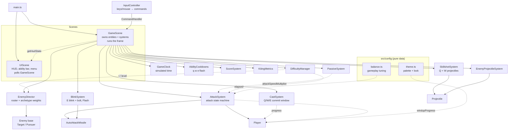

# Warmup — Technical Report

How the codebase actually works: architecture, mechanics, timing, state flow, and
known weaknesses. Written to be trustworthy enough to learn the project from.

Everything here was read out of the source. Where behaviour is subtle, surprising,
or differs from what a comment claims, it is called out. Values quoted are the ones
currently in `src/config/balance.ts` and `src/config/theme.ts`.

---

## 1. Overview

A 60-second mechanical warm-up trainer for League-style ADC play. The player
practises positioning, kiting/orbwalking, dodging, and an Ezreal-flavoured kit
(Q/W/E + Flash) against two enemy archetypes while difficulty ramps.

| Layer | Choice |
| --- | --- |
| Engine | Phaser **3.90** — rendering, scenes, input, tweens only |
| Language | TypeScript **5.9**, `strict`, `noUnusedLocals`, `noUnusedParameters` |
| Bundler | Vite **7**; `npm run build` = `tsc --noEmit && vite build` |
| Physics | **None** — all movement and collision is hand-written math |

No physics engine is central to the design: every distance check, projectile step and
collision test is explicit arithmetic inside a system class, which keeps timing
deterministic and tunable.

Phaser provides exactly five things: the game loop (`Scene.update`), two parallel
scenes, input capture, drawing primitives (`Arc`, `Polygon`, `Rectangle`, `Ellipse`,
`Line`, `Graphics`, `Container`, `Text`), and tweens — used **only** for
fire-and-forget decoration. No tween is ever load-bearing.



Two dotted relationships matter most: **systems → Player is a one-way visual feed**,
and **UIScene polls GameScene** (never events — `scene.restart()` rebuilds every
object, and an event-wired HUD kept breaking across restarts).

---

## 2. Files

### Config *(pure data)*

- **`src/config/balance.ts`** — gameplay tuning: `ARENA`, `ROUND`, `PLAYER`,
  `ATTACK`, `attackReach()`, `KEYBINDS`, `INDICATORS`, `DEBUG`, `SKILLSHOT_Q`,
  `SKILLSHOT_W`, `BLINK_E`, `FLASH`, `PASSIVE`, `TARGETS`, `PURSUER`,
  `ENEMY_SPAWN`, `ENEMY_SCALING`, `STAGE`, `ENEMY_PROJECTILES`, `DIFFICULTY`,
  `SCORE`, `UI`. `ATTACK`, `DEBUG` and `KEYBINDS` are deliberately not `as const`
  so they stay writable from the console.
- **`src/config/theme.ts`** — `THEME.{arena, player, target, pursuer, cast, mark,
  passive, projectiles, markers, ui, rangeHint, ability, menu}`. Nothing here
  affects gameplay.

### Scenes

- **`GameScene.ts`** (~760 lines) — the only file that knows about everything. Owns
  the player, the enemy list, every system, `state`, `result`, and the "already
  drawn" timestamps. Runs the frame (§3), implements the `CommandHandler` (§4),
  owns W-mark detonation (§8) and the round lifecycle (§12).
- **`UIScene.ts`** — HUD, ability bar, passive display, pause menu, end screen.
  Holds no gameplay state; polls `getHudState()` / `getRoundResult()` every frame.

### Entities

- **`Player.ts`** — authoritative `x`, `y`, `hp`, move order, `rootCount`
  (reference-counted movement lock), `lastHitAt`. Also owns its own rendering: a
  `Container` with a dart `Polygon` hull, core, idle ring; plus shadow, range ring,
  move marker, charge ring, release ring, passive aura and a cast `Graphics`.
  Visual entry points (`applyAttackVisual`, `setCastVisual`, `setRangeRingState`,
  `playReleaseBurst`, `playCastRelease`, `showCancelTag`, `playPassivePulse`) are
  pure sinks — none can change timing.
- **`Enemy.ts`** — abstract base holding everything archetype-independent: position,
  HP, damage/death lifecycle, `spawnId`, the W mark, and all shared feedback (hit
  flash, floating damage numbers, draining ghost HP bar, death burst, shadow).
  Subclasses supply the body (in their constructor), `syncBody()` and optionally
  `updateAi()`. Every combat system types against `Enemy`, never a concrete
  archetype.
- **`Target.ts`** — basic dummy: red hexagon, wanders, never attacks.
- **`Pursuer.ts`** — melee stalker with a two-state AI (§10).
- **`AutoAttackMissile.ts`** — homing missile, spec-driven so autos (cyan) and the E
  bolt (pink) share one class. Carries a `targetSpawnId` guard.
- **`Projectile.ts`** — straight-line projectile shared by Q, W and enemy fire.
  Fixed `vx/vy`, accumulates `travelled`, dies at `maxRange` or out of bounds.

### Systems

| File | Role |
| --- | --- |
| `GameClock.ts` | Simulated time. The reason pause is safe (§13) |
| `InputController.ts` | Keys/mouse → `CommandHandler` calls. Owns only `attackMovePending` |
| `AttackSystem.ts` | Attack state machine, orders, acquisition, attack-speed scaling, auto missiles |
| `CastSystem.ts` | Q/W/E commitment window, input lockout, movement buffering |
| `AbilityCooldowns.ts` | One `readyAt` table for `q w e flash` |
| `SkillshotSystem.ts` | Q and W projectiles (one loop, two configs) |
| `BlinkSystem.ts` | E blink + homing bolt, Flash |
| `PassiveSystem.ts` | Stack count, shared expiry, attack-speed multiplier |
| `EnemyDirector.ts` | Roster, archetype weights, HP scaling, respawn, separation |
| `EnemyProjectileSystem.ts` | Dodge pressure |
| `DifficultyManager.ts` | `elapsed`, ramp `t`, `level`, stage countdown |
| `ScoreSystem.ts` | Score, damage, kills by archetype |
| `KitingMetrics.ts` | Six raw mechanical counters |

### UI

`AbilityBar.ts` (slots + procedural icons + cooldown sweep + cast fill),
`PassiveDisplay.ts` (pips + duration bar), `PauseMenu.ts` (scrim, panel, buttons,
settings rows, controls reference).

---

## 3. The frame

`GameScene.create()` runs on boot and on every `scene.restart()`, rebuilding
everything. `UIScene.create()` runs once and is never re-run — hence polling.

```ts
const dt = Math.min(delta, 50) / 1000;   // clamped seconds
this.clock.advance(dt * 1000);           // simulated time
const now = this.clock.now;
```

Exact order, from `GameScene.update()`:

```
if (state !== 'running' || paused) return      ← pause freezes everything below
dt = min(delta, 50) / 1000
clock.advance(dt * 1000);  now = clock.now

difficulty.update(dt)          elapsed += dt
scoring.tickSurvival(dt)       +5 pts/sec
passive.update(now)            expire stacks
cooldowns.update(now)          refresh "now"
cast.update(now)               ← resolves a Q/W/E cast, then replays buffered order

attacks.update(now, dt, enemies)   ① GAMEPLAY DECIDES
   ├─ auto missiles fly + resolve hits
   ├─ windup complete → fireAttack()
   ├─ recovery elapsed → idle
   ├─ attack-move acquire / chase / release
   └─ target reticle

player.applyAttackVisual(...)      ② VISUALS READ IT
player.setRangeRingState(...)
player.update(dt)                  ③ MOVE + REDRAW

metrics.update(dt, ...)
player.setPassiveMaxed(...)
player.setCastVisual(...)          cast charge, read from cast.progress
one-shot cues: cast release / attack cancel / attack release (timestamp-gated)

director.update(dt, now, ctx)      enemy AI, respawns, archetype re-rolls, separation
skillshot.update(dt, now, enemies) Q + W projectiles and collisions
blink.update(dt)                   E bolts
enemyProjectiles.update(dt, now)   spawn, fly, collide with player

end conditions → endRound(survived)
```

The ①②③ ordering is load-bearing: when `applyAttackVisual` ran *after*
`player.update()`, the charge ring rendered one frame stale and visibly persisted
into recovery.

**Time sources.** `dt` (clamped seconds) drives rate-based motion. `clock.now`
(`GameClock`, ms) drives **every** gameplay deadline. Phaser's own `time` is used
only for tweens. `scene.time.now` appears **zero** times in gameplay code.

---

## 4. Input

`InputController` registers exactly two Phaser listeners plus context-menu
suppression:

```ts
scene.input.mouse?.disableContextMenu();
scene.input.on('pointerdown', this.onPointerDown, this);
scene.input.keyboard?.on('keydown', this.onKeyDown, this);
```

One `keydown` listener plus the `KEYBINDS` table — that is what makes rebinding a
config change. Keys are normalised (`' '` → `SPACE`, else `toUpperCase()`).
Keyboard-issued commands read `scene.input.activePointer.worldX/Y`.

### Command surface

`GameScene.commandHandler()` returns the only methods input may call:

```
commandMove        commandAttackTarget   commandAttackMove   commandStop
castSkillshot(Q)   castMark(W)           castBlink(E)        castFlash(F)
targetAt           isRoundRunning        acceptsGameplayInput
isPaused           togglePause           restartRound
```

### Key handling order

```
restart keys (only when the round is over) → restartRound
if round not running → ignore
ESC → armed A-mode? cancel it : togglePause()      ← handled ABOVE the pause gate
if !acceptsGameplayInput() → ignore                ← everything below stops at the menu
A → toggle attackMovePending
T → commandAttackMove(cursor, {showRangeHint})
S → commandStop
Q/W/E/F → cast* (cursor)
```

Pointer: right-click cancels any pending A-mode *and* still issues its contextual
order (attack an enemy / move to ground). Left-click resolves a pending A-mode, else
attacks an enemy under the cursor.

### The four order types

1. **Move** — hands movement to the player, clears attack orders, cancels an
   uncommitted windup.
2. **Direct attack** — commits to one `Enemy` object, chases it anywhere, ignores
   attack-move selection, does *not* cancel a windup.
3. **Attack Move (A + click)** — an order at a *location*; targets chosen
   dynamically from whoever is in range.
4. **Attack Move Click (T)** — the identical order at the cursor, no targeting mode.

A and T call the **same** `commandAttackMove(x, y)`. There is no T-specific branch
downstream, so targeting rules, attack timing, cancellation and metrics are identical
by construction. T passes a cosmetic `showRangeHint` flag; that is the only
difference.

---

## 5. Movement

```ts
private destX: number | null = null;   // move order, null = standing still
private rootCount = 0;                 // >0 blocks movement entirely
```

```
if (!rooted && dest != null):
    dist = |dest - position|
    step = PLAYER.moveSpeed * dt            // 340 px/s
    if dist <= max(step, arriveEpsilon):    // 3px
        position = dest; stop()             // snap, clear the order
    else:
        position += normalize(dest - position) * step
```

`max(step, arriveEpsilon)` is what prevents overshoot jitter: at 340 px/s and 60fps a
step is ~5.7px, so a fixed 3px epsilon alone would oscillate. `moveTo()` clamps the
destination into the playable rect, so the player can never leave the arena.

`blinkTo(x, y)` (E/Flash) sets position directly with the same clamp and calls
`stop()` — so the player does not walk back toward a stale destination.

**The root is reference-counted**, not a boolean: the attack windup and a cast can
both hold it, and neither can unlock movement the other still wants held.

---

## 6. Auto attacks

```
        idle ──(target in range && idle)──> WINDUP ──(timer)──> RELEASE ──> RECOVERY ──> idle
                                             rooted,              missile     free to move
                                             cancellable          spawns
```

`AttackState = 'idle' | 'windup' | 'recovery'`. Release is an **event**, not a state:
the single frame `fireAttack()` runs.

Both deadlines are set once, in `beginWindup()`:

```ts
this.windupEndsAt = nowMs + this.windupMs;
this.cycleEndsAt  = nowMs + this.cooldownMs;   // cooldown starts at WINDUP START
```

That second line is the key design decision — firing never extends the cycle, so
recovery is free movement time.

### Attack speed

```
attackSpeedT  = clamp(elapsed / attackSpeedRampSeconds, 0, 1) ^ attackSpeedCurve
baseCooldownMs = lerp(ATTACK.baseCooldownMs, ATTACK.minCooldownMs, attackSpeedT)
cooldownMs     = baseCooldownMs / passive.attackSpeedMultiplier      ← authoritative
windupMs       = windupMsOverride ?? max(minWindupMs, cooldownMs * windupPercent)
```

With current values (`700 → 420` over 45s, curve 1.15, windup 25%, floor 90ms):

| Round time | Stacks | cooldown | windup | recovery | attacks/sec |
| --- | --- | --- | --- | --- | --- |
| 0s | 0 | 700ms | 175ms | 525ms | 1.43 |
| 0s | 5 | 467ms | 117ms | 350ms | 2.14 |
| 45s+ | 0 | 420ms | 105ms | 315ms | 2.38 |
| 45s+ | 5 | 280ms | 90ms (floor) | 190ms | 3.57 |

### Chasing

`chaseToward()` walks to a point `reach - chaseBufferPx` from the target, re-issued
every frame. In practice the `inRange` branch calls `player.stop()` the moment the
range test passes, so the player halts at ~277px against a reach of 278px; the buffer
only shapes the approach to a target that is actively moving away.

### Four durations that are not the same thing

| Term | @ round start | What it is |
| --- | --- | --- |
| Windup | 175ms | Rooted, cancellable, no damage |
| Release | instantaneous | The commitment point |
| Projectile travel | ~226ms from max range | Damage delay only; gates nothing |
| Cooldown | 700ms | Whole cycle, windup included |

---

## 7. Cancellation and orbwalking

The distinction lives in **one condition**, in `onMoveOrder()` / `onStop()`:

```ts
if (this.state === 'windup' && ATTACK.allowMoveCancel) this.cancelWindup();
```

`cancelWindup()` nulls `windupTarget`, which is the *only* path to
`new AutoAttackMissile(...)`.

| | On cancel | After release |
| --- | --- | --- |
| `cycleEndsAt` | **reset to 0** — attack instantly available | keeps running |
| `windupTarget` | nulled → no missile | already nulled |
| Missiles | none exist | unaffected, keeps flying |
| Metrics | `attacksCancelled++` | `attacksFired++`, later `attacksLanded++` |

**Which orders cancel a windup**

| Order | Cancels? | Why |
| --- | --- | --- |
| Move / `S` | **Yes** | It is a move/stop order |
| Right-click enemy | No | Attack order; the committed swing resolves |
| A-click / T | No | Attack order — and T is meant to be spammed while kiting |
| Q / W / E cast | **Yes** | Casting calls `attacks.onMoveOrder()` |
| Flash | **Yes** | Same path |

> The cooldown refund on cancel is **total** (`cycleEndsAt = 0`), so cancel-spam is
> free — but it also deals no damage, so it is a no-op rather than an exploit.

---

## 8. Abilities

### Cast windows (`CastSystem`)

Q, W and E commit for a short window anchored to the auto windup:

| | castTimeMs | Measured keypress → effect |
| --- | --- | --- |
| Auto windup (reference) | 175ms | — |
| Q | 165 | **167ms** to projectile spawn |
| W | 185 | **186ms** to projectile spawn |
| E | 210 | **211ms** to blink |
| Flash | — | next frame, no cast state |

`CastSystem` holds one `PendingCast { ability, payload, startedAt, endsAt,
durationMs }`. `begin()` calls `player.stop()` + `player.root()`; `update()` resolves
when `now >= endsAt`, releases the root, fires `onResolve`, then replays any buffered
order. `progress` is derived from the deadline, so the animation can never disagree.

Key properties:

- **The payload is committed at keypress.** Q/W store the aim point, E stores the
  already-clamped blink destination. Moving the mouse mid-cast cannot re-aim.
- **Cooldowns start at cast start**, so the window never extends them.
- **Input lockout**: while casting, Q/W/E/F are ignored entirely.
- **Order buffering**: a move, attack-move or direct attack order issued mid-cast is
  stashed as a thunk (latest wins) and replayed *after* the resolve — so E's blink
  lands before the queued order runs from the new position, and no auto can start
  during the window. Move/attack-move pings show immediately. `S` mid-cast discards
  the buffered order (`CastSystem.clearBufferedCommand`) but never cancels the cast.
- `castTimeMs <= 0` skips the system entirely (`GameScene.beginCastOrResolve`), so
  any ability can be made instant from config alone.

### Q — damage skillshot

Quick-cast toward the cursor after its window. Straight line, fixed `vx/vy`, dies at
`maxRange` (450) or on the first enemy touched. On hit: damage 30, passive stack, and
`cooldowns.reduce(750, ['q','w','e'])`.

### W — mark skillshot

The projectile deals **zero** damage; it calls `target.applyMark(now)` and grants a
passive stack. The mark stores `markUntil` on the `Enemy` itself, so every archetype
gets it free and it dies with the enemy.

**Detonation** is centralised in `GameScene.onTargetDamaged()` — the funnel every
*damaging* hit already passes through (auto, Q, E bolt). W does not call it, so it
cannot detonate its own mark. `detonateMark()` deliberately does **not** route back
through that funnel: that would recurse, and a detonation must not grant a second
stack.

```
W hits → mark (4s) + 1 stack
   ↓
auto / Q / E bolt hits the marked enemy
   ↓
their damage → onTargetDamaged → isMarked? → detonateMark()
   ↓
clearMark + 45 damage + violet burst   (no extra stack)
```

Because respawn **replaces** the enemy object outright, a fresh enemy can never
inherit a predecessor's mark.

### E — blink + homing bolt

Destination is computed at keypress: cursor if within `range` (364), else the point
at max range along that direction, clamped to the arena. After the cast window:
`onBeforeBlink` (cancels an uncommitted auto) → `player.blinkTo()` → departure/arrival
rings + a ~100ms streak → bolt acquisition **from the new position**.

```
inRange   = enemies within boltAcquisitionRange (455) of the NEW position
marked    = inRange.filter(isMarked)
pool      = marked.length ? marked : inRange
target    = nearest of pool
```

Marked targets win because the mark is an *expiring* damage opportunity — E is the
tool that guarantees you can cash one in after the target has left auto range. The
bolt deals 38, grants a stack, and can detonate.

### Flash

Same blink geometry with `FLASH.range` (325). No bolt, no damage, no passive stack,
and Q never refunds its cooldown. Instant by design: the hierarchy Flash-instant vs
Q/W/E-committed is deliberate.

### Shared cooldowns (`AbilityCooldowns`)

One `readyAt` table for `q | w | e | flash` plus `DURATIONS` read from config.

```ts
reduce(ms, ids) { for (id of ids) readyAt[id] = Math.max(now, readyAt[id] - ms); }
```

It never restarts or extends anything — it only pulls `readyAt` toward now, clamped.
A landed Q is therefore a single call, and the HUD reads all four slots from the same
source (measured: W and E each drop ~750ms + elapsed; Flash drops only its natural
decay).

### Passive (`PassiveSystem`)

Ownership is deliberately narrow: `SkillshotSystem`/`BlinkSystem` decide *when* a hit
lands, this system owns the count and expiry, `AttackSystem` only reads
`attackSpeedMultiplier`.

```
attackSpeedMultiplier = 1 + stacks * 0.10          (max 5 stacks → ×1.5)
```

One **shared** buff, not per-stack timers: every qualifying hit adds a stack (to the
cap) and refreshes the whole 6s window; when it lapses, all stacks go together.
Stacking events: Q hit, W mark landing, E bolt hit. **Not**: W detonation, Flash,
autos. All three call one helper, `GameScene.grantPassiveStack()`, which also fires
the player's pulse — so the visual cannot fire without a real stack.

---

## 9. Enemies and the director

### `EnemyDirector`

Owns the roster as fixed **slots** (`TARGETS.count` = 4), each `{ enemy, respawnAt }`.
When a kill is registered, `onEnemyKilled()` sets `respawnAt = now + respawnDelayMs`;
when that elapses the old enemy is **destroyed** and a freshly rolled archetype spawns
in its place. That is how composition evolves rather than switching abruptly.

```ts
const ARCHETYPES: Record<EnemyArchetype, ArchetypeSpec> = {
  basic:   { baseHp: () => TARGETS.maxHp, create: ..., minSpawnDistance: 240 },
  pursuer: { baseHp: () => TARGETS.maxHp * 2.5, create: ..., minSpawnDistance: 360 },
};
```

Adding a third archetype = one entry here + one weight row in `ENEMY_SPAWN` + the new
`Enemy` subclass. No system changes, because everything downstream types against
`Enemy`.

**Spawn weights** (normalised, index = level − 1):

| Difficulty | 1–3 | 4 | 5 | 6 | 7 | 8+ |
| --- | --- | --- | --- | --- | --- | --- |
| basic | 100% | 80% | 75% | 65% | 60% | 50% |
| pursuer | 0% | 20% | 25% | 35% | 40% | 50% |

**HP scaling**: `min(1.5, 1 + max(0, level − 3) × 0.05)` — D1–3 100%, D4 105%,
D6 115%.

**Separation**: overlapping enemies are pushed apart with the share split by radius,
so a Pursuer shoves a basic target rather than the reverse.

### `Enemy` lifecycle

```
ALIVE  hp > 0, drifting/chasing, markable
  │ takeDamage(): hp -= n, hitFlash, damage number, (mark detonation upstream)
  ▼ hp == 0
DEAD   active=false IMMEDIATELY, mark cleared, death anim 300ms, kill scored
  ▼ respawnAt (1200ms)
REPLACED  old object destroyed, new archetype rolled and spawned
```

`spawnId` is a generational counter captured by in-flight missiles; a bolt aimed at a
dead enemy fizzles rather than hitting its replacement.

### Pursuer AI

Two states, no separate recovery — the cooldown is a timestamp checked from CHASE, so
it keeps walking between swings.

```
CHASE   walk at the player's CURRENT position at 55% of player speed
        (facing smoothed via Angle.RotateTo; clamped to the arena)
        in reach && now >= nextAttackAt → WINDUP
WINDUP  rooted, telegraph ring contracts, 400ms
        on expiry → resolveSwing(): damage ONLY if still in reach
        nextAttackAt = swing start + 1200ms
```

| Stat | Value |
| --- | --- |
| HP | 60 (basic 24 × 2.5) × difficulty multiplier |
| Move speed | 187 px/s (55% of 340) |
| Reach | 16px + both radii ≈ 56px centre-to-centre |
| Damage | 10 |
| Windup | 400ms |
| Attack cooldown | 1200ms |
| Score | 2.25× a basic kill |

Walking or blinking out during the telegraph makes the swing miss — that is the
intended counterplay, and it is why E/Flash have a cast window at all.

### Enemy projectiles

Spawned on a random arena edge, aimed at the player's position **at spawn**, with ±3°
jitter. They never re-aim, so every shot is dodgeable by moving. Fractional volley
size rounds probabilistically. Collision is circle-vs-circle against the player.

> **i-frame interaction:** the missile is killed unconditionally on overlap, but
> `Player.takeDamage()` returns 0 within 250ms of the last hit — so during i-frames a
> projectile is consumed with no damage and no `projectileHitsTaken` increment.

---

## 10. Difficulty

Two independent ramps.

**Enemy pressure** (`DifficultyManager.t`):

```
start = DIFFICULTY.rampStartSeconds                          = 22s
end   = ROUND.durationSeconds * rampCompleteAtRoundFraction  = 54s
t = 0                                            , elapsed <= 22
t = clamp((elapsed - 22) / 32, 0, 1) ^ 1.8       , otherwise
level = min(10, 1 + floor(t * 10))
```

Every enemy-projectile parameter is `lerp(start, end, t)`:

| Parameter | t=0 | t=1 |
| --- | --- | --- |
| `spawnIntervalMs` | 2600 | 700 |
| `speed` | 250 | 520 |
| `radius` | 10 | 16 |
| `damage` | 8 | 16 |
| `volleySize` | 1 | 1.5 |

Because of the 1.8 exponent the HUD stays on "DIFFICULTY 1" until ~31s, and
difficulty 4 (first Pursuers) lands at ~38.5s.

**Attack speed** uses its own ramp (`AttackSystem.attackSpeedT`, 45s, curve 1.15, no
flat opening) so the arena can stay calm while your hands speed up.

**Stage countdown**: `secondsUntilNextLevel` inverts the ramp
(`e = start + (end-start) * t^(1/curve)`) purely for the HUD.

---

## 11. Collision

No physics bodies, no spatial partitioning — explicit math, O(n·m) over tiny n and m.

| Interaction | Method | Math |
| --- | --- | --- |
| Auto/E bolt → its target | **Arrival**, not overlap | `step >= dist - target.radius` |
| Q/W → any enemy | Circle-vs-circle | `(cx-x)² + (cy-y)² <= (r + enemy.radius)²` |
| Enemy projectile → player | Circle-vs-circle | `… <= (r + 14)²` |
| Attack range | Squared distance | `d² <= (260 + enemy.radius)²` |
| Pursuer swing | Distance at resolve | `dist <= radius + playerRadius + 16` |
| Click hit test | Distance + grace | `dist <= enemy.radius + 10` |

All collision is **discrete** — positions are tested only at frame boundaries. With
`dt` clamped at 50ms, worst-case travel is 95px for a Q bolt against a 25px collision
radius, so tunnelling is possible on a badly stuttering frame.

---

## 12. Score, metrics, round flow

**Score**: `1 × damage`, `100 × archetype scoreMultiplier` per kill, `5/second`
survival (fractional carry). `projectileHitsTaken` is tracked but does not affect
score. `killsByType` tallies per archetype.

**`KitingMetrics`** — four event counters (`attacksStarted`, `attacksFired`,
`attacksCancelled`, `attacksLanded`) and two per-frame accumulators:

```ts
if (attackState === 'idle' && enemyInRange) idleInRangeMs += ms;
if (attackState === 'recovery' && !playerMoving) wastedRecoveryMs += ms;
```

Both timing metrics are **approximate**: they quantise to the frame, use the clamped
`dt`, and measure "opportunity left on the table" rather than mistakes.
`attacksFired` also counts a release whose target died mid-windup (no missile
spawns), so `attacksFired - attacksLanded` overstates misses.

**Round flow**

```
Running ──(difficulty.remaining <= 0)──> Over (survived)
Running ──(!player.isAlive)───────────> Over (defeated)
Over ──(restartRound)──> scene.restart() → Running
Running <──> Paused  (setPaused; update() returns early, tweens paused)
```

`endRound()` freezes the sim, cancels attacks/casts/pending input, and snapshots an
immutable `RoundResult`. `UIScene.syncOverlay()` notices `getRoundResult() !== null`.

---

## 13. Pause safety

The hazard: every deadline is an absolute timestamp. If "now" came from the wall
clock, pausing would let real time run on and every deadline would fire at once on
resume — windups completing instantly, cooldowns wiped, a volley of projectiles.

So gameplay reads time from `GameClock`, which only advances on frames the simulation
runs. `setPaused(true)` makes `update()` return before `clock.advance()` and calls
`tweens.pauseAll()` (tweens are decoration but run on wall time). Nothing is
rescheduled; every deadline keeps exactly the remaining time it had.

Input is gated separately: `InputController` checks `acceptsGameplayInput()` before
any pointer event or gameplay key, which is what stops a click on a menu button from
also issuing a move order underneath. Escape is handled above that gate.

Verified frozen while paused: round timer, difficulty, player movement, attack
windup, cast progress (held at 0.50 across 2.5 real seconds), all four ability
cooldowns, W mark duration, Q/W/E bolts and enemy projectiles, Pursuer movement and
swing, respawn timers, passive duration.

---

## 14. Visuals vs gameplay

> Gameplay state decides what is happening. Visuals read that state and represent it.
> No animation callback is ever authoritative.

Enforced by shape: `AttackSystem.windupProgress` and `CastSystem.progress` are derived
from real deadlines; `Player.applyAttackVisual()` / `setCastVisual()` write only to
visual-only fields and cannot call `root()`, change position, or touch a timer. The
lean is a render offset applied to the body container — `this.x/this.y` stay
authoritative.

One-shot effects (release burst, cancel tag, cast release flash) are driven by
polling the owning system's timestamp (`lastReleaseAt`, `lastCancelAt`,
`lastResolveAt`) against a "last shown" value — not by callbacks. If an effect fails
to play, nothing about the mechanic changes.

**Cast animation compression.** The charge visuals use
`t = pow(progress, THEME.cast.anticipationCurve)` (0.55), which front-loads the
anticipation so a 165ms cast still reads as a windup while still peaking exactly at
t=1. Retiming `castTimeMs` needs no animation changes.

Measured: the visual windup tracks the configured windup to within a frame, and the
missile spawns in the same frame the state leaves `windup` — the animation never
leads or lags the mechanic.

---

## 15. Configuration reference

### `ATTACK` (mechanics)

| Variable | Value | Effect of increasing |
| --- | --- | --- |
| `range` | 260 | Attack from further; ring grows to match |
| `baseCooldownMs` / `minCooldownMs` | 700 / 420 | Slower attack speed at start / cap |
| `attackSpeedRampSeconds` / `attackSpeedCurve` | 45 / 1.15 | Slower growth / back-loaded |
| `attackSpeedScaling` | `true` | `false` pins at base |
| `windupPercent` / `minWindupMs` | 0.25 / 90 | Longer root, harder kiting |
| `windupMsOverride` | `null` | Fixes windup, breaks proportional scaling |
| `damage` | 12 | Faster kills |
| `allowMoveCancel` | `true` | `false` commits every auto |
| `chaseOutOfRangeTargets` / `chaseBufferPx` | `true` / 24 | — |
| `attackMoveTargeting` | `'cursor'` | `'player'` picks nearest to you |
| `attackMoveChasesAcquiredTarget` | `false` | `true` makes A/T drag you around |
| `rangeFromPlayerEdge` | `false` | `true` = edge-to-edge (+14px effective) |
| `projectileSpeed` / `projectileRadius` | 1150 / 6 | Damage lands sooner |

Visual-only: `windupLeanPx` 9, `windupScale` 1.18, `releaseKickPx/Ms` 8/120,
`chargeRingStartPad/EndPad` 20/3, `releaseRingRadius/Ms` 30/180.

### Abilities

| | `castTimeMs` | `cooldownMs` | Range | Speed | Damage | Notes |
| --- | --- | --- | --- | --- | --- | --- |
| `SKILLSHOT_Q` | 165 | 3000 | 450 | 1250 | 30 | `hitCooldownReductionMs` 750, radius 7, `boltLength` 26 |
| `SKILLSHOT_W` | 185 | 6000 | 450 | 1000 | 0 / **45** detonation | `markDurationMs` 4000, radius 12 |
| `BLINK_E` | 210 | 8000 | 364 | bolt 1050 | 38 | `boltAcquisitionRange` 455, `boltRadius` 7, `blinkStreakMs` 100 |
| `FLASH` | — | 20000 | 325 | — | — | `burstMs` 200 |

`PASSIVE`: `maxStacks` 5, `attackSpeedPerStack` 0.10, `durationMs` 6000.

### Enemies

`TARGETS`: count 4, radius 18, maxHp 24, respawn 1200ms, deathAnim 300ms,
hitFeedback 130ms, drift 45 px/s every 1800ms, minSpawnDistance 240, edgeMargin 60.

`PURSUER`: `baseHpMultiplier` 2.5, radius 26, `moveSpeedFraction` 0.55,
`attackRange` 16, `attackDamage` 10, `windupMs` 400, `attackCooldownMs` 1200,
`scoreMultiplier` 2.25.

`ENEMY_SCALING`: `hpRampStartDifficulty` 4, `hpPerDifficulty` 0.05,
`maxHpMultiplier` 1.5. `STAGE`: `countdownSeconds` 3, `bannerMs` 1500.

`ENEMY_PROJECTILES` ramps: interval 2600→700, speed 250→520, radius 10→16,
damage 8→16, volley 1→1.5, `aimJitterDegrees` 3, `cullMargin` 80.

`DIFFICULTY`: `rampStartSeconds` 22, `rampCompleteAtRoundFraction` 0.9,
`rampCurve` 1.8, `levels` 10.

### Other

`PLAYER`: radius 14, maxHp 100, moveSpeed 340, arriveEpsilon 3,
hitInvulnerabilityMs 250. `ROUND.durationSeconds` 60.
`SCORE`: 1/damage, 100/kill (× archetype), 5/second.
`DEBUG`: `attackRangeDisplay` `'contextual'`, `showAttackState`,
`showCancelFeedback`, `showTargetMarker`, `showDamageNumbers` — all overlay only, the
first three editable from the pause menu.
`KEYBINDS`: A, T, S, Q, W, E, F, ESCAPE, R/SPACE — arrays, so multiple bindings per
action already work.

---

## 16. Formulas

```
movement        step = moveSpeed * dt;  position += normalize(dest - pos) * step
attack reach    reach = ATTACK.range + enemy.radius + (rangeFromPlayerEdge ? player.radius : 0)
                inRange ⟺ (dx² + dy²) <= reach²
attack speed    t   = clamp(elapsed / 45, 0, 1) ^ 1.15
                cd  = lerp(700, 420, t) / (1 + stacks * 0.10)
                wind= max(90, cd * 0.25)
cast progress   1 - (endsAt - now) / durationMs          (animation uses pow(·, 0.55))
cooldown refund readyAt[id] = max(now, readyAt[id] - 750)   for q, w, e
difficulty      t = elapsed <= 22 ? 0 : clamp((elapsed-22)/32, 0, 1) ^ 1.8
enemy hp        hp = archetypeBaseHp * min(1.5, 1 + max(0, level-3) * 0.05)
blink dest      d = cursor - player; dest = |d| > range ? player + normalize(d)*range : cursor
                dest = clamp(dest, arena padding + player radius)
straight shot   vx,vy = cos/sin(angle) * speed;  dies when travelled >= maxRange
homing shot     arrives when speed*dt >= |target - pos| - target.radius
score           Σ damage + Σ (100 × scoreMultiplier) + floor-accumulated(5 × elapsed)
```

---

## 17. End-to-end traces

**Direct auto attack.** right-click enemy → `commandAttack` (source `direct`) →
`update()` sees out of range → `chaseToward` each frame → in range → `player.stop()` +
`beginWindup()` → rooted 175ms, charge ring contracts → `fireAttack()`: state
`recovery`, root released, `AutoAttackMissile` spawned with `target.spawnId` →
`playReleaseBurst` → missile homes at 1150 px/s → on arrival `onMissileHit` →
`takeDamage(12)` → hit flash, damage number → `onTargetDamaged` → score, and mark
detonation if marked → `cycleEndsAt` → `idle` → next windup starts immediately.

**W → auto detonation.** press W → `attacks.onMoveOrder()` (cancels any windup),
`cooldowns.start('w')`, `cast.begin('w', aim, 185ms)` → rooted, violet orb gathers →
resolve → `skillshot.fire('w')` → orb flies → touches enemy → `onWHit` →
`applyMark(now)` + `grantPassiveStack()` (no damage) → later an auto lands →
`onTargetDamaged` → `isMarked` → `detonateMark()` → `clearMark` + 45 damage + violet
burst, **no** second stack.

**E combo.** press E → cooldown starts, destination computed **and clamped now** →
`cast.begin('e', dest, 210ms)` → rooted, pink ring contracts → resolve →
`executeBlink`: `onBeforeBlink` → `player.blinkTo(dest)` → departure/arrival rings →
acquisition from the **new** position, W-marked first → bolt spawns → on impact 38
damage, a stack, and a detonation if marked. A move order pressed mid-cast replays
immediately after the blink.

**Q cooldown refund.** Q lands → `onQHit` → `onTargetDamaged` (+ detonation) →
`grantPassiveStack()` → `cooldowns.reduce(750, ['q','w','e'])` → the HUD's three kit
slots all jump down on the next frame; Flash is untouched.

**Player hit.** Spawn on a random edge → aimed at the player's position at spawn ±3° →
straight line → overlap with the player → missile killed unconditionally →
`Player.takeDamage(amount, now)` → 0 within i-frames, else HP drops, camera shake, red
rim flash → at 0 HP the next frame ends the round.

---

## 18. Known simplifications vs League

| Mechanic | League | Here |
| --- | --- | --- |
| Cancel refund | Strict rules | Total refund; cancel-spam is free (and damage-free) |
| Attack speed | Stat with a cap | Pure function of round time × passive stacks |
| Auto projectiles | Dodgeable by some abilities | Perfect homing; only target death stops them |
| Target acquisition | Acquisition range > attack range, priority rules | Only in-range enemies; nearest-to-cursor or nearest-to-player |
| Attack-move | Sticks to and chases the acquired target | Drops it when it leaves range (configurable) |
| Attack-move order | Ends on arrival | Persists as a stance until the next command |
| Movement | Pathfinding, unit collision, turn rate | Straight line, instant direction changes |
| Hitboxes | Per-unit, some non-circular | Uniform circles |
| Q | Ezreal: ~0.25s cast, on-hit effects, cooldown refund on hit | 165ms cast, no on-hit, refunds Q/W/E |
| W | Targets specific unit types, damages on mark application | Marks any `Enemy`, damage is entirely on detonation |
| E | Blink + bolt, on-hit effects | Blink + bolt, no on-hit |
| Flash | Multi-minute cooldown | 20s, so it appears in a 60s round |
| Casting | Spell queueing, buffered casts | Hard ability lockout; move, attack-move and attack orders are buffered |
| i-frames | Not a League concept | 250ms after any hit |

Where it *does* match: cooldown starting at windup start, centre-to-hitbox-edge range,
contextual right-click, attack orders not cancelling committed swings, move orders
cancelling uncommitted ones, and cast windows committing their aim at keypress.

---

## 19. Technical debt

### Important

1. **Two sources of truth for colour.** `theme.ts` owns the look, but `balance.ts`
   still declares colours nothing reads. Verified dead: the entire `UI` block,
   `ARENA.floorColor`, `ARENA.borderColor`, `PLAYER.color`, `TARGETS.color`,
   `ENEMY_PROJECTILES.color`, `ATTACK.projectileColor`. Editing them does nothing —
   an active trap while tuning. (`ARENA.backgroundColor` *is* used, in `main.ts`.)
2. **`stopsOnFirstHit` is now dead.** Both `SKILLSHOT_Q.stopsOnFirstHit` and
   `SKILLSHOT_W.stopsOnFirstHit` are documented but unread — the generalised
   `SkillshotSystem` kills the missile unconditionally on contact. Setting either
   `false` does not produce a piercing shot.
3. **`GameScene` is ~760 lines** and has become the ability orchestrator by accident:
   arena drawing, command handling, hit testing, ping effects, cast routing,
   detonation, passive granting, round lifecycle and the HUD snapshot all live there.
4. **In-flight projectiles freeze on round end.** `update()` returns early when the
   round is over, so missiles hang mid-air under the end overlay.
5. **Discrete collision, no swept test.** At the `dt` clamp a Q bolt moves 95px per
   frame against a 25px collision radius.

### Minor

6. **Dead public API**: `AttackSystem.hasFired`, `AttackSystem.cooldownRemaining`,
   `Projectile.team` are read by nothing in `src/`.
7. **`Projectile.isOutOfBounds()` uses `ENEMY_PROJECTILES.cullMargin`** for the
   player's Q and W too — correct behaviour, misleading constant.
8. **The drawn range ring assumes all enemies share `TARGETS.radius`.** With the
   Pursuer at radius 26, the ring is exact for basic targets and conservative for
   Pursuers; the per-target reticle is the accurate cue.
9. **`TARGETS` config is doing double duty** — `hitFeedbackMs`, `deathAnimMs`,
   `deathShards`, `respawnDelayMs` are read by *all* enemies from a block named for
   the basic target.
10. **`attacksFired` counts releases with no missile** (target died mid-windup).
11. **i-frames are global**, so a Pursuer swing and a projectile landing together
    means one is silently eaten.
12. **`HudState` is ~30 fields** — one grab-bag for every HUD region.
13. **Magic numbers remain in visual code** despite `theme.ts`: the 0.22 hit-squash,
    1.6 ghost-bar drain rate, 10px click grace, 0.35 rotation smoothing, reticle arc
    count and 1400 spin divisor.
14. **`AbilityId` / `CastAbility` unions are declared in three places** (cooldown
    durations, cast system, HUD).

### Future cleanup

15. No object pooling — every projectile, damage number, ping and shard is a fresh
    GameObject destroyed on completion. Fine at current densities.
16. `GameScene.update()` calls `attacks.hasTargetInRange(enemies)` purely for metrics,
    duplicating the range scan `attacks.update()` already did.
17. **No tests live in the repository.** The eleven browser suites that validate every
    system live in the session scratchpad, not in `src/` or `tests/`, so they are not
    runnable from a clean checkout. This is the single biggest gap.
18. `AttackMoveOrder.dest` / `.cursor` are always set to the same point.

---

## 20. Extending it

**More abilities (R).** `SkillshotSystem`'s `SPECS` table is the seam: one projectile
loop, per-ability config + on-hit effect. Add a config block, a `SPECS` entry, an
`AbilityId`, a keybind, a `CommandHandler` method and an `AbilityBar` slot. Cast
windows come free via `beginCastOrResolve`.

**More enemies.** One `Enemy` subclass + one `ARCHETYPES` entry + one weight row.
Nothing else changes.

**Configurable keybinds.** Already 90% there: `KEYBINDS` is the only source,
`InputController` the only reader, every action takes an array.

**Drill types / persistence.** `RoundResult` is a flat serialisable snapshot built in
one place; `DifficultyManager` and `ScoreSystem` are independent enough to swap per
drill.

---

## 21. Accuracy notes

Verified while writing: config values quoted from source; the frame order transcribed
from `GameScene.update()`; dead-config claims established by grepping each symbol
across `src/` excluding `balance.ts`; measured timings (167/186/211ms cast→effect,
750ms cooldown refund, 277px chase stop, 449px Q travel) taken from browser test
runs, not from reading config.

Where code and comments disagree, or a config value has no effect, it is listed in
§19 rather than described as working.
