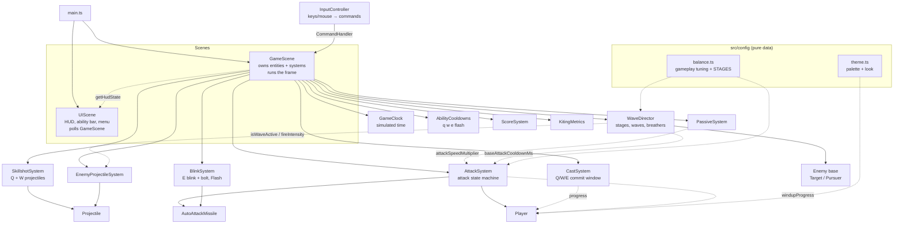

# Warmup — Technical Report

How the codebase actually works: architecture, mechanics, timing, state flow, and
known weaknesses. Written to be trustworthy enough to learn the project from.

Everything here was read out of the source. Where behaviour is subtle, surprising,
or differs from what a comment claims, it is called out. Values quoted are the ones
currently in `src/config/balance.ts` and `src/config/theme.ts`.

---

## 1. Overview

A mechanical warm-up trainer for League-style ADC play, structured as a gauntlet
of 10 stages of authored waves (1–4 per stage, 22 in all). The player practises positioning,
kiting/orbwalking, dodging, and an Ezreal-flavoured kit (Q/W/E + Flash) against two
enemy archetypes. Progression comes from clearing waves, never from elapsed time.

| Layer | Choice |
| --- | --- |
| Engine | Phaser **3.90** — rendering, scenes, input, tweens only |
| Language | TypeScript **5.9**, `strict`, `noUnusedLocals`, `noUnusedParameters` |
| Bundler | Vite **7**; `npm run build` = `tsc --noEmit && vite build` |
| Physics | **None** — all movement and collision is hand-written math |

No physics engine is central to the design: every distance check, projectile step and
collision test is explicit arithmetic inside a system class, which keeps timing
deterministic and tunable.

Phaser provides exactly five things: the game loop (`Scene.update`), two parallel
scenes, input capture, rendering (`Image` sprites from canvas-generated textures,
`BitmapText`, `Graphics`, `Rectangle`, plus a debug `Text`), and tweens — used **only**
for a couple of fire-and-forget screen effects. No tween is ever load-bearing.

Rendering runs with `pixelArt: true` (nearest-neighbour filtering, no antialias,
whole-pixel sprite placement). Gameplay positions stay fractional; only where a sprite
is *drawn* is rounded.



Two dotted relationships matter most: **systems → Player is a one-way visual feed**,
and **UIScene polls GameScene** (never events — `scene.restart()` rebuilds every
object, and an event-wired HUD kept breaking across restarts).

---

## 2. Files

### Config *(pure data)*

- **`src/config/balance.ts`** — gameplay tuning: `ARENA`, `PLAYER`, `ATTACK`,
  `attackReach()`, `KEYBINDS`, `DEBUG`, `SKILLSHOT_Q`, `SKILLSHOT_W`,
  `BLINK_E`, `FLASH`, `PASSIVE`, `TARGETS`, `ENEMY_PROJECTILES`, `PURSUER`, `RUN`,
  `STAGES`, `SCORE`. Gameplay numbers only — no colours or effect timings.
  `ATTACK`, `DEBUG` and `KEYBINDS` are deliberately
  not `as const` so they stay writable from the console. `RUN` + `STAGES` are the one
  place the run's structure and per-stage difficulty are tuned (§9, §10).
- **`src/config/theme.ts`** — `PALETTE` (raw colours) and `THEME.{art, depth,
  battlefield, player, enemy, basic, pursuer, hpBar, mark, fx, cast, passive, markers,
  ui, banners, rangeHint, ability, menu}`, plus `actorDepth()` / `propDepth()` for
  y-sorting. Nothing here affects gameplay.

### Scenes

- **`GameScene.ts`** (~800 lines) — the only file that knows about everything. Owns
  the player, the enemy list, every system, `state`, `result`, and the "already
  drawn" timestamps. Runs the frame (§3), implements the `CommandHandler` (§4),
  owns W-mark detonation (§8) and the round lifecycle (§12). Wave/stage logic lives in
  the `WaveDirector`, not here.
- **`UIScene.ts`** — HUD (run time, stage / wave / enemies, transition banners),
  ability bar, passive display, pause menu, end screen. Holds no gameplay state;
  polls `getHudState()` / `getRoundResult()` every frame.

### Entities

- **`Player.ts`** — authoritative `x`, `y`, `hp`, move order, `rootCount`
  (reference-counted movement lock), `lastHitAt`, crowd control (`stunnedUntil`,
  `slowUntil` / `slowFraction`, read through `isStunned` / `moveSpeed`) and the
  frame's velocity `vx` / `vy`. Rendering lives in its
  `PlayerView` (`player.view`); the visual entry points (`applyAttackVisual`,
  `setCastVisual`, `setRangeRingState`, `playReleaseBurst`, `playCastRelease`,
  `showCancelTag`, `playPassivePulse`) only forward state to it — none can change
  timing or position.
- **`Enemy.ts`** — abstract base holding everything archetype-independent: position,
  HP, damage/death lifecycle, `spawnId`, the W mark, and a `pose` (moving / facing /
  windup progress / reach) the AI publishes for its view. Subclasses build their
  `view` in the constructor and supply `updateAi()`. Every combat system types
  against `Enemy`, never a concrete archetype.
- **`Target.ts`** — basic enemy (red slime): hovers in a band around the player; from
  `TARGETS.spit.fromStage` it spits (token-gated windup → glob via `HostileSpellSystem`).
- **`Pursuer.ts`** — melee brute (horned purple slime) with a four-state AI (§9): chase, swing
  windup, dash windup, dash. Tells its `PursuerView` when a swing resolves and whether it landed.
- **`Caster.ts`** — shared base for the ranged casters: spacing band, leading aim with a
  per-cast random offset (`aimPoint`, `rollAimOffset`).
- **`Magus.ts`** — artillery caster (brass-masked slate slime) with a Xerath-style kit (§9).
  Owns spacing, spell choice and charge states; the spells it places belong to
  `HostileSpellSystem`.
- **`AutoAttackMissile.ts`** — homing missile, spec-driven (speed, art, impact effect)
  so autos and the E bolt share one class. Carries a `targetSpawnId` guard.
- **`Projectile.ts`** — straight-line projectile shared by Q, W and enemy fire.
  Fixed `vx/vy`, accumulates `travelled`, dies at `maxRange` or out of bounds. Its
  sprite (`ProjectileView`) is separate from its collision `radius`.

### Systems

| File | Role |
| --- | --- |
| `GameClock.ts` | Simulated time. The reason pause is safe (§13) |
| `InputController.ts` | Keys/mouse → `CommandHandler` calls. Owns only `attackMovePending` |
| `AttackSystem.ts` | Attack state machine, orders, acquisition, stage-based attack speed, auto missiles |
| `CastSystem.ts` | Q/W/E commitment window, input lockout, order buffering |
| `AbilityCooldowns.ts` | One `readyAt` table for `q w e flash` |
| `SkillshotSystem.ts` | Q and W projectiles (one loop, two configs) |
| `BlinkSystem.ts` | E blink + homing bolt, Flash |
| `PassiveSystem.ts` | Stack count, shared expiry, attack-speed multiplier |
| `WaveDirector.ts` | Stages, waves, finite rosters, breathers, stage tuning (HP / attack speed / fire), separation |
| `EnemyProjectileSystem.ts` | Dodge pressure — fires only during a wave, cleared when a wave is cleared |
| `HostileSpellSystem.ts` | Zones (line / circle / cone, styled arcane or void), Magus orbs, basic spit globs and the Sovereign's **Dark Spheres** (persistent ground objects: owner, lifetime, cap; `takeSphere`, `launchSphere`): resolves them, applies damage, stun and slow; spheres vanish when their owner dies; everything clears on wave clear |
| `Progression.ts` | The player's level: XP from kills (`ENEMIES[id].xp`), levels 1-18 (`LEVELS`), ability haste for Q/W/E cooldowns, the base auto cycle (it is the `AttackPacing` source) and the Q rank-up |
| `Difficulty.ts` | `threat(stage)`, `scaled(curve, stage, base)`, `stageDifficulty(stage)`: the per-stage curve every scaled number reads |
| `AttackTokens.ts` | Turn-taking pool (`DIFFICULTY.attackTokens` for the stage): an enemy holds a token through a token-gated windup; tokens of inactive enemies are reclaimed |
| `ScoreSystem.ts` | Score, damage, kills by archetype |
| `KitingMetrics.ts` | Six raw mechanical counters |

### UI

`AbilityBar.ts` (pixel slots + pixel icons + cooldown sweep + cast fill),
`PassiveDisplay.ts` (stack gems + duration bar), `PauseMenu.ts` (scrim, pixel panel,
buttons, settings rows, controls reference). All HUD text is `BitmapText` in the
generated 5×7 pixel font except the utilitarian debug readout.

### Art and view *(presentation only)*

| File | Role |
| --- | --- |
| `art/sprites.ts` | Every sprite as an original text pixel map with a character → `PALETTE` map |
| `art/textures.ts` | `ensureArt()` rasterises sprites + font once per game; `TEX` holds every texture key |
| `art/font.ts`, `art/glyphs.ts` | 5×7 bitmap font and `pixelText()` |
| `view/PlayerView.ts` | Blue slime sprite + squash/stretch frames, shot flash, rings, cast charge-ups, HP bar |
| `view/EnemyView.ts` | Enemy slime sprite, hit flash, death pop, W mark, HP bar; `PursuerView` adds slam frame + telegraph |
| `view/ProjectileView.ts`, `view/projectileArt.ts` | Projectile sprites and trails |
| `view/Fx.ts` | Pooled pixel particles, dotted rings and popups, advanced by `GameScene.update()` |
| `view/Battlefield.ts` | Seeded painted ground texture + decorative props (no collision) |
| `view/PixelBar.ts`, `view/pixelDraw.ts` | Health bars; dotted rings, pixel discs, HUD panels |

Views observe entity state and gameplay events; nothing in `art/` or `view/` is read
back by gameplay.

---

## 3. The frame

`GameScene.create()` runs on boot and on every `scene.restart()`, rebuilding
everything. `UIScene.create()` runs once and is never re-run — hence polling.

```ts
const dt = Math.min(delta, 50) / 1000;   // clamped seconds
this.clock.advance(dt * 1000);           // simulated time
const now = this.clock.now;
```

Exact order, from `GameScene.update()`:

```
if (state !== 'running' || paused) return      ← pause freezes everything below
dt = min(delta, 50) / 1000
clock.advance(dt * 1000);  now = clock.now

player.tickStatus(now)         stun / slow clock; a stun that just ended replays its held order
passive.update(now)            expire stacks
cooldowns.update(now)          refresh "now"
cast.update(now)               ← resolves a Q/W/E cast, then replays buffered order

attacks.update(now, dt, enemies)   ① GAMEPLAY DECIDES
   ├─ auto missiles fly + resolve hits
   ├─ windup complete → fireAttack()
   ├─ recovery elapsed → idle
   ├─ attack-move acquire / chase / release
   └─ target reticle

player.applyAttackVisual(...)      ② VISUALS READ IT
player.setRangeRingState(...)
player.update(dt)                  ③ MOVE + REDRAW

metrics.update(dt, ...)
player.setPassiveMaxed(...)
player.setCastVisual(...)          cast charge, read from cast.progress
one-shot cues: cast release / attack cancel / attack release (timestamp-gated)

director.update(dt, now, ctx)      breather over → next wave/stage spawns; enemy AI, separation
skillshot.update(dt, now, enemies) Q + W projectiles and collisions
blink.update(dt)                   E bolts
enemyProjectiles.update(dt, now)   wave cleared → clear all shots; else spawn, fly, collide
hostileSpells.update(dt, now)      wave cleared → clear all; else resolve due zones, fly orbs

end condition → endRound('defeated')   (the run is endless: death is the only end)
```

The ①②③ ordering is load-bearing: when `applyAttackVisual` ran *after*
`player.update()`, the charge ring rendered one frame stale and visibly persisted
into recovery.

A wave is cleared the instant its last kill is registered (inside `attacks`,
`skillshot`, `blink` or a detonation). `enemyProjectiles.update` runs after all of
those, so hostile shots are removed before that frame's collision test.

**Time sources.** `dt` (clamped seconds) drives rate-based motion. `clock.now`
(`GameClock`, ms) drives **every** gameplay deadline, including wave breathers.
Phaser's own `time` is used only for tweens. `scene.time.now` appears **zero** times
in gameplay code. Nothing in progression reads elapsed time.

---

## 4. Input

`InputController` registers exactly two Phaser listeners plus context-menu
suppression:

```ts
scene.input.mouse?.disableContextMenu();
scene.input.on('pointerdown', this.onPointerDown, this);
scene.input.keyboard?.on('keydown', this.onKeyDown, this);
```

One `keydown` listener plus the `KEYBINDS` table — that is what makes rebinding a
config change. Keys are normalised (`' '` → `SPACE`, else `toUpperCase()`).
Keyboard-issued commands read `scene.input.activePointer.worldX/Y`.

### Command surface

`GameScene.commandHandler()` returns the only methods input may call:

```
commandMove        commandAttackTarget   commandAttackMove   commandStop
castSkillshot(Q)   castMark(W)           castBlink(E)        castFlash(F)
targetAt           isRoundRunning        acceptsGameplayInput
isPaused           togglePause           restartRound
```

### Key handling order

```
restart keys (only when the round is over) → restartRound
if round not running → ignore
ESC → armed A-mode? cancel it : togglePause()      ← handled ABOVE the pause gate
if !acceptsGameplayInput() → ignore                ← everything below stops at the menu
A → toggle attackMovePending
T → commandAttackMove(cursor, {showRangeHint})
S → commandStop
Q/W/E/F → cast* (cursor)
```

Pointer: right-click cancels any pending A-mode *and* still issues its contextual
order (attack an enemy / move to ground). Left-click resolves a pending A-mode, else
attacks an enemy under the cursor.

### The four order types

1. **Move** — hands movement to the player, clears attack orders, cancels an
   uncommitted windup.
2. **Direct attack** — commits to one `Enemy` object, chases it anywhere, ignores
   attack-move selection, does *not* cancel a windup.
3. **Attack Move (A + click)** — an order at a *location*; targets chosen
   dynamically from whoever is in range.
4. **Attack Move Click (T)** — the identical order at the cursor, no targeting mode.

A and T call the **same** `commandAttackMove(x, y)`. There is no T-specific branch
downstream, so targeting rules, attack timing, cancellation and metrics are identical
by construction. T passes a cosmetic `showRangeHint` flag; that is the only
difference.

---

## 5. Movement

```ts
private destX: number | null = null;   // move order, null = standing still
private rootCount = 0;                 // >0 blocks movement entirely
```

```
if (!rooted && dest != null):
    dist = |dest - position|
    step = player.moveSpeed * dt            // 280 px/s (PLAYER.moveSpeed, × slow)
    if dist <= max(step, arriveEpsilon):    // 3px
        position = dest; stop()             // snap, clear the order
    else:
        position += normalize(dest - position) * step
```

`max(step, arriveEpsilon)` is what prevents overshoot jitter: at 280 px/s and 60fps a
step is ~4.7px, so a fixed 3px epsilon alone would oscillate. `moveTo()` clamps the
destination into the playable rect, so the player can never leave the arena.

`blinkTo(x, y)` (E/Flash) sets position directly with the same clamp and calls
`stop()` — so the player does not walk back toward a stale destination.

**The root is reference-counted**, not a boolean: the attack windup and a cast can
both hold it, and neither can unlock movement the other still wants held.

---

## 6. Auto attacks

```
        idle ──(target in range && idle)──> WINDUP ──(timer)──> RELEASE ──> RECOVERY ──> idle
                                             rooted,              missile     free to move
                                             cancellable          spawns
```

`AttackState = 'idle' | 'windup' | 'recovery'`. Release is an **event**, not a state:
the single frame `fireAttack()` runs.

Both deadlines are set once, in `beginWindup()`:

```ts
this.windupEndsAt = nowMs + this.windupMs;
this.cycleEndsAt  = nowMs + this.cooldownMs;   // cooldown starts at WINDUP START
```

That second line is the key design decision — firing never extends the cycle, so
recovery is free movement time.

### Attack speed

The base cycle is a property of the **stage**, supplied by the `WaveDirector`
through the `AttackPacing` interface. Elapsed time plays no part: a player who takes
longer over a stage does not get faster autos for it.

```
baseCooldownMs = LEVELS.baseAttackCooldownMs / (1 + 0.06 × (level − 1))   (700 → 347ms at 18)
cooldownMs     = baseCooldownMs / passive.attackSpeedMultiplier      ← authoritative
windupMs       = windupMsOverride ?? max(minWindupMs, cooldownMs * windupPercent)
```

With current values (windup 25%, floor 90ms):

| Stage | Stacks | cooldown | windup | recovery | attacks/sec |
| --- | --- | --- | --- | --- | --- |
| 1 | 0 | 700ms | 175ms | 525ms | 1.43 |
| 1 | 5 | 467ms | 117ms | 350ms | 2.14 |
| 10 | 0 | 420ms | 105ms | 315ms | 2.38 |
| 10 | 5 | 280ms | 90ms (floor) | 190ms | 3.57 |

### Chasing

`chaseToward()` walks to a point `reach - chaseBufferPx` from the target, re-issued
every frame. In practice the `inRange` branch calls `player.stop()` the moment the
range test passes, so the player halts at ~277px against a reach of 278px; the buffer
only shapes the approach to a target that is actively moving away.

### Four durations that are not the same thing

| Term | @ Stage 1 | What it is |
| --- | --- | --- |
| Windup | 175ms | Rooted, cancellable, no damage |
| Release | instantaneous | The commitment point |
| Projectile travel | ~226ms from max range | Damage delay only; gates nothing |
| Cooldown | 700ms | Whole cycle, windup included |

---

## 7. Cancellation and orbwalking

The distinction lives in **one condition**, in `onMoveOrder()` / `onStop()`:

```ts
if (this.state === 'windup' && ATTACK.allowMoveCancel) this.cancelWindup();
```

`cancelWindup()` nulls `windupTarget`, which is the *only* path to
`new AutoAttackMissile(...)`.

| | On cancel | After release |
| --- | --- | --- |
| `cycleEndsAt` | **reset to 0** — attack instantly available | keeps running |
| `windupTarget` | nulled → no missile | already nulled |
| Missiles | none exist | unaffected, keeps flying |
| Metrics | `attacksCancelled++` | `attacksFired++`, later `attacksLanded++` |

**Which orders cancel a windup**

| Order | Cancels? | Why |
| --- | --- | --- |
| Move / `S` | **Yes** | It is a move/stop order |
| Right-click enemy | No | Attack order; the committed swing resolves |
| A-click / T | No | Attack order — and T is meant to be spammed while kiting |
| Q / W / E cast | **Yes** | Casting calls `attacks.onMoveOrder()` |
| Flash | **Yes** | Same path |

> The cooldown refund on cancel is **total** (`cycleEndsAt = 0`), so cancel-spam is
> free — but it also deals no damage, so it is a no-op rather than an exploit.

---

## 8. Abilities

### Cast windows (`CastSystem`)

Q, W and E commit for a short window anchored to the auto windup:

| | castTimeMs | Measured keypress → effect |
| --- | --- | --- |
| Auto windup (reference) | 175ms | — |
| Q | 165 | **167ms** to projectile spawn |
| W | 185 | **186ms** to projectile spawn |
| E | 210 | **211ms** to blink |
| Flash | — | next frame, no cast state |

`CastSystem` holds one `PendingCast { ability, payload, startedAt, endsAt,
durationMs }`. `begin()` calls `player.stop()` + `player.root()`; `update()` resolves
when `now >= endsAt`, releases the root, fires `onResolve`, then replays any buffered
order. `progress` is derived from the deadline, so the animation can never disagree.

Key properties:

- **The payload is committed at keypress.** Q/W store the aim point, E stores the
  already-clamped blink destination. Moving the mouse mid-cast cannot re-aim.
- **Cooldowns start at cast start**, so the window never extends them.
- **Input lockout**: while casting, Q/W/E/F are ignored entirely.
- **Order buffering**: a move, attack-move or direct attack order issued mid-cast is
  stashed as a thunk (latest wins) and replayed *after* the resolve — so E's blink
  lands before the queued order runs from the new position, and no auto can start
  during the window. Move/attack-move pings show immediately. `S` mid-cast discards
  the buffered order (`CastSystem.clearBufferedCommand`) but never cancels the cast.
- `castTimeMs <= 0` skips the system entirely (`GameScene.beginCastOrResolve`), so
  any ability can be made instant from config alone.

### Q — damage skillshot

Quick-cast toward the cursor after its window. Straight line, fixed `vx/vy`, dies at
`maxRange` (450) or on the first enemy touched. On hit: damage 30, passive stack, and
`cooldowns.reduce(750, ['q','w','e'])`.

### W — mark skillshot

The projectile deals **zero** damage; it calls `target.applyMark(now)` and grants a
passive stack. The mark stores `markUntil` on the `Enemy` itself, so every archetype
gets it free and it dies with the enemy.

**Detonation** is centralised in `GameScene.onTargetDamaged()` — the funnel every
*damaging* hit already passes through (auto, Q, E bolt). W does not call it, so it
cannot detonate its own mark. `detonateMark()` deliberately does **not** route back
through that funnel: that would recurse, and a detonation must not grant a second
stack.

```
W hits → mark (4s) + 1 stack
   ↓
auto / Q / E bolt hits the marked enemy
   ↓
their damage → onTargetDamaged → isMarked? → detonateMark()
   ↓
clearMark + 45 damage + violet burst   (no extra stack)
```

Because every wave spawns brand-new enemy objects, an enemy can never inherit a
mark from an earlier wave.

### E — blink + homing bolt

Destination is computed at keypress: cursor if within `range` (364), else the point
at max range along that direction, clamped to the arena. After the cast window:
`onBeforeBlink` (cancels an uncommitted auto) → `player.blinkTo()` → departure/arrival
rings + a ~100ms streak → bolt acquisition **from the new position**.

```
inRange   = enemies within boltAcquisitionRange (380) of the NEW position
marked    = inRange.filter(isMarked)
pool      = marked.length ? marked : inRange
target    = nearest of pool
```

Marked targets win because the mark is an *expiring* damage opportunity — E is the
tool that guarantees you can cash one in after the target has left auto range. The
bolt deals 38, grants a stack, and can detonate.

### Flash

Same blink geometry with `FLASH.range` (325). No bolt, no damage, no passive stack,
and Q never refunds its cooldown. Instant by design: the hierarchy Flash-instant vs
Q/W/E-committed is deliberate.

### Shared cooldowns (`AbilityCooldowns`)

One `readyAt` table for `q | w | e | flash` plus `DURATIONS` read from config.

```ts
reduce(ms, ids) { for (id of ids) readyAt[id] = Math.max(now, readyAt[id] - ms); }
```

It never restarts or extends anything — it only pulls `readyAt` toward now, clamped.
A landed Q is therefore a single call, and the HUD reads all four slots from the same
source (measured: W and E each drop ~750ms + elapsed; Flash drops only its natural
decay).

### Passive (`PassiveSystem`)

Ownership is deliberately narrow: `SkillshotSystem`/`BlinkSystem` decide *when* a hit
lands, this system owns the count and expiry, `AttackSystem` only reads
`attackSpeedMultiplier`.

```
attackSpeedMultiplier = 1 + stacks * 0.10          (max 5 stacks → ×1.5)
```

One **shared** buff, not per-stack timers: every qualifying hit adds a stack (to the
cap) and refreshes the whole 6s window; when it lapses, all stacks go together.
Stacking events: Q hit, W mark landing, E bolt hit. **Not**: W detonation, Flash,
autos. All three call one helper, `GameScene.grantPassiveStack()`, which also fires
the player's pulse — so the visual cannot fire without a real stack. The multiplier
applies on top of whatever base cycle the current stage sets.

---

## 9. Enemies and the wave director

### `WaveDirector`

Owns stage/wave progression and the roster of the wave being fought. The run is
**endless** — it ends only on death. There are no respawns and no refilling slots:

```
spawnWave() ─► staggered arrivals (packs, maxAlive cap) ─► fight ─► last enemy killed
     ▲                                                                   │
     └──── next wave / Wave 1 of the next stage ◄── intermission (GameClock) ◄┘
```

- **Rosters — `rosterFor(s, w)`.** Stages `1..STAGES.length` (5) are hand-written:
  the authored mix grows to the stage's `DIFFICULTY.waveSize` by largest remainder
  (ties to basic), each mob held to its `maxPerWave` (never below its authored
  count; the excess goes to basics). Every later stage is **generated**
  (`ENDLESS.wavesPerStage` = 3 waves): a budget of `waveSize` points buys mobs —
  Wave 1 of a mob's `unlockStage` fields exactly one of it first, then mobs are
  drawn by `weight` among those unlocked whose `cost` still fits, each capped at
  `max(1, floor(maxShare × budget / cost))` and its `maxPerWave`, until nothing
  fits. Generated rosters use a per-run seed (`mulberry32(seed ^ f(stage, wave))`)
  and are cached, so a wave is fixed once rolled.
- **`spawnWave()`** destroys the previous, fully dead roster, shuffles the new one
  and groups it into packs of `DIFFICULTY.packSize`: packs are spaced
  `arrivalGapMs × packSize` (±`gapJitter`), members `RUN.spawn.packMemberGapMs` (90)
  apart. The first member of a pack picks a spot by rejection sampling (away from
  the player: 240px, Pursuers 360, Magus 400; away from other bodies); the rest land
  40–110px from it, clear of every body.
- **`beginDueArrivals()`** moves due entries onto the field while fewer than
  `DIFFICULTY.maxAlive` are alive or arriving; the overflow waits for a slot.
  `arriveAllNow()` (debug / tests) ignores the cap.
- **`onEnemyKilled()`** is called from the scene's damage funnel. A dead enemy stays
  in the roster with `active=false`, so its death animation plays out. When nothing
  is pending, arriving or active, the wave is cleared **on the spot**: the phase
  becomes `'intermission'` with `intermissionEndsAt = now + RUN.interWaveDelayMs`
  (400), or `RUN.interStageDelayMs` (700) after a stage's last wave, which also
  calls `onStageCleared()` (the scene heals 25 HP).
- **`update()`** advances once `now >= intermissionEndsAt` — the next wave, or Wave 1
  of the next stage — then runs enemy AI and separation. The breather is a GameClock
  deadline, so it freezes with a pause.

Nothing here reads elapsed time; the only way forward is killing the wave.
`validateConfig()` runs in the constructor and throws on an empty stage or wave, a
malformed `ENEMIES` entry, or a mob without a class in `ARCHETYPES`.

```ts
const ARCHETYPES: Record<EnemyArchetype, ArchetypeSpec> = {
  basic:   { create: ..., radius: 18, minSpawnDistance: 240 },
  pursuer: { create: ..., radius: 26, minSpawnDistance: 360 },
  magus:   { create: ..., radius: 20, minSpawnDistance: 400 },
};
```

The director is also the single source of stage-scoped tuning for other systems:

| Reader | Through | Value |
| --- | --- | --- |
| `EnemyProjectileSystem` | `EnemyFirePressure.isWaveActive` / `fireIntensity` | fire on/off, `STAGE_RAMPS.enemyFire` (0 → 1 by Stage 10, then holds) |
| itself, at spawn | `pipsFor(id, stage)` | `ENEMIES[id].pips`: `min(max, start + floor((stage−1)/every))` |
| scene, HUD, tests | `difficulty` / `describeStage(i)` | the stage's `DIFFICULTY` numbers / its pips, pacing, fire and rosters |

**Adding a mob** = its config block + an `ENEMIES` entry (its key becomes a valid
`EnemyArchetype`) + its `Enemy` subclass and view + one `ARCHETYPES` line. Generated
stages, the "New threat" chat line and the global speed / projectile / damage scaling
pick it up with no other change, because everything downstream types against `Enemy`.

**The hand-written intro** (`STAGES`; B = basic, P = Pursuer, M = Magus; fielded, with
the authored mix in brackets): 1: 4B (3B) · 2: 4B+1P (3B+1P) · 3: 3B+2P (2B+2P) ·
4: 5B+1P (3B+1P), 4B+2P (3B+2P) · 5: 4B+2P+1M (2B+1P+1M), 3B+4P (2B+3P).

**Separation**: overlapping enemies are pushed apart with the share split by radius,
so a Pursuer shoves a basic target rather than the reverse.

### `Enemy` lifecycle

```
ALIVE  hp > 0, drifting/chasing, markable
  │ takeDamage(): hp -= n, hitFlash, damage number, (mark detonation upstream)
  ▼ hp == 0
DEAD   active=false IMMEDIATELY, mark cleared, death anim 300ms, kill scored,
       director told — stays in the roster, never refilled
  ▼ the whole wave is dead and the breather has elapsed
GONE   destroyed by spawnWave() as the next wave's roster is built
```

`spawnId` is captured by in-flight missiles as a generational guard; a bolt aimed at
a dead enemy fizzles (its target is inactive) rather than hitting a later wave's
enemy.

### Pursuer AI

Four states, no separate recovery — the cooldowns are timestamps checked from CHASE,
so it keeps walking between attacks.

```
CHASE        walk at the player's CURRENT position at 55% of player speed
             (facing smoothed via Angle.RotateTo; clamped to the arena)
             canDash && now >= nextDashAt && player not stunned
               && 110 <= dist <= 240 → DASH_WINDUP (angle locked, nextDashAt = now + 5000)
             in reach && now >= nextAttackAt && player not stunned → WINDUP
WINDUP       rooted, telegraph ring contracts, 400ms
             on expiry → resolveSwing(): damage ONLY if still in reach
             nextAttackAt = swing start + 1200ms
DASH_WINDUP  rooted, crouched, locked path drawn, 350ms → DASH
DASH         170px along the locked angle over 140ms; back to CHASE at full
             distance or as soon as the player is in reach. No damage of its own.
```

`canDash` is set at spawn from the stage (`PURSUER.dash.fromStage`, 4); the first dash
waits 1s after activation.

### Basic spit

```
hovering   now >= nextSpitAt && dist <= 400 && attackTokens.tryTake() → WINDUP
WINDUP     rooted 350ms; aim tracks the player
           on expiry → fireGlob() at the player's position NOW; release token;
           nextSpitAt = now + 3000ms × (0.8..1.2)
```

`canSpit` is set at spawn from the stage (`TARGETS.spit.fromStage`, 2). The first spit
is staggered 0.3–1× a cooldown after activation. Globs are plain `HostileSpellSystem`
shots (damage 5, 280px/s, radius 6, range 400), so they fizzle on wave clear.

| Stat | Value |
| --- | --- |
| HP | 60 (basic 24 × 2.5) × stage HP multiplier |
| Move speed | 154 px/s (55% of 280) |
| Reach | 16px + both radii ≈ 56px centre-to-centre |
| Damage | 10 |
| Windup | 400ms |
| Attack cooldown | 1200ms |
| Score | 2.25× a basic kill |

Walking or blinking out during the telegraph makes the swing miss — that is the
intended counterplay, and it is why E/Flash have a cast window at all.

### Magus AI and hostile spells

Six states; everything but `reposition` is a cast, and it never moves while casting.

```
REPOSITION  hold 360-480px from the player (re-planned every 220ms): walk in beyond
            the band, back off inside it at 50% of player speed (fanning along a wall
            if straight back is blocked), otherwise stand still
            now >= nextCastAt → tryCast():
              1. Rite  — enemiesRemaining === 1 and not used this life
              2. Orb   — player within 300px
              3. random among ready spells whose reach covers the player
            a cast start sets nextCastAt = now + 1400ms and that spell's cooldown
LANCE       900ms charge, aim tracks (led by the 450ms lock) → castLine(), enter LOCK
LOCK        rooted 450ms while the placed line counts down
EYE         400ms targeting: eyeTarget (led by the 700ms delay) tracks, then castCircle() there
ORB         300ms windup, aim tracks (led by the orb's flight time) → fireOrb()
RITE        rooted; 3 circles at 500 / 1300 / 2100ms, each led by its 600ms delay
```

Aim leads the player: `aimPoint(ctx, impactMs)` = position + velocity ×
`MAGUS.aimLead` (0.85) × the time until the spell lands, plus the cast's random
offset (`rollAimOffset`: uniform in a disc of `MAGUS.aimSpreadPx.spell` 50px, or `.orb`
20px; rolled at cast start, and per circle for the Rite), clamped to the arena. A
straight-line runner is hit; a direction change or a stop dodges.

`HostileSpellSystem` owns every placed zone and orb, so a zone outlives its caster;
only a spell still being charged (LANCE, ORB windup, remaining Rite shots) dies with
it. A zone resolves exactly at its GameClock deadline: line = player centre within
`halfWidth + radius` of the segment; circle = within `radius + player radius`, sweet
spot = player centre within `centre.radius`. Orb stun =
`lerp(250, 750, travelled / range)`. Like edge fire, everything pending is dropped
the frame after a wave clear.

**Crowd control.** `GameScene.stunPlayer()` stuns the player, cancels an uncommitted
auto windup (`AttackSystem.interrupt()`, orders kept) and interrupts a cast window
(`CastSystem.interrupt()`, cooldown refunded via `AbilityCooldowns.refund()`; its
buffered order moves to the stun buffer). While stunned, `issueOrder()` holds
move / attack / attack-move orders (latest wins), `canAct` blocks Q/W/E and Flash,
`AttackSystem` starts no windup, and the Pursuer starts no swing. A slow only scales
`Player.moveSpeed`.

### Sovereign AI

`Sovereign extends Caster`. States: `reposition`, `sphere` (250ms pose after a Q),
`grab` (300ms lift), `throw` (500ms flight), `scatter` (350ms cone). Priority on each
cast check: Scatter if `linedUpSphere()` finds a sphere within the cone radius whose
flight line passes within 60px of the led player, or the player is inside the cone;
Q→E (`comboChance` 0.6) with Q and E ready — a sphere 160px toward the player; Force of
Will if a sphere of hers or a basic slime is within 280px (slime `slimeChance` 0.5 when
both); else Dark Sphere. Scatter snapshots the spheres inside the cone at cast start
(`exitLines`) and launches exactly those along her→sphere angle at the end. A thrown slime
is `held` (no AI, no contact, skipped by separation), moved by her, then released with
`dazedUntil`; dying mid-throw (`onDeath`) drops it. `EnemyContext.allies` is the roster
she grabs from.

### Enemy projectiles

Spawned on a random arena edge, aimed at the player's position **at spawn**, with ±3°
jitter. They never re-aim, so every shot is dodgeable by moving. Fractional volley
size rounds probabilistically. Collision is circle-vs-circle against the player.

No individual enemy fires them — the volleys belong to the **wave being fought**.
`EnemyProjectileSystem.update()` only spawns while `isWaveActive`; a wave's first
volley comes one spawn interval after the wave starts. When a wave is cleared, the
next update — which runs after every damage source in the frame and before the
collision test — removes every shot in flight and stops scheduling. A cleared wave
can therefore never damage the player during the breather.

> **i-frame interaction:** the missile is killed unconditionally on overlap, but
> `Player.takeDamage()` returns 0 within 250ms of the last hit — so during i-frames a
> projectile is consumed with no damage and no `projectileHitsTaken` increment.

---

## 10. Difficulty

Difficulty is a property of the **stage**, not of the clock. There is no time ramp:
the stage number sets everything that scales (`DIFFICULTY`, `ENEMIES` pips, `STAGE_RAMPS`).

| What | Column | Stage 1 → Stage 10 |
| --- | --- | --- |
| Stage length | `waves.length` | 1 wave (Stages 1–3) → 4 waves (Stage 10) |
| Wave rosters | `waves` | basic-only → Pursuer-heavy, mixed waves throughout |
| Enemy HP | `enemyHpMultiplier` | ×1.00 for 1–3, then +0.05 per stage → ×1.35 |
| Player base auto cycle | `baseAttackCooldownMs` | 700ms → 420ms |
| Edge fire | `enemyFire` | 0 → 1 |

A stage lasts exactly as long as the player takes to clear its waves — one wave early
on, four in the final gauntlet; the next one begins only after its last wave is
cleared plus `interStageDelayMs`. Later stages are
harder because of what they field — never because transitions arrive faster.

Every enemy-projectile parameter is `lerp(start, end, enemyFire)`:

| Parameter | enemyFire 0 | enemyFire 1 |
| --- | --- | --- |
| `spawnIntervalMs` | 2600 | 700 |
| `speed` | 250 | 520 |
| `radius` | 10 | 16 |
| `damage` | 8 | 16 |
| `volleySize` | 1 | 1.5 |

---

## 11. Collision

No physics bodies, no spatial partitioning — explicit math, O(n·m) over tiny n and m.

| Interaction | Method | Math |
| --- | --- | --- |
| Auto/E bolt → its target | **Arrival**, not overlap | `step >= dist - target.radius` |
| Q/W → any enemy | Circle-vs-circle | `(cx-x)² + (cy-y)² <= (r + enemy.radius)²` |
| Enemy projectile → player | Circle-vs-circle | `… <= (r + 14)²` |
| Attack range | Squared distance | `d² <= (260 + enemy.radius)²` |
| Pursuer swing | Distance at resolve | `dist <= radius + playerRadius + 16` |
| Click hit test | Distance + grace | `dist <= enemy.radius + 10` |

All collision is **discrete** — positions are tested only at frame boundaries. With
`dt` clamped at 50ms, worst-case travel is 95px for a Q bolt against a 25px collision
radius, so tunnelling is possible on a badly stuttering frame.

---

## 12. Score, metrics, round flow

**Score** (`ScoreSystem`, `SCORE`) never pays for time alive. Every award is × the stage
multiplier `1 + 0.25 (stage − 1)`, and is tallied in `scoreFrom { kills, speed, hp }`:
- **kills** — `100 × archetype scoreMultiplier` per kill;
- **speed** — on each wave clear (`WaveDirector.onWaveCleared`): `50 × enemies ×
  speedFactor`, where par = the wave's last scheduled arrival + its 300ms window +
  600ms per health pip, and `speedFactor` is 1 up to par, falling linearly to 0 at 2× par;
- **hp** — on each stage clear, before the full heal: `10 × HP left`, ×1.5 if the stage
  cost no damage (flawless).
`projectileHitsTaken` is tracked but does not affect score. `killsByType` tallies per
archetype. The run log stores each run's score; its summary carries `bestScore`.

**`KitingMetrics`** — four event counters (`attacksStarted`, `attacksFired`,
`attacksCancelled`, `attacksLanded`) and two per-frame accumulators:

```ts
if (attackState === 'idle' && enemyInRange) idleInRangeMs += ms;
if (attackState === 'recovery' && !playerMoving) wastedRecoveryMs += ms;
```

Both timing metrics are **approximate**: they quantise to the frame, use the clamped
`dt`, and measure "opportunity left on the table" rather than mistakes.
`attacksFired` also counts a release whose target died mid-windup (no missile
spawns), so `attacksFired - attacksLanded` overstates misses.

**Round flow**

```
Running ──(!player.isAlive)─────────> Over (defeated)   (no other end: the run is endless)
Over ──(restartRound)──> scene.restart() → Running at Stage 1 Wave 1
Running <──> Paused  (setPaused; update() returns early, tweens paused)
```

There is no timer end: a run lasts until death or the final clear. `endRound()`
freezes the sim, cancels attacks/casts/pending input, and snapshots an immutable
`RoundResult` — outcome, stage and wave reached, waves cleared / total, run time,
score, kills by type and the mechanical metrics. `UIScene.syncOverlay()` notices
`getRoundResult() !== null`. `scene.restart()` rebuilds a fresh `WaveDirector`, so a
restarted run starts from Stage 1 Wave 1 with nothing carried over.

---

## 13. Pause safety

The hazard: every deadline is an absolute timestamp. If "now" came from the wall
clock, pausing would let real time run on and every deadline would fire at once on
resume — windups completing instantly, cooldowns wiped, a breather skipped, a volley
of projectiles.

So gameplay reads time from `GameClock`, which only advances on frames the simulation
runs. `setPaused(true)` makes `update()` return before `clock.advance()` and calls
`tweens.pauseAll()` (tweens are decoration but run on wall time). Nothing is
rescheduled; every deadline keeps exactly the remaining time it had.

Input is gated separately: `InputController` checks `acceptsGameplayInput()` before
any pointer event or gameplay key, which is what stops a click on a menu button from
also issuing a move order underneath. Escape is handled above that gate.

Verified frozen while paused: run clock, player movement, attack windup, cast
progress (held at 0.50 across 2.5 real seconds), all four ability cooldowns, W mark
duration, Q/W/E bolts and enemy projectiles, Pursuer movement and swing, passive
duration, and a wave breather's remaining time.

---

## 14. Visuals vs gameplay

> Gameplay state decides what is happening. Visuals read that state and represent it.
> No animation callback is ever authoritative.

Enforced by shape: `AttackSystem.windupProgress` and `CastSystem.progress` are derived
from real deadlines; `Player.applyAttackVisual()` / `setCastVisual()` write only to
visual-only fields and cannot call `root()`, change position, or touch a timer. The
lean is a render offset applied to the sprite — `this.x/this.y` stay authoritative.

**The view layer.** `PlayerView`, `EnemyView`, `ProjectileView`, `Fx` and
`Battlefield` own every GameObject. Entities publish state (`Enemy.pose`, the
player's view state) and emit events (`onHit`, `onDeath`, `strike`); views read them.
Sprite size never feeds collision or range: enemy radii, Pursuer reach and projectile
radii stay the gameplay values, and the Pursuer's ground telegraph *reads* its real
reach. Animation frames are picked from gameplay progress and a view-local clock
advanced by frame `dt` (so they freeze with the pause) — never from Phaser animation
callbacks.

**Depth.** Fixed bands from `THEME.depth`: ground → pings → shadows → props (y-sorted)
→ ground overlays (range ring, telegraph, mark ring) → units (y-sorted by gameplay
`y`) → projectiles → effects → marks → health bars → reticle → text. Props sit below
every unit, so decoration never hides a combatant.

One-shot effects (release burst, cancel tag, cast release flash) are driven by
polling the owning system's timestamp (`lastReleaseAt`, `lastCancelAt`,
`lastResolveAt`) against a "last shown" value — not by callbacks. If an effect fails
to play, nothing about the mechanic changes. The stage / wave banners work the same
way: `UIScene` compares the polled `stage` / `wave` / `wavePhase` with what it last
saw.

**Cast animation compression.** The charge visuals use
`t = pow(progress, THEME.cast.anticipationCurve)` (0.55), which front-loads the
anticipation so a 165ms cast still reads as a windup while still peaking exactly at
t=1. Retiming `castTimeMs` needs no animation changes.

Measured: the visual windup tracks the configured windup to within a frame, and the
missile spawns in the same frame the state leaves `windup` — the animation never
leads or lags the mechanic.

---

## 15. Configuration reference

### `ATTACK` (mechanics)

| Variable | Value | Effect of increasing |
| --- | --- | --- |
| `range` | 260 | Attack from further; ring grows to match |
| `windupPercent` / `minWindupMs` | 0.25 / 90 | Longer root, harder kiting |
| `windupMsOverride` | `null` | Fixes windup, breaks proportional scaling |
| `damage` | 12 | Faster kills |
| `allowMoveCancel` | `true` | `false` commits every auto |
| `chaseOutOfRangeTargets` / `chaseBufferPx` | `true` / 24 | — |
| `attackMoveTargeting` | `'cursor'` | `'player'` picks nearest to you |
| `attackMoveChasesAcquiredTarget` | `false` | `true` makes A/T drag you around |
| `rangeFromPlayerEdge` | `false` | `true` = edge-to-edge (+14px effective) |
| `projectileSpeed` / `projectileRadius` | 1150 / 6 | Damage lands sooner |

The base attack cycle comes from the player's level (`Progression`, `LEVELS`).

The attack animation knobs live in `THEME.player.attack`: `windupLeanPx` 6,
`releaseKickPx/Ms` 6/120, `chargeRingStartPad/EndPad` 20/3, `releaseRingRadius/Ms` 30/180.

### Abilities

| | `castTimeMs` | `cooldownMs` | Range | Speed | Damage | Notes |
| --- | --- | --- | --- | --- | --- | --- |
| `SKILLSHOT_Q` | 165 | 3000 | 450 | 1250 | 30 | `hitCooldownReductionMs` 750, radius 7 |
| `SKILLSHOT_W` | 185 | 6000 | 450 | 1000 | 0 / **45** detonation | `markDurationMs` 4000, radius 12 |
| `BLINK_E` | 210 | 8000 | 364 | bolt 1050 | 38 | `boltAcquisitionRange` 380, `boltRadius` 7 |
| `FLASH` | — | 20000 | 325 | — | — | — |

Effect sizes and durations for every ability are presentation and live in `THEME.fx`.

`PASSIVE`: `maxStacks` 5, `attackSpeedPerStack` 0.10, `durationMs` 6000.

### The run

`RUN`: `interWaveDelayMs` 400, `interStageDelayMs` 700, `spawn.gapJitter` ⅓, `spawn.manifestMs` 300.

`DIFFICULTY` (each `clamp(base × T^k, min, max)`, `T = growth^(stage−1)`, growth 1.15):
`waveSize` 6 / k 0.85; `maxAlive` 8 / k 0.6 / 8–40; `arrivalGapMs` 250 / k −0.5 / min 50;
`moveSpeed` 1 / k 0.1; `projectileSpeed` 1 / k 0.15 (max 650px/s); `damage` 1 / k 0.35;
`contactDamage` 1 / k 0.5; `attackTokens` 2 / k 0.5 / 2–10; `packSize` 1 / k 0.4 / 1–5;
`stageClearHeal` 1 (full). Casters (Magus, Sovereign) cost 3 budget points, so each one
in a wave displaces basics. Per-mob `scaling` blocks: basic `spitCooldownMs` k −0.15 / min 1500;
Pursuer `dashCooldownMs` k −0.2 / min 2500, `attackCooldownMs` k −0.15 / min 800,
`maxSpeedFraction` 0.85; Magus `spellGapMs` k −0.3 / min 700. An enemy resolves its
scaled stats once, at spawn, from the stage it spawned on.

Wave rosters: `WaveDirector.rosterFor(s, w)` keeps the authored mix and grows it to
`max(authored, waveSize)` by largest remainder (ties to basic), caps Magi at
each mob's `maxPerWave` (never below authored) and gives the excess to basics; generated
stages buy their rosters from the same `waveSize` budget (see §9). Arrivals wait while
`maxAlive` enemies are on the field (`arriveAllNow()`, the debug hook, ignores the cap).
Enemy damage (swings, spit, Magus spells) goes through `GameScene.onEnemyHit()`, which
multiplies by the stage's `damage`; edge fire keeps its own ramp. Clearing a stage's
last wave calls `onStageCleared()`, which heals the player.

`STAGES`: the hand-written intro, one row per stage — `waves`, each a `WaveRoster` mix
such as `{ basic: 2, pursuer: 2 }`. `ENDLESS.wavesPerStage` 3 for generated stages.
`STAGE_RAMPS`: `enemyFire` per stage, last value holding. `LEVELS`: max 18, `xp` first 10
growth 1.2, `abilityHastePerLevel` 5, `baseAttackCooldownMs` 700, `attackSpeedPerLevel`
0.06, `qRankUp` level 9 → 2 pips. `CONTACT.cooldownMs` 800; `ENEMIES[id].contactDamage`
(6 / 10 / 6) and `xp` (1 / 2 / 3). `DIFFICULTY.damage` k 0.35, `contactDamage` k 0.5,
`stageClearHeal` 1 (full). `BALANCE_VERSION` tags the run log.
`ENEMIES`: per mob `name`, `cost`, `unlockStage`, `weight`, `maxShare`, optional
`maxPerWave`, `pips { start, every, max }` (basic 1/3/3, Pursuer 2/3/4, Magus 1/3/3).
`DIFFICULTY.packSize` 1 / k 0.4 / 1–5; `RUN.spawn.packMemberGapMs` 90. Values in §9.

Banner durations are presentation: `THEME.banners` (`stageMs` 1500, `waveMs` 900).

### Enemies

`TARGETS`: radius 18, maxHp 24, drift 45 px/s every 1800ms, minSpawnDistance 240,
edgeMargin 60. (Hit flash / death pop timings: `THEME.enemy`.)

`PURSUER`: `baseHpMultiplier` 2.5, radius 26, `moveSpeedFraction` 0.55,
`attackRange` 16, `attackDamage` 10, `windupMs` 400, `attackCooldownMs` 1200,
`scoreMultiplier` 2.25.

`MAGUS`: radius 20, `scoreMultiplier` 1.5, `moveSpeedFraction` 0.6, `spacing` 360-480,
`spellGapMs` 1400, `aimLead` 0.85; `lance` / `eye` / `orb` / `rite` blocks hold each
spell's timings, sizes, damage and cooldown (see §9).

`ENEMY_PROJECTILES` ramps (position set by `STAGE_RAMPS.enemyFire`): interval
2600→700, speed 250→520, radius 10→16, damage 8→16, volley 1→1.5,
`aimJitterDegrees` 3, `cullMargin` 80.

### Other

`PLAYER`: radius 14, maxHp 100, moveSpeed 340, arriveEpsilon 3,
hitInvulnerabilityMs 250.
`SCORE`: 1/damage, 100/kill (× archetype), 5/second.
`DEBUG`: `attackRangeDisplay` `'contextual'`, `showAttackState`,
`showCancelFeedback`, `showTargetMarker`, `showDamageNumbers` — all overlay only, the
first three editable from the pause menu.
`KEYBINDS`: A, T, S, Q, W, E, F, ESCAPE, R/SPACE — arrays, so multiple bindings per
action already work.

---

## 16. Formulas

```
movement        step = moveSpeed * dt;  position += normalize(dest - pos) * step
attack reach    reach = ATTACK.range + enemy.radius + (rangeFromPlayerEdge ? player.radius : 0)
                inRange ⟺ (dx² + dy²) <= reach²
attack speed    cd  = 700 / (1 + 0.06 (level − 1)) / (1 + stacks * 0.10)
ability cd      cd  = base / (1 + 5 (level − 1) / 100)           Q / W / E only, not Flash
contact         dmg = ENEMIES[id].contactDamage × T^0.5        ≤ 1 per enemy per 800ms
                wind= max(90, cd * 0.25)
cast progress   1 - (endsAt - now) / durationMs          (animation uses pow(·, 0.55))
cooldown refund readyAt[id] = max(now, readyAt[id] - 750)   for q, w, e
enemy fire      param = lerp(start, end, STAGE_RAMPS.enemyFire[stage])
enemy pips      pips = min(max, start + floor((stage - 1) / every))   (ENEMIES[id].pips)
wave clear      no enemy active → intermissionEndsAt = now + (last wave of stage ? 700 : 400)
blink dest      d = cursor - player; dest = |d| > range ? player + normalize(d)*range : cursor
                dest = clamp(dest, arena padding + player radius)
straight shot   vx,vy = cos/sin(angle) * speed;  dies when travelled >= maxRange
homing shot     arrives when speed*dt >= |target - pos| - target.radius
score           Σ damage + Σ (100 × scoreMultiplier) + floor-accumulated(5 × run time)
```

---

## 17. End-to-end traces

**Direct auto attack.** right-click enemy → `commandAttack` (source `direct`) →
`update()` sees out of range → `chaseToward` each frame → in range → `player.stop()` +
`beginWindup()` → rooted 175ms, charge ring contracts → `fireAttack()`: state
`recovery`, root released, `AutoAttackMissile` spawned with `target.spawnId` →
`playReleaseBurst` → missile homes at 1150 px/s → on arrival `onMissileHit` →
`takeDamage(12)` → hit flash, damage number → `onTargetDamaged` → score, and mark
detonation if marked → `cycleEndsAt` → `idle` → next windup starts immediately.

**W → auto detonation.** press W → `attacks.onMoveOrder()` (cancels any windup),
`cooldowns.start('w')`, `cast.begin('w', aim, 185ms)` → rooted, violet orb gathers →
resolve → `skillshot.fire('w')` → orb flies → touches enemy → `onWHit` →
`applyMark(now)` + `grantPassiveStack()` (no damage) → later an auto lands →
`onTargetDamaged` → `isMarked` → `detonateMark()` → `clearMark` + 45 damage + violet
burst, **no** second stack.

**E combo.** press E → cooldown starts, destination computed **and clamped now** →
`cast.begin('e', dest, 210ms)` → rooted, pink ring contracts → resolve →
`executeBlink`: `onBeforeBlink` → `player.blinkTo(dest)` → departure/arrival rings →
acquisition from the **new** position, W-marked first → bolt spawns → on impact 38
damage, a stack, and a detonation if marked. A move order pressed mid-cast replays
immediately after the blink.

**Q cooldown refund.** Q lands → `onQHit` → `onTargetDamaged` (+ detonation) →
`grantPassiveStack()` → `cooldowns.reduce(750, ['q','w','e'])` → the HUD's three kit
slots all jump down on the next frame; Flash is untouched.

**Wave clear.** the last living enemy takes lethal damage (auto, Q, E bolt or
detonation) → `onTargetDamaged` → `director.onEnemyKilled` → no enemy active → phase
`intermission`, `intermissionEndsAt = now + 400` (700 after a stage's last wave) → later that same
frame `enemyProjectiles.update` sees `!isWaveActive` → every hostile shot removed,
nothing scheduled → the HUD polls `wavePhase` → "WAVE CLEAR" / "STAGE CLEAR" → at the
deadline `director.update` → `advance()` → `spawnWave()` destroys the dead roster and
spawns the next authored one → the HUD sees the new wave or stage → "WAVE N" /
"STAGE N" banner → the first volley follows one spawn interval later. After the final
stage's last wave the director also calls `onStageCleared()` (the player heals 25 HP).
Clearing Stage 5's last wave leads into the first generated stage; there is no last stage.

**Player hit.** Spawn on a random edge → aimed at the player's position at spawn ±3° →
straight line → overlap with the player → missile killed unconditionally →
`Player.takeDamage(amount, now)` → 0 within i-frames, else HP drops, camera shake, red
rim flash → at 0 HP the next frame ends the run (`defeated`).

---

## 18. Known simplifications vs League

| Mechanic | League | Here |
| --- | --- | --- |
| Cancel refund | Strict rules | Total refund; cancel-spam is free (and damage-free) |
| Attack speed | Stat with a cap | Per-stage base cycle × passive stacks |
| Auto projectiles | Dodgeable by some abilities | Perfect homing; only target death stops them |
| Target acquisition | Acquisition range > attack range, priority rules | Only in-range enemies; nearest-to-cursor or nearest-to-player |
| Attack-move | Sticks to and chases the acquired target | Drops it when it leaves range (configurable) |
| Attack-move order | Ends on arrival | Persists as a stance until the next command |
| Movement | Pathfinding, unit collision, turn rate | Straight line, instant direction changes |
| Hitboxes | Per-unit, some non-circular | Uniform circles |
| Q | Ezreal: ~0.25s cast, on-hit effects, cooldown refund on hit | 165ms cast, no on-hit, refunds Q/W/E |
| W | Targets specific unit types, damages on mark application | Marks any `Enemy`, damage is entirely on detonation |
| E | Blink + bolt, on-hit effects | Blink + bolt, no on-hit |
| Flash | Multi-minute cooldown | 20s, so it comes up repeatedly during a run |
| Casting | Spell queueing, buffered casts | Hard ability lockout; move, attack-move and attack orders are buffered |
| i-frames | Not a League concept | 250ms after any hit |

Where it *does* match: cooldown starting at windup start, centre-to-hitbox-edge range,
contextual right-click, attack orders not cancelling committed swings, move orders
cancelling uncommitted ones, and cast windows committing their aim at keypress.

---

## 19. Technical debt

### Important

1. *(Resolved in the pixel-art pass.)* Colours and effect timings now live only in
   `theme.ts`; the dead `balance.ts` colours, the `UI` block, `INDICATORS`,
   `BANNERS` and the visual-only ability/enemy fields were removed.
2. **`stopsOnFirstHit` is now dead.** Both `SKILLSHOT_Q.stopsOnFirstHit` and
   `SKILLSHOT_W.stopsOnFirstHit` are documented but unread — the generalised
   `SkillshotSystem` kills the missile unconditionally on contact. Setting either
   `false` does not produce a piercing shot.
3. **`GameScene` is ~800 lines** and has become the ability orchestrator by accident:
   arena drawing, command handling, hit testing, ping effects, cast routing,
   detonation, passive granting, round lifecycle and the HUD snapshot all live there.
4. **In-flight projectiles freeze on round end.** `update()` returns early when the
   round is over, so missiles hang mid-air under the end overlay.
5. **Discrete collision, no swept test.** At the `dt` clamp a Q bolt moves 95px per
   frame against a 25px collision radius.

### Minor

6. **Dead public API**: `AttackSystem.hasFired`, `AttackSystem.cooldownRemaining`,
   `Projectile.team` are read by nothing in `src/`.
7. **`Projectile.isOutOfBounds()` uses `ENEMY_PROJECTILES.cullMargin`** for the
   player's Q and W too — correct behaviour, misleading constant.
8. **The drawn range ring assumes all enemies share `TARGETS.radius`.** With the
   Pursuer at radius 26, the ring is exact for basic targets and conservative for
   Pursuers; the per-target reticle is the accurate cue.
9. *(Resolved.)* Shared enemy feedback timings moved to `THEME.enemy`.
10. **`attacksFired` counts releases with no missile** (target died mid-windup).
11. **i-frames are global**, so a Pursuer swing and a projectile landing together
    means one is silently eaten.
12. **`HudState` is ~35 fields** — one grab-bag for every HUD region.
13. **Small animation constants remain inline in the views** (hit-squash amount,
    ghost-bar drain rate, bob/pulse speeds, spark speeds). Colours no longer do.
14. **`AbilityId` / `CastAbility` unions are declared in three places** (cooldown
    durations, cast system, HUD).

### Future cleanup

15. Particles, rings, pings and damage numbers are pooled in `Fx`; projectile sprites
    are still created/destroyed per shot. Fine at current densities.
16. `GameScene.update()` calls `attacks.hasTargetInRange(enemies)` purely for metrics,
    duplicating the range scan `attacks.update()` already did.
17. **No tests live in the repository.** The eleven browser suites that validate every
    system live in the session scratchpad, not in `src/` or `tests/`, so they are not
    runnable from a clean checkout. This is the single biggest gap.
18. `AttackMoveOrder.dest` / `.cursor` are always set to the same point.

---

## 20. Extending it

**More abilities (R).** `SkillshotSystem`'s `SPECS` table is the seam: one projectile
loop, per-ability config + on-hit effect. Add a config block, a `SPECS` entry, an
`AbilityId`, a keybind, a `CommandHandler` method and an `AbilityBar` slot. Cast
windows come free via `beginCastOrResolve`.

**More enemies.** Its config block + an `ENEMIES` entry + one `Enemy` subclass and view
+ one `ARCHETYPES` line in `WaveDirector`. Generated stages pick it up from its
`unlockStage`. Nothing else changes.

**More stages or waves.** Edit `STAGES` to change the hand-written intro (any stage past
it is generated), or `ENDLESS.wavesPerStage` for generated stages. `validateConfig()`
rejects empty stages and malformed registry entries at startup.

**Configurable keybinds.** Already 90% there: `KEYBINDS` is the only source,
`InputController` the only reader, every action takes an array.

**Drill types / persistence.** `RoundResult` is a flat serialisable snapshot built in
one place; the stage table and `ScoreSystem` are independent enough to swap per
drill.

---

## 21. Accuracy notes

Verified while writing: config values quoted from source; the frame order transcribed
from `GameScene.update()`; dead-config claims established by grepping each symbol
across `src/` excluding `balance.ts`; measured timings (167/186/211ms cast→effect,
750ms cooldown refund, 277px chase stop, 449px Q travel) taken from browser test
runs, not from reading config.

Where code and comments disagree, or a config value has no effect, it is listed in
§19 rather than described as working.
