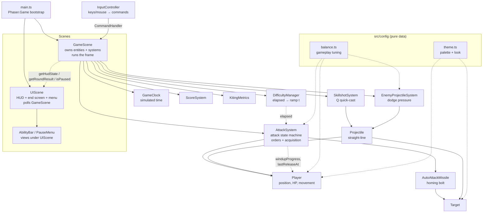
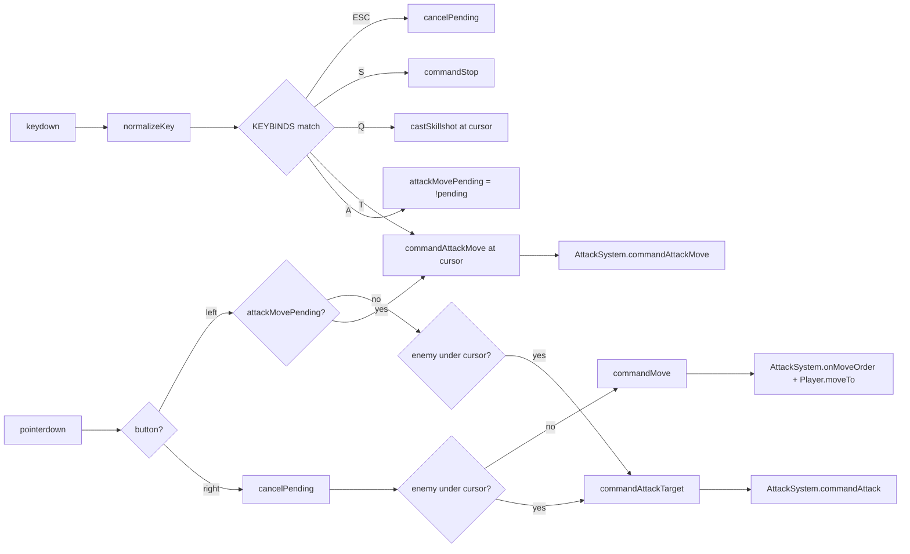
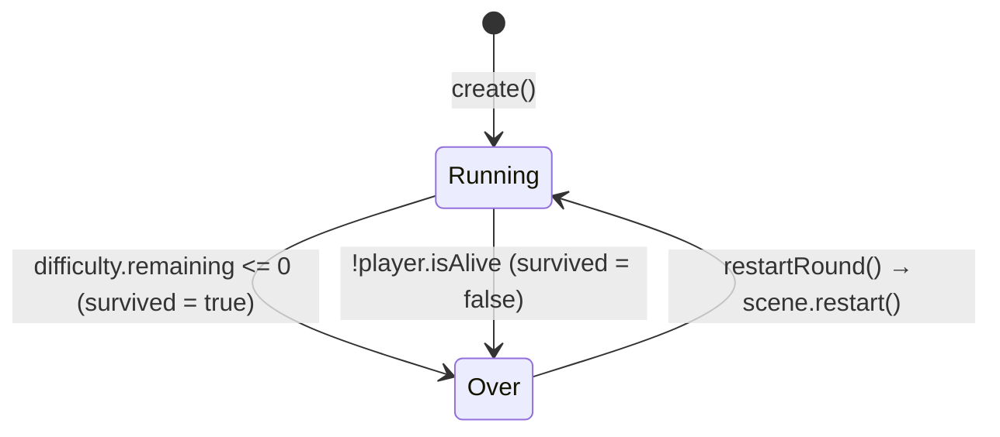

# Warmup — Technical Report

A complete description of the codebase as it exists today: architecture, mechanics,
timing, state flow, configuration, and known weaknesses.

Everything in this document was read out of the source. Where behaviour is subtle,
surprising, or differs from what a comment claims, it is called out explicitly.
Values quoted are the ones currently in `src/config/balance.ts`.

---

## 1. Project overview

### Purpose

A browser-based mechanical warm-up trainer for League-style ADC play. The player
practises four skills simultaneously inside a 60-second round:

1. Click-to-move positioning
2. Kiting / orbwalking (attack → move during recovery → attack)
3. Dodging non-homing enemy projectiles
4. Aiming a linear skillshot

It is deliberately a **gray-box prototype**: no external art, no audio, no backend,
no accounts. All visuals are procedural Phaser shapes, graphics and tweens.

### Current gameplay loop

```
Round starts (60s)
  → 4 hexagonal target dummies spawn away from the player
  → player kites: right-click move, T / A-click attack-move, right-click enemy
  → autos wind up, release a homing bolt, deal 12 damage on impact
  → targets die in 2 autos, fade out, respawn 1200ms later elsewhere
  → enemy projectiles fire from the arena edge at the player's position-at-spawn
  → attack speed ramps up over the round; projectile pressure ramps after 22s
  → round ends on timer (survived) or at 0 HP (defeated)
  → end screen shows score + raw mechanical metrics; R / Space / button restarts
```

### Tech stack

| Layer | Choice | Notes |
| --- | --- | --- |
| Engine | Phaser **3.90** | Rendering, scenes, input, tweens only |
| Language | TypeScript **5.9**, `strict` | `noUnusedLocals`, `noUnusedParameters`, `noImplicitOverride` |
| Bundler | Vite **7** | Zero plugins; `npm run build` = `tsc --noEmit && vite build` |
| Physics | **None** | No Arcade/Matter. All movement and collision is hand-written math |

The decision to skip Phaser's physics engine is central: every distance check,
every projectile step and every collision test is explicit arithmetic in a system
class. This is what makes the timing deterministic and tunable.

### How Phaser is actually used

Phaser provides only five things here:

1. **The game loop** — `Scene.update(time, delta)` drives everything.
2. **Scene management** — two parallel scenes (`GameScene` simulates, `UIScene` overlays).
3. **Input capture** — `input.on('pointerdown')`, `input.keyboard.on('keydown')`, `activePointer.worldX/Y`.
4. **Drawing primitives** — `Arc`, `Polygon`, `Rectangle`, `Ellipse`, `Line`, `Graphics`, `Container`, `Text`.
5. **Tweens** — exclusively for *fire-and-forget decoration* (pings, impact rings, damage numbers, death bursts). No tween is ever load-bearing for gameplay.

Notably **not** used: physics bodies, sprites, texture atlases, animation manager,
particle emitters, timers/`scene.time.addEvent` for gameplay (all timing is
timestamp comparison against `time` from the update loop).

### Architecture



The dotted lines matter: **`AttackSystem → Player` is a one-way visual feed**, and
**`UIScene → GameScene` is polling, never events**. Both choices are explained in
§16 and §2.

---

## 2. File and module architecture

### `src/main.ts` — bootstrap *(configuration)*

Creates the `Phaser.Game` at a fixed 1280×720 with `Scale.FIT` + `CENTER_BOTH`, and
registers `[GameScene, UIScene]`. Exposes `window.__warmup` (the game) and
`window.__balance` (the whole config module) for live console tuning — this is also
what the browser test suites drive.

> **Note:** Phaser only auto-starts the *first* scene in the config array. `UIScene`
> starts because its constructor passes `{ key: 'UIScene', active: true }`. This bit
> a previous iteration: without `active: true`, the HUD silently never booted.

### `src/config/balance.ts` — gameplay tuning *(configuration)*

Exports `ARENA`, `ROUND`, `PLAYER`, `ATTACK`, `KEYBINDS`, `INDICATORS`, `DEBUG`,
`SKILLSHOT_Q`, `TARGETS`, `ENEMY_PROJECTILES`, `DIFFICULTY`, `SCORE`, `UI`, plus the
function `attackReach()`.

Most blocks are `as const` (readonly at the type level, still mutable at runtime from
the console). **`ATTACK` and `DEBUG` and `KEYBINDS` deliberately are not `as const`**,
so they are freely writable for live experimentation.

`attackReach(targetRadius, playerRadius)` is the single source of truth for attack
distance — see §9.

### `src/config/theme.ts` — visual tuning *(configuration)*

`THEME.{arena, player, target, projectiles, markers, ui}`. Colours, shadow alphas,
idle-pulse rate, enemy spin speed, HUD panel styling. Nothing in here affects
gameplay. Introduced to stop `balance.ts` from being half look and half feel — but
the split is **incomplete**, see §24.

### `src/game/scenes/GameScene.ts` — simulation root *(gameplay + rendering + wiring)*

The largest file and the only place that knows about everything.

**Owns:** `player`, `targets[]`, all six systems, `state: 'running' | 'over'`,
`result: RoundResult | null`, and the two "already-drawn" timestamps
(`lastCancelShownAt`, `lastReleaseShownAt`).

**Key methods:**

| Method | Role |
| --- | --- |
| `create()` | Draws the arena, constructs player/systems/targets, wires `InputController` |
| `update(time, delta)` | The frame — see §3 |
| `commandHandler()` | Returns the `CommandHandler` object that `InputController` calls |
| `targetAt(x, y)` | Click hit test with a 10px grace radius |
| `ping(x, y, color, kind)` | Transient ground marker (move = collapse, attack-move = bloom + crosshair) |
| `separateTargets()` | Soft body-blocking so drifting enemies don't stack |
| `findSpawnSpot()` | Rejection-sampled respawn position |
| `drawArena()` | Layered procedural field (floor, grid, centre mark, vignette, bracketed frame) |
| `getHudState()` / `getRoundResult()` | The read-only surface `UIScene` polls |
| `endRound(survived)` / `restartRound()` | Round lifecycle |

### `src/game/scenes/UIScene.ts` — HUD and end screen *(rendering only)*

Runs in parallel above `GameScene`. Holds **no gameplay state**. Every frame it calls
`this.game_.getHudState()` and writes text. The end screen is a `Container` that is
shown when `getRoundResult()` stops returning `null`.

Polling rather than event subscription is deliberate: `GameScene.restart()` destroys
and rebuilds every game object, and an event-based HUD kept breaking across restarts.
Polling a getter is immune to that.

### `src/game/entities/Player.ts` — the avatar *(gameplay + rendering)*

**Owns the authoritative gameplay state:** `x`, `y`, `hp`, the current move order
(`destX`, `destY`), `rootCount` (reference-counted movement lock), and `lastHitAt`.

**Also owns its own rendering:** a `Container` (`body`) holding a dart `Polygon`
(`hull`), a bright `core` and an `idleRing`; plus `shadow`, `rangeRing`, `moveMarker`,
`chargeRing`, `releaseRing`.

The critical API split:

```ts
// gameplay — called by AttackSystem / GameScene
moveTo(x, y); stop(); root(); releaseRoot(); takeDamage(amount, nowMs); update(dt);

// visuals — pure sinks, cannot affect timing
applyAttackVisual({ windupProgress, msSinceRelease, targetX, targetY });
setRangeRingState(inRange, attackMovePending);
playReleaseBurst(scene); showCancelTag(scene);
```

### `src/game/entities/Enemy.ts` — the enemy base *(gameplay + rendering)*

Abstract class holding everything archetype-independent: position, HP, the
damage/death lifecycle, `spawnId`, and all shared feedback (hit flash, floating
damage numbers, draining ghost HP bar, death burst, shadow). Subclasses supply
only `buildBody` (in their constructor), `syncBody()` and optionally
`updateAi()`. Every combat system types against `Enemy`, never a concrete
archetype — which is why adding a mob touches no system code.

### `src/game/entities/Pursuer.ts` — the melee stalker *(gameplay + rendering)*

The first mob with movement AI: a two-state machine (`chase` / `windup`) that
walks the player down and swings on a cooldown. See §14b.

### `src/game/systems/PassiveSystem.ts` — the Q passive *(gameplay)*

Owns the stack count and the shared expiry. `SkillshotSystem` calls `addStack()`
on a landed Q; `AttackSystem` only reads `attackSpeedMultiplier`.

### `src/game/systems/EnemyDirector.ts` — the roster *(gameplay)*

Owns the enemy slots, difficulty-weighted archetype selection, HP scaling,
respawn timing and enemy-vs-enemy separation.

### `src/game/entities/Target.ts` — the basic dummy *(gameplay + rendering)*

**Owns:** `x`, `y`, `hp`, `active`, **`spawnId`**, `respawnAt`, wander state
(`wanderX/Y`, `nextWanderAt`), and visual-only `hitFlashUntil`, `deathAnimUntil`,
`ghostHp`.

Rendering is a `Container` of two hexagon `Polygon`s plus an `eye` `Arc`, with a
separate `shadow`, `hpBarBg`, `hpGhost` and `hpBar`. The module-level helper
`hexPoints(r)` generates the silhouette.

### `src/game/entities/AutoAttackMissile.ts` — the auto bolt *(gameplay + rendering)*

A **homing** projectile holding a direct reference to its `Target` plus the
`targetSpawnId` captured at spawn. Applies damage via an `onHit` callback on arrival.
See §8.

### `src/game/entities/Projectile.ts` — straight-line projectile *(gameplay + rendering)*

Shared by Q and enemy fire. Stores velocity components (`vx`, `vy`) computed once at
construction, accumulates `travelled`, and dies at `maxRange` or out of bounds.
Config flags `shape: 'orb' | 'bolt'`, `trail`, `heavyOutline` select the look.
`hits(cx, cy, r)` is circle-vs-circle.

### `src/game/systems/AttackSystem.ts` — the heart *(gameplay)*

Owns the attack state machine, the order model, target acquisition, attack-speed
scaling, and the in-flight auto missiles. Detailed in §6, §7, §10, §11.

### `src/game/systems/SkillshotSystem.ts` — Q *(gameplay + rendering)*

Quick-cast, cooldown, missile list, collision against targets, cast flash and impact
ring. Detailed in §12.

### `src/game/systems/EnemyProjectileSystem.ts` — dodge pressure *(gameplay)*

Spawn scheduling, edge-point selection, aim, player collision, culling. Detailed in §13.

### `src/game/systems/DifficultyManager.ts` — the ramp *(gameplay)*

Owns `elapsedSeconds`. Exposes `t` (the 0→1 ramp), `level` (cosmetic 1–10), and
lerped getters for every enemy-projectile parameter. Detailed in §11.

### `src/game/systems/InputController.ts` — input translation *(input)*

Owns exactly one piece of state: `attackMovePending` (the A-key targeting mode).
Translates raw Phaser events into `CommandHandler` calls. Detailed in §4.

### `src/game/systems/KitingMetrics.ts` — measurement *(gameplay, read-only)*

Six counters, incremented by `AttackSystem` hooks and by a per-frame `update()`.
Detailed in §18.

### `src/game/systems/ScoreSystem.ts` — scoring *(gameplay)*

`score`, `damageDealt`, `targetsKilled`, `projectileHitsTaken`, plus fractional
survival accumulation. Detailed in §19.

---

## 3. Main game loop

### Scene lifecycle

`GameScene.create()` runs on boot and again on every `scene.restart()`. It rebuilds
*everything* — arena graphics, player, systems, targets, input controller. There is
no object pooling across rounds; Phaser destroys the display list and the old
JS objects are garbage.

`UIScene.create()` runs once at boot and is **not** re-run on `GameScene` restart,
which is exactly why it polls.

### Delta time and the game clock

```ts
const dt = Math.min(delta, 50) / 1000;   // seconds, clamped at 50ms
this.clock.advance(dt * 1000);           // simulated time
const now = this.clock.now;
```

The clamp prevents an alt-tab or a long GC pause from teleporting entities through
each other. A consequence: **the round clock is simulation time, not wall time** —
if frames are dropped, a "60 second" round takes longer in reality. `DifficultyManager`
accumulates this same clamped `dt`.

Note the two distinct time sources in use:

- `dt` (seconds, clamped) — for movement and anything rate-based.
- `clock.now` (`GameClock`, ms) — for **every** gameplay deadline comparison
  (`windupEndsAt`, `cycleEndsAt`, `readyAt`, `respawnAt`, `hitFlashUntil`, i-frames).

`GameClock` accumulates the same clamped delta, and only on frames the simulation
actually runs. Phaser's own `time` is used for tweens and other decoration only.
Two properties follow from this:

- A long stall cannot make deadlines expire together, because the clock advances
  by at most 50ms per frame just like movement does.
- Pausing is simply "stop calling `advance()`" — see §19.

### Exact update order

From `GameScene.update()`, top to bottom:

```
Frame (time, delta)
 │
 ├─ if state !== 'running' → return          (round over freezes the sim)
 ├─ dt = min(delta, 50) / 1000
 │
 ├─ difficulty.update(dt)                    elapsed += dt
 ├─ scoring.tickSurvival(dt)                 +5 pts/sec, fractional carry
 │
 ├─ attacks.update(time, dt, targets)        ① GAMEPLAY DECIDES
 │    ├─ updateMissiles(dt)                  auto bolts fly + resolve hits
 │    ├─ windup complete? → fireAttack()     spawn missile, state = recovery
 │    ├─ recovery elapsed? → state = idle
 │    ├─ drop dead currentTarget
 │    ├─ attack-move: acquire in-range target, else issue the walk
 │    ├─ in range? → stop chase, beginWindup if idle
 │    ├─ out of range? → chase, or drop (per source)
 │    └─ updateVisuals()                     target reticle
 │
 ├─ player.applyAttackVisual({...})          ② VISUALS READ IT
 ├─ player.setRangeRingState(...)
 │
 ├─ player.update(dt)                        ③ MOVE + REDRAW
 │
 ├─ metrics.update(dt, {state, enemyInRange, playerMoving})
 │
 ├─ cancel tag  (if attacks.lastCancelAt  > lastCancelShownAt)
 ├─ release burst (if attacks.lastReleaseAt > lastReleaseShownAt)
 │
 ├─ for each target: target.update(dt, time); respawn if due
 ├─ separateTargets()                        soft body-blocking
 │
 ├─ skillshot.update(dt, time, targets)      Q missiles + collision
 ├─ enemyProjectiles.update(dt, time)        spawn, fly, collide with player
 │
 └─ end condition: !player.isAlive → endRound(false)
                   difficulty.remaining <= 0 → endRound(true)
```

The ordering of ①②③ is load-bearing and was a real bug once: when
`applyAttackVisual` ran *after* `player.update()`, the charge ring rendered one frame
stale and visibly persisted into recovery. See §16.

### Event-driven vs polled

| Mechanism | Style |
| --- | --- |
| Mouse / keyboard | **Event-driven** (Phaser emitters → `InputController`) |
| Everything else in gameplay | **Polled** every frame |
| Damage application | **Callback**, but only ever invoked from inside a polled update |
| HUD | **Polled** (`getHudState()`) |
| Decorative effects | **Tweens** (fire-and-forget, self-destructing) |

There are no `setTimeout`s and no Phaser timer events in gameplay code.

---

## 4. Input system

### Detection

`InputController`'s constructor registers exactly two Phaser listeners:

```ts
scene.input.mouse?.disableContextMenu();
scene.input.on('pointerdown', this.onPointerDown, this);
scene.input.keyboard?.on('keydown', this.onKeyDown, this);
```

A **single** `keydown` listener plus a binding table (`KEYBINDS`) rather than
per-key `keydown-A` listeners — that is what makes rebinding a config change.
Keys are normalised: `' '` → `'SPACE'`, everything else `toUpperCase()`
(so `Escape` → `'ESCAPE'`).

Keyboard-issued commands read the cursor from `scene.input.activePointer.worldX/Y`.

### The command surface

`InputController` never touches gameplay objects. It calls methods on a
`CommandHandler` implemented by `GameScene.commandHandler()`:

```ts
commandMove(x, y)            commandAttackTarget(target)
commandAttackMove(x, y)      commandStop()
castSkillshot(x, y)          targetAt(x, y)
isRoundRunning()             restartRound()
```

### Every input

| Input | Detected as | Handler call | Resulting state |
| --- | --- | --- | --- |
| **Right-click empty ground** | `pointerdown` + `rightButtonDown()`, `targetAt()` returns null | `commandMove(x,y)` | `attacks.onMoveOrder()` → cancels uncommitted windup, clears all orders; `player.moveTo()`; blue collapse ping |
| **Right-click enemy** | same, `targetAt()` hits | `commandAttackTarget(t)` | `attacks.commandAttack(t)` → `currentTarget = t`, `targetSource = 'direct'`, clears any attack-move. **Does not cancel a windup.** |
| **A then left-click** | `keydown A` sets `attackMovePending = true`; next `pointerdown` + `leftButtonDown()` | `commandAttackMove(x,y)` | `attacks.commandAttackMove()`; red bloom ping |
| **T** | `keydown T` | `commandAttackMove(cursorX, cursorY)` | *Identical* to the A path |
| **Q** | `keydown Q` | `castSkillshot(cursorX, cursorY)` | `skillshot.castToward()` fires immediately or no-ops on cooldown |
| **S** | `keydown S` | `commandStop()` | `attacks.onStop()` → cancel windup, clear orders, `player.stop()` |
| **Esc** | `keydown ESCAPE` | — | `cancelPending()` only (clears A-mode) |
| **R / Space** | `keydown`, only when `!isRoundRunning()` | `restartRound()` | `scene.restart()` |
| **Left-click enemy (no mode)** | `pointerdown` + left | `commandAttackTarget(t)` | Legacy V0.1 convenience; identical to right-clicking it |

### Input flow



### The four command types

They are genuinely different orders, not variations:

1. **Move** — hands movement control to the player, clears every attack order, cancels an uncommitted windup.
2. **Direct attack** — commits to one specific `Target` object, chases it anywhere, ignores attack-move target selection, does *not* cancel a windup.
3. **Attack Move (A-click)** — an order at a *location*; targets are chosen dynamically from whoever is in range.
4. **Attack Move Click (T)** — the same order, issued at the cursor with no intermediate mode.

### Why T reuses A's implementation

`InputController` emits the **same `commandAttackMove(x, y)` call** for both. There is
no T-specific branch anywhere downstream. Consequences that are true by construction
rather than by maintenance:

- `attackMoveTargeting` ('cursor' vs 'player') governs both.
- Acquisition is restricted to in-range enemies for both.
- The windup/release/recovery timing is the same state machine.
- `KitingMetrics` counts both identically.
- Any future change to attack-move (priority targeting, acquisition range) applies to both automatically.

The only difference is that T skips the `attackMovePending` intermediate state.

---

## 5. Player movement

### State

```ts
private destX: number | null = null;   // current move order, null = standing still
private destY: number | null = null;
private rootCount = 0;                 // >0 blocks movement entirely
```

`isMoving` is `destX !== null && !isRooted`. A move order is a *destination*, not a
velocity — there is no acceleration, no momentum, no turn rate.

### The integration step

`Player.update(dt)`:

```
if (!rooted && dest != null):
    d     = dest - position
    dist  = |d|
    step  = PLAYER.moveSpeed * dt          // 340 px/s
    if dist <= max(step, arriveEpsilon):   // arriveEpsilon = 3px
        position = dest                    // snap
        stop()                             // clear the order
    else:
        position += (d / dist) * step      // normalised direction
```

The `max(step, arriveEpsilon)` guard is what prevents the classic overshoot
oscillation: at 340 px/s and 60fps a single step is ~5.7px, so a fixed 3px epsilon
alone would let the player jitter across the destination. Taking whichever is larger
guarantees the snap happens on the frame that would otherwise overshoot.

`moveTo()` clamps the destination into the playable rect:

```ts
destX = clamp(x, ARENA.padding + radius, ARENA.width - ARENA.padding - radius)
```

Note the player can *never* be pushed out of bounds because position only ever moves
toward a clamped destination.

### Edge cases

| Case | Behaviour |
| --- | --- |
| Click within 3px of the player | Snap + immediate stop; effectively a no-op with a ping |
| Click repeatedly | Each `moveTo()` overwrites `destX/destY`; no queue, instant redirect |
| Click during windup | The move order lands, but `rootCount > 0` so no movement happens *this* frame; the windup is cancelled by `onMoveOrder()` in the same call, which releases the root — so movement begins next frame |
| Stop during windup | `onStop()` cancels the windup and calls `player.stop()`; stationary until a new command |
| Arrival | `stop()` clears the order, so `isMoving` goes false and the recovery-idle metric starts counting |

### Movement vs attacking

Movement is locked by a **reference-counted root**, not a boolean:

```ts
root()        // rootCount++   — called by beginWindup()
releaseRoot() // rootCount--   — called by fireAttack() and cancelWindup()
```

Reference counting means a future second root source (a cast time, a stun) cannot
accidentally unlock movement when only one of them ends. Today only the attack
windup ever roots, and Q explicitly does not.

---

## 6. Auto-attack system

This is the most important system in the project.

### The state machine

```
        commandAttack / attack-move acquisition
                        │
                        ▼
   ┌──── idle ────────────────────────────────┐
   │      │  target in range && state == idle │
   │      ▼                                   │
   │   WINDUP   rooted, no damage yet,        │
   │      │     cancellable                   │
   │      │  now >= windupEndsAt              │
   │      ▼                                   │
   │   RELEASE  (instantaneous — not a state) │
   │      │     missile spawned, metrics fired│
   │      ▼                                   │
   │  RECOVERY  free to move, damage committed│
   │      │  now >= cycleEndsAt               │
   └──────┘                                   │
          └───────────────────────────────────┘
```

`AttackState` is `'idle' | 'windup' | 'recovery'`. **Release is an event, not a
state** — it is the single frame in which `fireAttack()` runs, transitioning
`windup → recovery`.

### Timing variables

All in `AttackSystem`:

| Variable | Meaning |
| --- | --- |
| `windupEndsAt` | Timestamp when damage commits |
| `cycleEndsAt` | Timestamp when the next attack may start |
| `windupTarget` | The `Target` this swing committed to |
| `currentTarget` | The order's target — may differ from `windupTarget` |

Both deadlines are set once, in `beginWindup()`:

```ts
this.windupEndsAt = nowMs + this.windupMs;
this.cycleEndsAt  = nowMs + this.cooldownMs;   // cooldown starts at WINDUP START
```

That second line is the key design decision. Because the cooldown begins when the
windup begins (not when the missile fires), the recovery window is
`cooldownMs - windupMs` and **firing never extends the cycle**. This is what makes
recovery a free movement window rather than dead time.

### Derived durations

```
attackSpeedT = clamp(elapsed / attackSpeedRampSeconds, 0, 1) ^ attackSpeedCurve
cooldownMs   = lerp(baseCooldownMs, minCooldownMs, attackSpeedT)
windupMs     = windupMsOverride ?? max(minWindupMs, cooldownMs × windupPercent)
```

With current values (`base 700`, `min 420`, `ramp 45s`, `curve 1.15`, `windupPercent
0.25`, `minWindupMs 90`):

| Round time | cooldown | windup | recovery | attacks/sec |
| --- | --- | --- | --- | --- |
| 0s | 700ms | 175ms | 525ms | 1.43 |
| 22s | ~577ms | ~144ms | ~433ms | 1.73 |
| 30s | ~524ms | ~131ms | ~393ms | 1.91 |
| 45s+ | 420ms | 105ms | 315ms | 2.38 |

The `minWindupMs: 90` floor is never reached at current values (105ms at max speed);
it only engages if `minCooldownMs` drops below 360ms.

### How an attack starts

`beginWindup()` is only ever called from one place in `update()`:

```ts
if (inRange) {
  if (this.chasing) { this.player.stop(); this.chasing = false; }
  if (this.state === 'idle') this.beginWindup(target, nowMs);
}
```

So all four preconditions live in one spot: there is a `currentTarget`, it is
`active`, it is in range, and the cycle is `idle`. `beginWindup()` then stops
movement, roots the player, sets both deadlines, and increments
`metrics.attacksStarted`.

### Target validation and range

- Dead targets are dropped at the top of `update()` (step 3): `if (currentTarget && !currentTarget.active)`.
- Range is `isInRange()` — see §9.
- Moving into range is `chaseToward()` — see below.

### Chasing into range

```ts
private chaseToward(target: Target): void {
  const dx = this.player.x - target.x;          // from target TOWARD player
  const dy = this.player.y - target.y;
  const dist = Math.hypot(dx, dy) || 1;
  const standoff = Math.max(0, this.reachTo(target) - ATTACK.chaseBufferPx);
  this.player.moveTo(target.x + (dx/dist) * standoff, target.y + (dy/dist) * standoff);
  this.chasing = true;
}
```

The destination is a point on the line between the two, `standoff` px from the
target — so the player walks to the *edge of their range*, not onto the enemy.
Re-issued every frame, so a drifting target is tracked.

In practice the `chaseBufferPx: 24` rarely matters: the `inRange` branch fires and
calls `player.stop()` the moment the range test passes, which happens at exactly
`reach`. Measured: the player halts at ~277px against a reach of 278px. The buffer
only shapes the approach to a target that is actively moving away.

### Release

```ts
private fireAttack(): void {
  const target = this.windupTarget;
  this.state = 'recovery';
  this.windupTarget = null;
  this.player.releaseRoot();
  this.lastReleaseAt = this.now;
  this.metrics.onAttackFired();
  if (!target || !target.active) return;
  this.missiles.push(new AutoAttackMissile(scene, player.x, player.y, target,
                                           target.spawnId, ATTACK.damage, onMissileHit));
}
```

Order matters here: the root is released and the state flips to `recovery` **before**
the missile is constructed, and unconditionally — even if the target died during the
windup, the player still leaves the windup properly and the cooldown still runs.
(A swing at a target that died during windup fires no missile and deals no damage,
but is still counted in `attacksFired`. See §18.)

### Four durations that are not the same thing

| Term | Value @ round start | What it is |
| --- | --- | --- |
| **Attack windup** | 175ms | Rooted, cancellable, no damage |
| **Attack release** | instantaneous | The frame the missile spawns; commitment point |
| **Projectile travel** | distance / 1150 px/s (≈**226ms** from max range) | Damage delay only. Gates nothing |
| **Attack cooldown** | 700ms | Whole cycle, windup included |

Travel time is longer than you might expect. Firing from maximum range (278px
centre-to-centre) the bolt only needs to close to within the target's 18px radius,
so it covers ~260px at 1150 px/s ≈ **226ms** — roughly half the 525ms recovery
window at round start. The damage lands well after you have started kiting away.

---

## 7. Attack cancellation and orbwalking

### Trace A — cancelled attack

```
t=0     right-click enemy       → commandAttack(t): currentTarget = t, source='direct'
t=16ms  update: in range, idle  → beginWindup()
                                   state='windup', windupTarget=t
                                   windupEndsAt = t+175, cycleEndsAt = t+700
                                   player.stop(), player.root()  (rootCount 0→1)
                                   metrics.attacksStarted++
t=80ms  right-click ground      → InputController → commandMove
                                   AttackSystem.onMoveOrder():
                                     state==='windup' && allowMoveCancel → cancelWindup()
                                       state='idle'
                                       windupTarget = null        ← no missile can ever spawn
                                       player.releaseRoot()       (rootCount 1→0)
                                       cycleEndsAt = 0            ← FULL cooldown refund
                                       lastCancelAt = now
                                       metrics.attacksCancelled++
                                     clearOrders(): currentTarget = null, attackMove = null
                                   player.moveTo(x, y)
t=96ms  update: windupProgress → 0, charge ring hidden, CANCEL tag tweens up
        No missile exists. Target HP unchanged.
```

### Trace B — completed attack, then movement

```
t=0     ... beginWindup() as above
t=175ms update: now >= windupEndsAt → fireAttack()
                                   state='recovery'
                                   windupTarget = null
                                   player.releaseRoot()  (movement free NOW)
                                   lastReleaseAt = now
                                   metrics.attacksFired++
                                   new AutoAttackMissile(...) pushed to missiles[]
        GameScene sees lastReleaseAt > lastReleaseShownAt → playReleaseBurst()
t=180ms right-click ground      → onMoveOrder(): state is 'recovery', NOT 'windup'
                                   → cancelWindup() is NOT called
                                   → clearOrders() only (currentTarget = null)
                                   player.moveTo(x, y) — player walks away
        The missile is in `missiles[]`, which clearOrders() does not touch.
t=~400ms missile reaches target → onHit → onMissileHit → target.takeDamage(12)
                                   metrics.attacksLanded++
                                   callbacks.onDamage → score += 12
t=700ms update: now >= cycleEndsAt → state = 'idle', next attack allowed
```

### The state that makes the distinction

It is a **single condition**, in `onMoveOrder()` / `onStop()`:

```ts
if (this.state === 'windup' && ATTACK.allowMoveCancel) this.cancelWindup();
```

`cancelWindup()` nulls `windupTarget`, which is the *only* path to
`new AutoAttackMissile(...)`. Once `fireAttack()` has run, `windupTarget` is already
null and the missile is an independent object in `missiles[]` — it holds its own
reference to the `Target` and needs nothing from the attack system to complete.

| Thing | On cancel | After release |
| --- | --- | --- |
| `windupEndsAt` | stale, ignored (state is idle) | stale, ignored |
| `cycleEndsAt` | **reset to 0** — attack instantly available again | keeps running |
| `windupTarget` | nulled → no missile | already nulled |
| `currentTarget` | cleared by `clearOrders()` | cleared by `clearOrders()` |
| Missiles | none exist | unaffected, keeps flying |
| Metrics | `attacksCancelled++` | `attacksFired++`, later `attacksLanded++` |

> **The cooldown refund is total.** `cycleEndsAt = 0` means a cancelled attack costs
> nothing, so cancel-spam is free — but it also deals no damage, so it is not an
> exploit so much as a no-op. It is what makes animation-cancel drilling possible.

### Which orders cancel

| Order | Cancels a windup? | Rationale |
| --- | --- | --- |
| Right-click ground (move) | **Yes** | It's a move order |
| `S` (stop) | **Yes** | It's a stop order |
| Right-click enemy (direct attack) | No | Attack order; the committed swing resolves |
| A-click / T (attack move) | No | Attack order — and T is *designed* to be spammed while kiting; cancelling per press would mean never landing an auto |

That last row was a real bug: while T was cancelling windups, hammering T at 40ms
intervals produced **zero** autos. Now T-spam is verified to fire at exactly the
cooldown cadence (655ms measured against a 648ms cooldown).

---

## 8. Auto-attack projectile system

### Spawning

Constructed only in `fireAttack()`, at the player's **current position at the moment
of release** — not at the position where the windup started. Kiting during a windup
is impossible (rooted), so in practice these coincide.

```ts
new AutoAttackMissile(scene, player.x, player.y, target, target.spawnId,
                      ATTACK.damage, (t, dmg) => this.onMissileHit(t, dmg))
```

### Homing and per-frame movement

The missile holds a **live object reference** to its `Target` and re-reads
`target.x/y` every frame:

```ts
const dx = target.x - this.x;
const dy = target.y - this.y;
const dist = Math.hypot(dx, dy) || 0.0001;
const step = ATTACK.projectileSpeed * deltaSeconds;      // 1150 px/s

if (step >= dist - this.target.radius) {  // arrival test
  playImpact(); onHit(target, damage); kill(); return;
}
this.x += (dx / dist) * step;
this.y += (dy / dist) * step;
```

This is **perfect homing** — the bolt cannot miss a living target. That is
intentional: League auto-attacks don't miss either.

### Arrival, not collision

There is no overlap test. The missile arrives when the remaining gap is smaller than
one frame's step plus the target radius. At 1150 px/s and 60fps, `step ≈ 19px`, so it
"lands" when within roughly 37px of the target centre. At low framerates (`dt` clamped
at 50ms → `step ≈ 57px`) it can register a hit from noticeably further out. Cosmetic,
but it means hit distance is mildly framerate-dependent.

### Damage

Damage is applied in `AttackSystem.onMissileHit()`, not in the missile:

```ts
private onMissileHit(target: Target, damage: number): void {
  if (!target.active) return;
  const killed = target.takeDamage(damage);
  this.metrics.onAttackLanded();
  this.callbacks.onDamage(target, damage, killed);   // → scoring, respawn scheduling
}
```

### Target death mid-flight, and the `spawnId` guard

`Target` objects are **pooled**: a dead target is set `active = false` and the same
object is later revived by `respawnAtPosition()`. Without protection, a bolt aimed at
a target that died could land on its reincarnation somewhere else on the map.

The guard is a monotonically increasing generation counter:

```ts
// Target.respawnAtPosition()
this.spawnId++;

// AutoAttackMissile.update(), first thing every frame
if (!this.target.active || this.target.spawnId !== this.targetSpawnId) {
  this.kill();   // fizzle silently
  return;
}
```

The missile captured `target.spawnId` at construction. Dead target → fizzle. Same
object, new life → `spawnId` mismatch → fizzle. This is the standard
generational-handle pattern applied to a pooled entity.

### Difference from a League skillshot

| | Auto bolt | Q skillshot |
| --- | --- | --- |
| Targeting | Locked to a `Target` reference | A direction only |
| Path | Curves to follow the target | Dead straight, fixed `vx/vy` |
| Can miss | No | Yes |
| Range limit | None (chases until arrival) | Hard 450px cap |
| Collision | Arrival test against its own target | Circle-vs-circle against all targets |
| On target death | Fizzles | Keeps flying to its cap |

---

## 9. Attack range

### The model

**Player centre → target hitbox edge**, which is League's model. One function is the
single source of truth:

```ts
export function attackReach(targetRadius: number, playerRadius: number): number {
  return ATTACK.range + targetRadius + (ATTACK.rangeFromPlayerEdge ? playerRadius : 0);
}
```

The test itself is squared-distance (no `sqrt`):

```ts
isInRange(target) {
  const reach = attackReach(target.radius, this.player.radius);
  return (target.x - player.x)² + (target.y - player.y)² <= reach²;
}
```

With current config (`range 260`, `TARGETS.radius 18`, `rangeFromPlayerEdge false`):

```
reach = 260 + 18 + 0 = 278px   (centre-to-centre distance at which an auto connects)
```

Setting `rangeFromPlayerEdge: true` switches to edge-to-edge (reach becomes 292px,
because the player's own 14px radius is also subtracted from the requirement).

### Mapping to the drawn ring

`Player.attackRingRadius()` calls the **same function**:

```ts
private attackRingRadius(): number {
  return attackReach(TARGETS.radius, this.radius);   // 278
}
```

So the ring drawn around the player is the exact locus of attackable target
*centres*. A target whose centre is inside the ring is attackable, always. This is
regression-tested: a browser test compares `insideRing === isInRange(target)`.

**Caveat:** the ring uses `TARGETS.radius` (the standard size). If per-target radii
ever differ, the ring becomes an approximation for odd-sized enemies. The per-target
truth is the reticle, which turns green only when *that* specific enemy passes
`isInRange()`.

---

## 10. Attack Move

### Order shape

```ts
interface AttackMoveOrder {
  destX: number; destY: number;    // where to walk
  cursorX: number; cursorY: number; // where the click/keypress happened
}
```

Currently `dest` and `cursor` are always the same point (both set from the click
position). They are separate fields so that a future "attack-move toward a location
but prioritise near the mouse" variant needs no restructuring.

### Issuing

```ts
commandAttackMove(x, y) {
  this.currentTarget = null;
  this.chasing = false;
  this.attackMove = { destX: x, destY: y, cursorX: x, cursorY: y };
  this.attackMoveNeedsWalk = true;   // deferred — see below
}
```

The walk is **deferred to `update()`** rather than issued here. That is what makes an
enemy already standing in range get attacked with zero movement: acquisition runs
first, and only if it fails does the walk get issued.

### Acquisition algorithm

```
candidates = every target where target.active AND isInRange(target)
origin     = attackMoveTargeting === 'cursor' ? order.cursor : player position
target     = argmin over candidates of squaredDistance(candidate, origin)
```

```ts
private acquireAttackMoveTarget(targets: Target[]): Target | null {
  const byCursor = ATTACK.attackMoveTargeting === 'cursor';
  const originX = byCursor ? order.cursorX : this.player.x;
  const originY = byCursor ? order.cursorY : this.player.y;
  let best = null, bestDist = Infinity;
  for (const t of targets) {
    if (!t.active || !this.isInRange(t)) continue;
    const d = (t.x - originX) ** 2 + (t.y - originY) ** 2;
    if (d < bestDist) { best = t; bestDist = d; }
  }
  return best;
}
```

**Only in-range enemies are ever candidates.** This is the rule that stops an A-click
or T press from turning into a cross-arena sprint at a distant enemy.

### Per-frame behaviour

```
if (attackMove && !currentTarget):
    acquired = acquireAttackMoveTarget(targets)
    if acquired:
        currentTarget = acquired; targetSource = 'attack-move'
        attackMoveNeedsWalk = false; player.stop()
    else if attackMoveNeedsWalk && state !== 'windup':
        player.moveTo(order.destX, order.destY)
        attackMoveNeedsWalk = false
```

The `state !== 'windup'` guard defers the walk until a committed swing finishes —
pressing T mid-windup does not break the root.

### Losing a target

If an acquired target leaves range and `attackMoveChasesAcquiredTarget` is `false`
(the default), the target is dropped and `attackMoveNeedsWalk` is set again, so the
player resumes walking toward the original destination. With it `true`, the player
chases like a direct order.

### Persistence

The order stays alive after arriving at the destination — the player holds position
in "attack-move stance" and keeps acquiring anything that wanders into range, until
another command replaces it. This is what makes `T → auto → right-click away → T`
repeatable without re-pressing on arrival.

### Attack Move vs direct right-click

| | Direct attack | Attack move |
| --- | --- | --- |
| Target | One specific object, chosen by you | Chosen dynamically from in-range candidates |
| `targetSource` | `'direct'` | `'attack-move'` |
| Chases out of range | Yes (`chaseOutOfRangeTargets: true`) | No (`attackMoveChasesAcquiredTarget: false`) |
| Target dies | Order ends | Order survives, re-acquires |
| Walks anywhere | Toward the enemy | Toward the clicked point only |
| Cancels a windup | No | No |

---

## 11. Difficulty scaling

There are **two independent ramps**. This is deliberate — it lets the arena stay calm
while your hands speed up.

### Ramp 1 — enemy pressure (`DifficultyManager.t`)

```
start = DIFFICULTY.rampStartSeconds                              = 22s
end   = ROUND.durationSeconds × rampCompleteAtRoundFraction      = 60 × 0.9 = 54s

t = 0                                             if elapsed <= 22
t = clamp((elapsed - 22) / (54 - 22), 0, 1) ^ 1.8 otherwise
```

Flat zero for the first 22 seconds, then a curved climb (exponent 1.8 back-loads the
pressure), reaching full strength at 54s and holding there for the final 6 seconds.

Every enemy projectile parameter is a linear interpolation on that same `t`:

```ts
private lerp(ramp: {start, end}) { return Phaser.Math.Linear(ramp.start, ramp.end, this.t); }
```

| Parameter | t=0 | t=1 | At 40s (t≈0.355) |
| --- | --- | --- | --- |
| `spawnIntervalMs` | 2600 | 700 | ~1926 |
| `speed` | 250 | 520 | ~346 |
| `radius` | 10 | 16 | ~12.1 |
| `damage` | 8 | 16 | ~10.8 |
| `volleySize` | 1 | 1.5 | ~1.18 |

`level` is cosmetic only: `min(10, 1 + floor(t × 10))`. Because of the 1.8 exponent,
the HUD stays on "DIFFICULTY 1" until about **31 seconds** in.

### Ramp 2 — player attack speed (`AttackSystem.attackSpeedT`)

```
attackSpeedT = clamp(elapsed / attackSpeedRampSeconds, 0, 1) ^ attackSpeedCurve
             = clamp(elapsed / 45, 0, 1) ^ 1.15

cooldownMs   = lerp(700, 420, attackSpeedT)
windupMs     = max(90, cooldownMs × 0.25)
```

Differences from ramp 1 that matter:

- **No flat opening.** Attack speed starts improving from second one.
- **Different endpoint** (45s vs 54s).
- **Different curve** (1.15, nearly linear, vs 1.8).
- Gated by `ATTACK.attackSpeedScaling`; set it `false` to pin at base speed.

### Why later difficulty allows faster attack-moving

The recovery window is `cooldownMs - windupMs`:

| Time | cooldown | windup | recovery | recovery as % of cycle |
| --- | --- | --- | --- | --- |
| 0s | 700ms | 175ms | 525ms | 75% |
| 45s+ | 420ms | 105ms | 315ms | 75% |

The *proportion* is constant (because the windup is a ratio of the cooldown), but
both the cycle and the rooted window shrink in absolute terms. You get 2.38 attacks
per second instead of 1.43, and you are rooted for only 105ms per attack instead of
175ms — so the same kiting pattern yields more autos and more movement, while the
reaction window for cancelling gets tighter. That is the intended difficulty curve:
the same skill, executed faster.

---

## 12. Q skillshot system

### Input → cast

`keydown Q` → `InputController.onKeyDown` → `cmd.castSkillshot(activePointer.worldX,
activePointer.worldY)` → `SkillshotSystem.castToward(x, y)`.

No targeting mode, no confirming click, no aim indicator, no cast time, no root.
On cooldown, `castToward` returns `false` immediately and nothing happens.

### Firing

```ts
castToward(worldX, worldY): boolean {
  if (!this.isReady) return false;                      // now >= readyAt
  const angle = Math.atan2(worldY - player.y, worldX - player.x);
  this.missiles.push(new Projectile(scene, {
    x: player.x, y: player.y, angle,
    speed: 1900, radius: 7, damage: 30,
    maxRange: 450, team: 'player', trail: true,
    shape: 'bolt', boltLength: 26,
  }));
  this.showCastFlash(angle);
  this.shotsFired++;
  this.readyAt = this.now + SKILLSHOT_Q.cooldownMs;      // 4000ms
  return true;
}
```

Velocity is fixed at construction — the bolt does not re-aim:

```ts
this.vx = Math.cos(angle) * speed;
this.vy = Math.sin(angle) * speed;
```

### Travel and range cap

`Projectile.update()` accumulates real distance travelled:

```ts
const dx = vx * dt, dy = vy * dt;
this.x += dx; this.y += dy;
this.travelled += Math.hypot(dx, dy);
if (this.travelled >= this.maxRange || this.isOutOfBounds()) { this.kill(); return; }
```

`isOutOfBounds()` uses `ENEMY_PROJECTILES.cullMargin` (80px past the canvas) — note
that a Q projectile is therefore culled using a constant named for enemy projectiles.
Harmless, but misleading (§24).

Measured behaviour: a bolt with a clear path dies after ~449px against the 450px cap.
At 1900 px/s that is ~237ms of flight.

### Collision

Done by `SkillshotSystem`, not the projectile:

```ts
for (const missile of this.missiles) {
  missile.update(dt);
  if (!missile.alive) continue;
  for (const target of targets) {
    if (!target.active) continue;
    if (!missile.hits(target.x, target.y, target.radius)) continue;
    const killed = target.takeDamage(missile.damage);
    this.shotsHit++;
    this.showImpact(missile.x, missile.y);
    this.callbacks.onHit(target, missile.damage, killed);
    if (SKILLSHOT_Q.stopsOnFirstHit) missile.kill();
    break;                       // one target per frame regardless
  }
}
```

`hits()` is circle-vs-circle: `(cx-x)² + (cy-y)² <= (radius + r)²`, i.e. `7 + 18 =
25px` against a standard target.

Because collision is tested only at discrete frame positions, a very fast bolt can in
principle step past a small target — at 1900 px/s and 60fps the step is ~32px against
a 25px collision radius, so **tunnelling is possible in a dropped-frame scenario**.
No swept collision test exists.

### How Q differs from an auto

| | Auto | Q |
| --- | --- | --- |
| Input | Order (target or attack-move) | Direct key, instant |
| Roots the player | Yes, for the windup | No |
| Gated by | Attack cooldown (700→420ms) | Its own cooldown (4000ms) |
| Path | Homing | Straight, fixed velocity |
| Can miss | No | Yes |
| Damage | 12 | 30 |
| Interacts with the attack state machine | Is the state machine | **Not at all** |

Q is completely orthogonal to `AttackSystem`. Casting mid-windup neither cancels nor
delays the auto.

---

## 13. Enemy projectile system

### Spawn scheduling

```ts
if (nowMs >= this.nextSpawnAt) {
  this.spawnVolley();
  this.nextSpawnAt = nowMs + this.difficulty.spawnIntervalMs;   // re-read each time
}
```

The interval is re-read from the difficulty ramp on every reschedule, so the rate
tightens smoothly as the round progresses.

### Volley size (fractional)

```ts
const size = this.difficulty.volleySize;       // e.g. 1.18
let shots = Math.floor(size);                  // 1
if (Math.random() < size - shots) shots++;     // 18% chance of a second
```

Probabilistic rounding keeps the ramp continuous instead of jumping a whole
projectile at a time.

### Spawn position and aim

```
pick edge ∈ {top, bottom, left, right}   uniformly
point     = uniform random along that edge, offset 12px outside the play area
jitter    = uniform(-3°, +3°)
angle     = atan2(player.y - spawnY, player.x - spawnX) + jitter
velocity  = (cos(angle), sin(angle)) × difficulty.projectileSpeed
```

Critically: the aim is computed **once, at spawn, against the player's current
position**. There is no lead/prediction and no re-aiming. Every shot is a fixed line
through the point where you were standing — which is precisely what makes them all
dodgeable by moving. Non-homing is the whole design point of this system.

The ±3° jitter exists so that standing still is not a perfectly readable line either.

### Player collision and cleanup

```ts
if (missile.hits(player.x, player.y, player.radius)) {
  this.callbacks.onPlayerHit(missile.damage);
  missile.kill();
}
```

Circle-vs-circle against the player's 14px radius. Projectiles are culled when
`isOutOfBounds()` (80px past the canvas edge).

> **i-frame interaction:** the missile is killed unconditionally on overlap, but
> `GameScene.onPlayerHit` → `Player.takeDamage()` returns 0 if the player was hit
> within the last 250ms. So during i-frames a projectile is **consumed without
> dealing damage** and without counting toward `projectileHitsTaken`.

---

## 14. Target system

### Lifecycle

```
constructed at a findSpawnSpot() position
   │
   ▼
ALIVE  active=true, hp=24, drifting toward a wander point
   │   takeDamage(n): hp -= n, hitFlashUntil = now+130ms, floating damage number
   │
   ▼ hp reaches 0
DEAD (instantly)  active=false  ← gameplay state flips here, immediately
   │   deathAnimUntil = now + 300ms; ring + 6 shards tween outward
   │   AttackSystem.onMissileHit → callbacks.onDamage(killed=true)
   │     → ScoreSystem.addKill() (+100)
   │     → target.scheduleRespawn(now)   respawnAt = now + 1200ms
   ▼
HIDDEN  death animation finished, body invisible
   │
   ▼ now >= respawnAt  (checked in GameScene.update)
RESPAWN  respawnAtPosition(spot.x, spot.y, now)
           hp = 24, ghostHp = 24, active = true, spawnId++
           body scale/alpha/rotation reset
```

Note the separation: `active = false` happens on the damage frame, while the fade is
purely a render concern driven by `deathAnimUntil`. Gameplay never waits on a tween.

### Drift

Targets wander so that standstill kiting doesn't work:

```ts
if (nowMs >= nextWanderAt) pickWanderPoint(nowMs);   // ±160px, clamped to the field
// then move toward (wanderX, wanderY) at TARGETS.driftSpeed (45 px/s)
nextWanderAt = nowMs + TARGETS.driftRetargetMs;      // 1800ms
```

### Health bars

Three stacked rectangles above the target: a dark `hpBarBg` (46×7), a pale `hpGhost`
that lags behind, and the coloured `hpBar`. The ghost drains toward the true value at
`maxHp × 1.6` per second, making each individual hit visible. Bar colour thresholds:
green > 50%, amber > 25%, red below.

### Respawn placement

`GameScene.findSpawnSpot()` is rejection sampling, up to 60 attempts:

```
reject if distance to player < TARGETS.minSpawnDistanceFromPlayer   (240px)
reject if distance to any active target < TARGETS.radius × 5        (90px)
fallback after 60 failures: any point inside the margins (constraints ignored)
```

Margins are `ARENA.padding + TARGETS.edgeMargin` = 84px from the canvas edge.

### Respawn-related projectile protection

The `spawnId` generation counter, covered in §8. It is the mechanism that prevents a
bolt aimed at a corpse from damaging the replacement.

---

## 15. Collision detection

No Phaser physics bodies, no bounding boxes, no spatial partitioning. Every test is
explicit arithmetic, all O(n·m) over very small n and m (4 targets, a handful of
projectiles).

| Interaction | Where | Method | Math |
| --- | --- | --- | --- |
| Auto bolt → its target | `AutoAttackMissile.update()` | **Arrival**, not overlap | `step >= dist - target.radius` |
| Q → any target | `SkillshotSystem.update()` | Circle-vs-circle | `(cx-x)² + (cy-y)² <= (7 + 18)²` |
| Enemy projectile → player | `EnemyProjectileSystem.update()` | Circle-vs-circle | `(px-x)² + (py-y)² <= (r + 14)²` |
| Attack range test | `AttackSystem.isInRange()` | Squared distance | `d² <= (260 + 18)²` |
| Click hit test | `GameScene.targetAt()` | Distance + grace | `dist <= target.radius + 10` |
| Target ↔ target | `GameScene.separateTargets()` | Overlap + symmetric push | `minDist = rA + rB + 6`, each pushed `(minDist - dist)/2` |

All comparisons that can avoid `sqrt` do (the range test and Q collision use squared
distances); the ones that need a direction vector use `Math.hypot`.

**All collision is discrete** — positions are tested only at frame boundaries. With
`dt` clamped to 50ms, worst-case per-frame travel is 95px for a Q bolt and 26px for a
max-speed enemy projectile, against collision radii of 25px and ~24-30px respectively.
Tunnelling is unlikely at 60fps but possible on a badly stuttering frame.

---

## 16. Visuals vs gameplay logic

This separation is the most deliberate architectural decision in the project.

### The rule

> Gameplay state decides what is happening. Visuals read that state and represent it.
> No animation callback is ever authoritative.

### How it is enforced

`AttackSystem` exposes derived, read-only values computed from the real deadlines:

```ts
get windupProgress(): number {
  if (this.state !== 'windup') return 0;
  const remaining = this.windupEndsAt - this.now;
  return Math.min(1, Math.max(0, 1 - remaining / this.windupMs));
}
```

`GameScene` pipes that into the player each frame:

```ts
this.player.applyAttackVisual({
  windupProgress: this.attacks.windupProgress,
  msSinceRelease: time - this.attacks.lastReleaseAt,
  targetX: aimTarget ? aimTarget.x : null,
  targetY: aimTarget ? aimTarget.y : null,
});
```

`Player.applyAttackVisual()` writes only to visual-only fields (`visualOffsetX/Y`,
`windupAmount`, `aimAngle`). It cannot call `root()`, cannot change position, cannot
touch a timer. Position (`this.x`, `this.y`) remains authoritative; the lean is a
*render offset* applied to the body container only:

```ts
const bx = this.x + this.visualOffsetX;   // visual
const by = this.y + this.visualOffsetY;
this.body.setPosition(bx, by);            // this.x / this.y untouched
```

### One-shot effects without callbacks

Release burst and cancel tag are one-shot events, but they are still driven by
polling the system's timestamps rather than by callbacks:

```ts
if (this.attacks.lastReleaseAt > this.lastReleaseShownAt) {
  this.lastReleaseShownAt = this.attacks.lastReleaseAt;
  this.player.playReleaseBurst(this);
}
```

If the effect fails to play, nothing about the attack changes. If the game logic
fires twice, the effect plays twice. The dependency only ever runs one way.

### Why the update order matters

Because `applyAttackVisual()` writes fields that `player.update()` → `syncVisuals()`
then reads, the two calls must happen in that order *within the same frame*. When
they were reversed, the charge ring rendered one frame late and was briefly visible
during recovery — a visible lie about whether the attack was still cancellable. The
frame is now explicitly ordered `attacks.update()` → `applyAttackVisual()` →
`player.update()`, with a comment saying why.

### Verified, not just asserted

A browser test samples `windupProgress`, the body's visual offset and the state
machine simultaneously across a real attack. Measured: the visual windup lasts
**149ms against a configured 150ms**, and the missile spawns in the same frame the
state leaves `windup`.

---

## 17. Animation and visual feedback

| Effect | Implementation | Driven by |
| --- | --- | --- |
| **Player idle** | `idleRing.setScale(1 + amp·sin(pulseClock))`, `pulseClock += dt·1000·idlePulseSpeed` | Per-frame interpolation |
| **Player facing** | `Phaser.Math.Angle.RotateTo(facingAngle, desired, 0.35)` then `body.setRotation()` | Per-frame smoothing toward `aimAngle ?? moveAngle()` — see note below |
| **Windup lean** | `visualOffsetX/Y = unit(target) × windupLeanPx × progress`; `body.setScale(1 + (windupScale-1)·progress)` | Direct function of `windupProgress` |
| **Windup brightening** | `Phaser.Display.Color.Interpolate.ColorWithColor(core, coreBright, 100, progress·85)` | Same |
| **Charge ring** | `Arc` radius lerped `chargeRingStartPad → chargeRingEndPad` (20→3px) over the windup, stroke width and alpha also scale with progress | Same — lands on the body exactly at release |
| **Release burst** | **Tween** on a persistent `Arc`: radius → 30, alpha → 0, 180ms, `Quad.easeOut` | One-shot, triggered by `lastReleaseAt` |
| **Recoil kick** | `kick = releaseKickPx × (1 - msSinceRelease/releaseKickMs)`, subtracted from the lean vector | Per-frame decay over 120ms |
| **Cancel tag** | **Tween** on a `Text` object: y -18, alpha → 0, 420ms, then `destroy()` | One-shot, triggered by `lastCancelAt` |
| **Auto bolt** | `Polygon` (dart) `setRotation(atan2(dy,dx))` + white `Arc` core + `Line` trail redrawn from previous position | Per-frame transform |
| **Q bolt** | Same `Polygon` dart pattern via `Projectile`'s `shape: 'bolt'`, rotation fixed at spawn | Set once |
| **Enemy projectile** | `Arc` + inner core `Arc` whose scale pulses `1 + 0.18·sin(travelled·0.05)` | Per-frame |
| **Cast flash (Q)** | **Tween**: `Arc` radius → 26, alpha → 0, 160ms | One-shot |
| **Impact rings** | **Tween**: `Arc` radius → 22 (auto) / 30 (Q), alpha → 0, ~190-200ms, then `destroy()` | One-shot |
| **Target hit** | `flash = (hitFlashUntil - now)/hitFeedbackMs`; `setScale(1 + 0.22·flash)`, hull fill swaps to `hitFlashColor` above 0.35 | Per-frame decay over 130ms |
| **Floating damage** | **Tween** on `Text`: y -26, alpha → 0, 520ms, `Quad.easeOut`, then `destroy()` | One-shot per hit |
| **Target death** | Per-frame fade/shrink from `deathAnimUntil` (`scale 0.35+0.65t`, `alpha t`, spin), **plus** tweened ring + 6 tweened shard `Arc`s | Mixed |
| **HP ghost bar** | `ghostHp` eased toward `hp` at `maxHp × 1.6` per second | Per-frame |
| **Enemy spin** | `body.setRotation(nowMs × spinSpeed)` | Per-frame, absolute time |
| **Move ping** | `Arc` + pip, **tween** scale → 0.35, alpha → 0, 260ms | One-shot |
| **Attack-move ping** | `Arc` (starting at 0.5 scale) + `Graphics` crosshair, **tween** scale → 1.25, alpha → 0 | One-shot |
| **Target reticle** | `Graphics` cleared and redrawn every frame: 4 arcs at `spin = (now/1400) mod 2π` | Per-frame |
| **Player hit** | `cameras.main.shake(90, 0.004)` + **tween** on a full-screen `Rectangle` stroke, alpha → 0, 260ms | One-shot |
| **Arena** | Four `Graphics` layers built once in `create()`: floor + grid + centre mark, vignette (14 nested stroked rects with `α·(1-t)^2.2`), border frame, corner brackets | Static |

The pattern is consistent: **anything tied to gameplay timing is computed per-frame
from a timestamp; anything purely decorative is a self-destructing tween.**

> **Facing nuance:** `applyAttackVisual()` only sets `aimAngle` when the lean or the
> recoil kick is non-zero — i.e. during a windup or the 120ms after a release. The
> rest of the time `aimAngle` is `null` and the hull falls back to the movement
> heading. So a player standing still with an acquired target does **not** turn to
> face it until the windup starts. Minor, but it means the hull is not a reliable
> "what am I targeting?" indicator between attacks; the reticle is.

---

## 18. Metrics

`KitingMetrics` holds six counters. Four are event-driven from `AttackSystem`, two
accumulate per frame.

| Metric | Incremented in | Meaning | Exact |
| --- | --- | --- | --- |
| `attacksStarted` | `beginWindup()` | Windups begun | Yes |
| `attacksFired` | `fireAttack()` | Windups that reached the release point | Yes |
| `attacksCancelled` | `cancelWindup()` | Windups aborted before release | Yes |
| `attacksLanded` | `onMissileHit()` | Missiles that connected with a live target | Yes |
| `idleInRangeMs` | `update()` per frame | Time in `idle` with any enemy in range | **Approximate** |
| `wastedRecoveryMs` | `update()` per frame | Time in `recovery` with no move order | **Approximate** |

The invariant `attacksStarted === attacksFired + attacksCancelled` holds (verified by
test) — **except** transiently between the release frame and a cancel, and it is only
exactly true when no attack is mid-windup at the moment of reading.

The per-frame metrics:

```ts
update(deltaSeconds, ctx) {
  const ms = deltaSeconds * 1000;
  if (ctx.attackState === 'idle' && ctx.enemyInRange) this.idleInRangeMs += ms;
  if (ctx.attackState === 'recovery' && !ctx.playerMoving) this.wastedRecoveryMs += ms;
}
```

Why these are approximate:

- They quantise to the frame (±16ms per sample at 60fps).
- They use the **clamped** `dt`, so during a stutter they under-count real time.
- `idleInRangeMs` counts any time you are off cooldown with a target in range,
  including time when you deliberately chose not to attack. It is "DPS left on the
  table", not "mistakes".
- `wastedRecoveryMs` counts standing still during recovery, which is sometimes
  correct play (you may want to hold position). It is "kiting distance left on the
  table", not an error count.
- `attacksFired` counts a release whose target died during the windup, even though no
  missile spawns and no damage occurs. So `attacksFired - attacksLanded` conflates
  "missile fizzled because the target died" with "still in flight".

They are measurements for future scoring, not a score.

---

## 19. Score and round logic

### Score sources (`ScoreSystem`)

| Source | Rate | Method |
| --- | --- | --- |
| Damage to targets | `1 × damage` | `addDamage()` — called from `onTargetDamaged` for both autos and Q |
| Kills | `+100` | `addKill()` |
| Survival | `+5 / second` | `tickSurvival(dt)`, with fractional carry so partial seconds are not lost |

`projectileHitsTaken` is counted but **does not affect score**.

A full 60-second round is worth 300 points of survival alone. A target killed with
two autos is worth `24 + 100 = 124`.

### Round lifecycle



`endRound(survived)`:

1. `state = 'over'` — which makes `update()` return early on every subsequent frame, freezing the simulation.
2. `attacks.cancel()`, `inputs.cancelPending()`, `player.stop()`, range ring reset.
3. Builds the immutable `RoundResult` snapshot (score, kills, damage, hits taken, Q accuracy, survival time, and all six metrics).

`UIScene.syncOverlay()` notices `getRoundResult() !== null` and shows the end screen
(it uses an `overlayVisible` latch so the text is only rebuilt on transition).

`restartRound()` clears in-flight missiles from both systems and calls
`scene.restart()`, which re-runs `create()` from scratch. `UIScene` keeps running and
simply starts seeing fresh polled values.

### Pause

`GameScene.setPaused(true)` flips a flag that makes `update()` return before it
advances the clock, and calls `tweens.pauseAll()` so decoration stops with the
simulation. Nothing is rescheduled on resume: because every deadline is measured
against `GameClock` — which stopped — each one keeps exactly the remaining time it
had. A windup frozen 20% of the way through resumes 20% of the way through.

Input is gated separately: `InputController` checks
`cmd.acceptsGameplayInput()` (false while paused) before acting on any pointer
event or gameplay key, which is what stops a click on a menu button from also
issuing a move order underneath the overlay. Escape is handled *above* that gate,
and is contextual — it backs out of armed A-targeting first, and otherwise toggles
the menu.

> **Artifact:** because `update()` returns early when `state === 'over'`, any
> auto-attack missiles and enemy projectiles in flight at the buzzer freeze mid-air
> and remain visible under the end-screen overlay until restart.

---

## 20. Configuration system

Two files. `balance.ts` = feel, `theme.ts` = look. `main.ts` exposes the whole balance
module as `window.__balance`, and since most values are read every frame, edits from
the browser console apply on the next frame.

### `ARENA`

| Variable | Meaning | Value | Effect of increasing |
| --- | --- | --- | --- |
| `width` / `height` | Canvas size | 1280 / 720 | Bigger play space; UI is positioned relative to these |
| `padding` | Playable inset | 24 | Smaller play field |

### `ROUND` / `PLAYER`

| Variable | Meaning | Value | Effect of increasing |
| --- | --- | --- | --- |
| `durationSeconds` | Round length | 60 | Longer round; also shifts the difficulty ramp end (`0.9 × duration`) |
| `radius` | Player hitbox | 14 | Easier to hit by enemy projectiles |
| `maxHp` | Player HP | 100 | More forgiving |
| `moveSpeed` | Movement | 340 px/s | Easier kiting, easier dodging |
| `arriveEpsilon` | Snap threshold | 3px | Sloppier arrival at the destination |
| `hitInvulnerabilityMs` | i-frames after a hit | 250 | Fewer multi-hits from dense volleys |

### `ATTACK` — mechanics

| Variable | Meaning | Value | Effect of increasing |
| --- | --- | --- | --- |
| `range` | Attack range (centre→edge) | 260 | Attack from further; ring grows to match |
| `baseCooldownMs` | Cycle at round start | 700 | Slower opening attack speed |
| `minCooldownMs` | Cycle at full ramp | 420 | Slower end-of-round attack speed |
| `attackSpeedRampSeconds` | Time to reach min | 45 | Slower attack-speed growth |
| `attackSpeedCurve` | Ramp shape | 1.15 | >1 back-loads the gains |
| `attackSpeedScaling` | Master switch | `true` | `false` pins at base |
| `windupPercent` | Rooted fraction of cycle | 0.25 | Longer root, harder kiting |
| `windupMsOverride` | Absolute windup | `null` | Fixes windup, breaks the proportional scaling |
| `minWindupMs` | Windup floor | 90 | Guards readability at extreme attack speed |
| `damage` | Auto damage | 12 | Faster kills |
| `allowMoveCancel` | Move cancels windup | `true` | `false` commits every auto |
| `chaseOutOfRangeTargets` | Direct orders chase | `true` | `false` ignores out-of-range attack commands |
| `chaseBufferPx` | Chase standoff inset | 24 | Walks slightly deeper into range |
| `attackMoveTargeting` | A/T selection origin | `'cursor'` | `'player'` picks nearest to you |
| `attackMoveChasesAcquiredTarget` | A/T chases | `false` | `true` makes A/T drag you around |
| `rangeFromPlayerEdge` | Range model | `false` | `true` = edge-to-edge (+14px effective) |
| `projectileSpeed` | Auto bolt speed | 1150 px/s | Damage lands sooner; no effect on cadence |
| `projectileRadius` | Auto bolt draw size | 6 | Visual only |

### `ATTACK` — visual tuning

| Variable | Value | Effect |
| --- | --- | --- |
| `windupLeanPx` | 9 | Lean distance at full windup |
| `windupScale` | 1.18 | Body stretch at full windup |
| `releaseKickPx` / `releaseKickMs` | 8 / 120 | Recoil distance and decay |
| `chargeRingStartPad` / `chargeRingEndPad` | 20 / 3 | Charge ring travel |
| `releaseRingRadius` / `releaseRingMs` | 30 / 180 | Release burst size and duration |

### `SKILLSHOT_Q`

| Variable | Meaning | Value | Effect of increasing |
| --- | --- | --- | --- |
| `speed` | Bolt speed | **1250 px/s** | Less leading required |
| `radius` | Collision half-width | 7 | Easier to land |
| `maxRange` | Hard travel cap | 450 (1.73× attack range) | Longer reach |
| `damage` | Hit damage | 30 | — |
| `cooldownMs` | Cooldown | **3000** | Less frequent casts |
| `hitCooldownReductionMs` | Refund on a landed Q | **750** | Bigger reward for hitting |
| `castTimeMs` | Cast time | 0 | **Declared but never read** (§24) |
| `stopsOnFirstHit` | No pierce | `true` | `false` would pierce (untested path) |
| `boltLength` / `castFlashRadius` / `castFlashMs` / `impactRadius` / `impactMs` | Visuals | 26 / 26 / 160 / 30 / 200 | Visual only |

### `TARGETS`

| Variable | Meaning | Value | Effect of increasing |
| --- | --- | --- | --- |
| `count` | Simultaneous dummies | 4 | More targets available |
| `radius` | Hitbox | 18 | Bigger; also grows the drawn range ring |
| `maxHp` | HP | 24 (= 2 autos at 12 dmg) | Longer to kill |
| `respawnDelayMs` | Respawn delay | 1200 | Longer gaps between targets |
| `deathAnimMs` / `deathShards` / `hitFeedbackMs` | Feedback | 300 / 6 / 130 | Visual only |
| `hpBarWidth/Height/OffsetY` | Bar geometry | 46 / 7 / 16 | Visual only |
| `minSpawnDistanceFromPlayer` | Respawn exclusion | 240 | Targets spawn further away |
| `edgeMargin` | Border keep-out | 60 | Targets stay more central |
| `driftSpeed` | Wander speed | 45 px/s | More movement to track (0 = static) |
| `driftRetargetMs` | Wander re-pick | 1800 | Longer straight drifts |

`Target` is constructed with a `GameClock` reference and stamps its hit-flash and
death-fade deadlines from it, so target feedback freezes with a pause too.

### `ENEMY_PROJECTILES` (all `{start, end}` ramp on `DifficultyManager.t`)

| Variable | Start → End | Effect of increasing |
| --- | --- | --- |
| `spawnIntervalMs` | 2600 → 700 | **Higher = fewer projectiles** |
| `speed` | 250 → 520 | Harder to dodge |
| `radius` | 10 → 16 | Bigger hitbox, harder to dodge |
| `damage` | 8 → 16 | More punishing |
| `volleySize` | 1 → 1.5 | More shots per tick |
| `aimJitterDegrees` | 3 | More spray, less predictable |
| `cullMargin` | 80 | Projectiles live longer off-screen |

### `DIFFICULTY` / `SCORE`

| Variable | Value | Effect of increasing |
| --- | --- | --- |
| `rampStartSeconds` | 22 | Longer calm opening |
| `rampCompleteAtRoundFraction` | 0.9 | Ramp peaks later |
| `rampCurve` | 1.8 | Gentler early ramp, sharper late |
| `levels` | 10 | More HUD tiers (cosmetic) |
| `pointsPerDamage` | 1 | — |
| `pointsPerKill` | 100 | Base kill value, multiplied by each archetype's `scoreMultiplier` |
| `pointsPerSecondAlive` | 5 | Rewards surviving over fighting |

### `DEBUG` / `KEYBINDS` / `INDICATORS`

`DEBUG` — all pure overlay, and the first three are editable live from the pause
menu:

| Variable | Value | Meaning |
| --- | --- | --- |
| `attackRangeDisplay` | `'contextual'` | `'contextual'` shows the range ring only while an Attack Move command is in play (A armed, or briefly after T); `'always'` / `'off'` also available |
| `showDamageNumbers` | `true` | Floating damage numbers |
| `showAttackState` | `true` | The whole top-right debug panel |
| `showCancelFeedback` | `true` | The "CANCEL" tag |
| `showTargetMarker` | `true` | Rotating reticle on the current target |

`KEYBINDS` — `attackMove: ['A']`, `attackMoveClick: ['T']`, `stop: ['S']`,
`skillshotQ: ['Q']`, `cancel: ['ESCAPE']`, `restart: ['R','SPACE']`. Arrays, so
multiple bindings per action already work.

`INDICATORS` — ping colours and `pingDurationMs: 260`, `pingRadius: 15`.

---

## 21. Important formulas

**Movement**

```
step         = PLAYER.moveSpeed × dt
direction    = (dest - position) / |dest - position|
position    += direction × step            (if |dest - position| > max(step, 3))
```

**Attack range**

```
reach        = ATTACK.range + target.radius + (rangeFromPlayerEdge ? player.radius : 0)
             = 260 + 18 + 0 = 278
inRange      ⟺ (tx - px)² + (ty - py)² ≤ reach²
```

**Attack speed scaling**

```
attackSpeedT = clamp(elapsed / 45, 0, 1) ^ 1.15
cooldownMs   = 700 + (420 - 700) × attackSpeedT
windupMs     = max(90, cooldownMs × 0.25)
recoveryMs   = cooldownMs - windupMs
windupEndsAt = start + windupMs
cycleEndsAt  = start + cooldownMs          ← both set at windup START
windupProgress = clamp(1 - (windupEndsAt - now) / windupMs, 0, 1)
```

**Enemy difficulty ramp**

```
t            = 0                                          , elapsed ≤ 22
             = clamp((elapsed - 22) / (54 - 22), 0, 1)^1.8, otherwise
param        = lerp(param.start, param.end, t)
level        = min(10, 1 + floor(t × 10))
```

**Chase standoff**

```
standoff     = max(0, reach - chaseBufferPx) = 278 - 24 = 254
destination  = target + normalize(player - target) × standoff
```

**Straight-line projectile (Q, enemy)**

```
vx, vy       = cos(angle) × speed, sin(angle) × speed
position    += (vx, vy) × dt
travelled   += |(vx, vy) × dt|
dies when     travelled ≥ maxRange  ∨  out of bounds
hits(c, r)   ⟺ (cx - x)² + (cy - y)² ≤ (radius + r)²
```

**Homing auto bolt**

```
step         = 1150 × dt
arrives when  step ≥ |target - position| - target.radius
else          position += normalize(target - position) × step
```

**Enemy spawn aim**

```
angle        = atan2(player.y - spawn.y, player.x - spawn.x) + uniform(-3°, +3°)
shots        = floor(volleySize) + (random() < frac(volleySize) ? 1 : 0)
```

**Score**

```
score        = Σ damage × 1  +  kills × 100  +  floor-accumulated(5 × elapsed)
```

---

## 22. End-to-end traces

### A — Direct auto attack (right-click an out-of-range enemy)

1. `InputController.onPointerDown` — `rightButtonDown()`, `cmd.targetAt(x,y)` finds a target within `radius + 10`.
2. `GameScene.commandHandler().commandAttackTarget(t)` → `AttackSystem.commandAttack(t)`: `attackMove = null`, `currentTarget = t`, `targetSource = 'direct'`. No windup cancel.
3. Next `AttackSystem.update()` — step 5: `isInRange(t)` is false, `state !== 'windup'`, `targetSource === 'direct'` so `mayChase = chaseOutOfRangeTargets = true` → `chaseToward(t)` issues `player.moveTo(standoff point)`, `chasing = true`.
4. `Player.update(dt)` walks the player ~5.7px per frame; chase destination is recomputed every frame.
5. When `isInRange(t)` becomes true: `player.stop()`, `chasing = false`, and since `state === 'idle'` → `beginWindup(t, now)`.
6. Rooted for `windupMs` (175ms at round start). `windupProgress` drives the lean, the stretch, the brightening, and the charge ring contracting from 20px to 3px of padding.
7. `now >= windupEndsAt` → `fireAttack()`: state → `recovery`, root released, `lastReleaseAt = now`, `attacksFired++`, `AutoAttackMissile` constructed at the player's position with `target.spawnId` captured.
8. `GameScene` sees `lastReleaseAt > lastReleaseShownAt` → `player.playReleaseBurst()`.
9. Missile homes at 1150 px/s; on arrival `playImpact()` then `AttackSystem.onMissileHit()` → `target.takeDamage(12)` → hit flash, squash, floating "-12", ghost-bar drain → `attacksLanded++` → `GameScene.onTargetDamaged()` → `scoring.addDamage(12)`.
10. `now >= cycleEndsAt` → `state = 'idle'`. `currentTarget` is still `t`, still in range → step 5 starts the next windup immediately.

### B — Attack Move Click (T)

1. `InputController.onKeyDown`, `normalizeKey('t')` → `'T'`, matches `KEYBINDS.attackMoveClick`.
2. `attackMovePending = false`; `cursor()` reads `scene.input.activePointer.worldX/Y`.
3. `cmd.commandAttackMove(x, y)` → `GameScene` fires the red bloom ping and calls `AttackSystem.commandAttackMove(x, y)`: `currentTarget = null`, `attackMove = {dest, cursor}`, `attackMoveNeedsWalk = true`. **No windup cancel.**
4. Next `AttackSystem.update()` step 4: `acquireAttackMoveTarget()` filters to `active && isInRange`, then picks the minimum squared distance to the cursor (`attackMoveTargeting: 'cursor'`).
   - **Found** → `currentTarget = it`, `targetSource = 'attack-move'`, `attackMoveNeedsWalk = false`, `player.stop()`. Step 5 then calls `beginWindup()` on the same frame if `state === 'idle'`. No movement occurs at all.
   - **Not found** → `player.moveTo(dest)` (unless mid-windup, in which case the walk is deferred). The player walks; acquisition is retried every frame; the instant something enters range, `player.stop()` and the windup begins.
5. From here it is identical to trace A from step 6 — same state machine, same timing, same metrics.
6. Press T again during recovery: `commandAttackMove` replaces the order, `currentTarget` is cleared and immediately re-acquired, but `beginWindup()` still requires `state === 'idle'`, so **the cooldown is never bypassed**.

### C — Cancelled auto

Covered in detail in §7 Trace A. Summary of state deltas:
`state: windup → idle`, `windupTarget: t → null`, `cycleEndsAt: start+700 → 0`,
`rootCount: 1 → 0`, `currentTarget: t → null`, `attackMove → null`,
`lastCancelAt = now`, `attacksCancelled++`, **no `AutoAttackMissile` ever constructed**,
target HP unchanged.

### D — Q, keypress to destruction

1. `keydown Q` → `KEYBINDS.skillshotQ` match → `cmd.castSkillshot(cursor.x, cursor.y)`.
2. `SkillshotSystem.castToward()`: `isReady` = `now >= readyAt`. If not ready, return `false` — no feedback beyond the HUD countdown.
3. `angle = atan2(cursorY - player.y, cursorX - player.x)`.
4. `new Projectile({x: player.x, y: player.y, angle, speed: 1900, radius: 7, damage: 30, maxRange: 450, shape: 'bolt', trail: true})` — `vx/vy` fixed at construction.
5. `showCastFlash(angle)` tweens an `Arc` outward from the player's edge. `shotsFired++`. `readyAt = now + 4000`.
6. Each frame `Projectile.update(dt)` advances by `(vx,vy)·dt`, redraws the trail from the previous position, accumulates `travelled`.
7. `SkillshotSystem.update()` then tests every active target with `hits(tx, ty, 18)` → circle-vs-circle at `7+18 = 25px`.
   - **Hit** → `takeDamage(30)` (kills a full-HP 24 HP target outright), `shotsHit++`, `showImpact()`, `callbacks.onHit` → scoring, `missile.kill()` because `stopsOnFirstHit`. `break` — no pierce.
   - **Miss** → continues until `travelled >= 450` (~237ms) → `kill()`.
8. `kill()` destroys the body, core and trail game objects; the dead entry is spliced out of `missiles[]` at the end of the same update.

### E — Enemy projectile to player damage

1. `EnemyProjectileSystem.update()`: `now >= nextSpawnAt` → `spawnVolley()`; `nextSpawnAt = now + difficulty.spawnIntervalMs` (2600ms early, ~700ms at full ramp).
2. `spawnVolley()` rolls the fractional volley size; `spawnOne()` per shot.
3. `randomEdgePoint()` picks one of four edges uniformly, then a uniform point along it, 12px outside the play area.
4. `angle = atan2(player.y - y, player.x - x) + jitter(±3°)` — aimed at **where you are now**, never re-aimed.
5. `new Projectile({speed, radius, damage from the difficulty ramp, heavyOutline: true})` — fat amber orb with a dark rim and a pulsing core.
6. Each frame it advances along its fixed velocity; `hits(player.x, player.y, 14)` is tested.
7. On overlap: `callbacks.onPlayerHit(damage)` and `missile.kill()` **unconditionally**.
8. `GameScene.onPlayerHit()` → `Player.takeDamage(amount, now)`:
   - Within 250ms of the last hit → returns 0, `GameScene` returns early. The projectile is still gone, no damage, no hit counted.
   - Otherwise → `lastHitAt = now`, `hp -= amount`, returns the amount. `scoring.addProjectileHit()`, camera shake (90ms, 0.004), red rim flash tween.
9. If `hp` reaches 0, the next `GameScene.update()` sees `!player.isAlive` → `endRound(false)` → "DEFEATED".

---

## 23. Known simplifications vs League

| Mechanic | League | Here |
| --- | --- | --- |
| **Attack windup** | Fixed cast time in seconds, scales with attack speed in a more complex way | A flat `windupPercent` of the cycle, floored at 90ms |
| **Cancel refund** | Strict rules about when the cooldown is refunded | Total refund (`cycleEndsAt = 0`) — cancel-spam is completely free |
| **Attack speed** | Stat with a hard cap, from items/levels/buffs | A pure function of round elapsed time |
| **Auto projectiles** | Ranged autos travel and can be dodged by some abilities | Perfect homing, cannot be lost except by target death |
| **Target acquisition** | Acquisition range larger than attack range; priority rules (champions, lowest effective HP, etc.) | Only in-range enemies; nearest-to-cursor or nearest-to-player |
| **Attack-move chase** | Sticks to the acquired target and chases | Drops it when it leaves range (configurable) |
| **Attack-move order lifetime** | Ends on arrival at the location | Persists as a stance until another command |
| **Movement** | Pathfinding, unit collision, turn rate, acceleration | Straight line to a point; instant direction changes; no collision with anything |
| **Hitboxes** | Per-unit gameplay radii, some non-circular | Uniform circles; 14px player, 18px targets |
| **Q** | Ezreal's Q: ~0.25s cast time, roots briefly, applies on-hit effects, refunds cooldown on hit, ~1150 range (≈2.1× his attack range) | No cast time, no root, no on-hit, no refund, 450 range (1.73× attack range) |
| **Enemy behaviour** | Units attack, path, and threaten | Dummies that drift; all danger comes from edge-spawned projectiles |
| **Death/respawn** | Complex | Instant flag flip, 300ms fade, fixed 1200ms respawn |
| **i-frames** | Not a League concept for basic damage | 250ms of invulnerability after any hit |

Where behaviour *does* match League closely: the cooldown starting at windup start
(so recovery is a free movement window), centre-to-hitbox-edge range measurement,
right-click contextual move/attack, attack orders not cancelling committed swings,
and move orders cancelling uncommitted ones.

---

## 24. Potential bugs and technical debt

### Important

1. **Config has two overlapping sources of truth for colour.** `theme.ts` was added
   later, and `balance.ts` still declares colours that nothing reads. Verified dead:
   `UI` (the entire block, 0 references), `ARENA.floorColor`, `ARENA.borderColor`,
   `PLAYER.color`, `TARGETS.color`, `ENEMY_PROJECTILES.color`, `ATTACK.projectileColor`.
   Only `ARENA.backgroundColor` is still used (in `main.ts`). Editing any of the dead
   ones does nothing, which is an actively misleading trap while tuning.

2. **`SKILLSHOT_Q.castTimeMs` is declared, documented, and never read.** The comment
   says "0 = instant, and you keep moving" — which is accurate only because nothing
   implements it. Setting it non-zero has no effect.

3. **Round timing is simulation time, not wall time.** `dt` is clamped at 50ms and
   both `DifficultyManager` and `GameClock` accumulate the clamped value, so a
   stuttering machine gets a longer real-time round and a slower difficulty ramp.
   Deadlines and movement now share that same clamped source, so they no longer
   disagree with each other — but neither tracks a wall clock.

4. **In-flight projectiles freeze on round end.** `update()` returns early when
   `state === 'over'`, so missiles hang in mid-air under the end overlay.

5. **Discrete collision with no swept test.** At the `dt` clamp (50ms) a Q bolt moves
   95px per frame against a 25px collision radius. Tunnelling through a target is
   possible on a stuttering frame.

### Minor

6. **`separateTargets()` can push targets out of the play area.** The push has no
   clamp against `ARENA.padding`, unlike every other position write.

7. **Ordering artefact:** `separateTargets()` runs *after* `target.update()`, which is
   what syncs target visuals. A pushed target therefore renders one frame behind its
   gameplay position.

8. **Dead public API.** `AttackSystem.hasFired` and `AttackSystem.cooldownRemaining`
   are read by nothing in `src/` (only by the browser test suites).
   `HudState.qCooldownTotalMs` is populated and never displayed.
   `Projectile.team` is assigned and never read.

9. **`Projectile.isOutOfBounds()` uses `ENEMY_PROJECTILES.cullMargin`** even for the
   player's Q. Correct behaviour, misleading source of the constant.

10. **The drawn range ring assumes all targets share `TARGETS.radius`.** True today;
    it silently becomes an approximation if per-target sizes are ever introduced.

11. **`attacksFired` counts releases with no missile.** If the target dies during the
    windup, `fireAttack()` still increments the counter and returns before
    constructing a missile, so `attacksFired - attacksLanded` overstates misses.

12. **i-frames consume projectiles.** A shot that overlaps during invulnerability is
    destroyed without dealing damage or counting as a hit — arguably correct, but it
    is implicit rather than a decision made in one place.

13. **`GameScene` is doing a lot.** ~520 lines covering arena rendering, command
    handling, hit testing, ping effects, target separation, spawn placement, round
    lifecycle and the HUD snapshot. The arena drawing and the ping effects in
    particular have no reason to live in the same file as the round logic.

14. **Magic numbers remain in visual code** despite `theme.ts`: the `0.22` hit-squash
    factor and `1.6` ghost-bar drain rate in `Target`, the `10px` click grace and
    `6px` separation padding in `GameScene`, the `0.35` rotation smoothing in
    `Player`, arc counts and `1400` spin divisor in the reticle.

### Future cleanup

15. No object pooling — every projectile, damage number, ping and shard is a fresh
    Phaser GameObject that is destroyed on completion. Fine at current densities;
    would matter if projectile counts rose by an order of magnitude.

16. `GameScene.update()` calls `attacks.hasTargetInRange(targets)` every frame purely
    for metrics, duplicating the range scan already done inside `attacks.update()`.

17. No automated tests live in the repository. The six browser suites that validated
    each iteration live in the scratchpad directory, not in `src/` or a `tests/`
    folder, so they are not runnable from a clean checkout.

18. The `AttackMoveOrder.dest` / `.cursor` split exists but both fields are always
    set to the same point.

---

## 25. Future architecture

**More abilities (W/E/R).** `SkillshotSystem` is already parameterised by a config
block — a second instance with a different block is the intended path. The work is in
`InputController` (a case per key, bindings already array-shaped in `KEYBINDS`) and in
`CommandHandler` (one method per ability, or one `castAbility(slot, x, y)`). Abilities
needing a cast time would use `Player.root()` / `releaseRoot()`, which is already
reference-counted for exactly this.

**Enemies that attack.** `Target` currently owns position, HP and drift. An enemy AI
system would sit beside `EnemyProjectileSystem`, consume the target list, and emit
`Projectile`s using the existing entity. The player-side damage path
(`onPlayerHit` → `Player.takeDamage` with i-frames) already exists and is agnostic
about the source.

**Champion-like kits.** The natural seam is a per-champion config object replacing the
`ATTACK` / `SKILLSHOT_Q` singletons — `AttackSystem` already reads all its numbers
through getters, so making those getters read from an injected kit rather than the
module import is a contained change.

**Configurable keybinds.** Already 90% there: `KEYBINDS` is the only source,
`InputController` is the only reader, keys are normalised strings, and every action
accepts an array of bindings. A settings UI would write to that object and (for
persistence) mirror it into `localStorage`.

**More drill types.** `GameScene` currently hard-codes one round shape. A drill would
become a small strategy object supplying: spawn rules, win/lose conditions, which
systems are active, and which metrics matter. `DifficultyManager` and `ScoreSystem`
are already independent enough to be swapped per drill.

**Advanced statistics.** `KitingMetrics` is the hook. It already receives a per-frame
context object; adding time-series sampling (attack cadence histogram, distance-to-
target over time, dodge reaction latency) means extending that context and buffering
samples rather than only accumulating counters.

**Persistent scores.** `RoundResult` is already a flat, serialisable snapshot built in
one place (`endRound`). Writing it to `localStorage` and reading a personal best into
`UIScene` requires no changes to any gameplay system.

---

## 26. Accuracy notes

Everything above was read from the source at the time of writing. Specific
verifications performed:

- Config values quoted directly from `src/config/balance.ts`.
- Update order transcribed from `GameScene.update()`.
- Dead-config claims verified by grepping each symbol across `src/` excluding `balance.ts`.
- Timing figures (149ms measured windup, 655ms T-spam cadence, 449px Q travel,
  277px chase stop) come from the browser test runs performed during development,
  not from reading the config.

Where the code and its comments disagree, or where a config value has no effect, it
is flagged in §24 rather than described as working.
