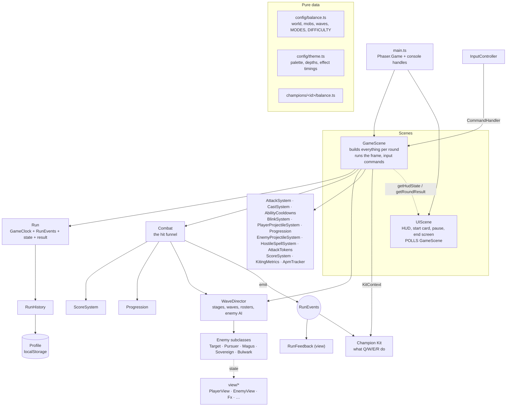

# hands diff — Technical Report

> **Current as of 2026-10-05** (`BALANCE_VERSION` 15, after commit `a4a8da9`). Rewritten
> from the source after the champion refactor, the endless run, the five mobs, difficulty
> modes, the profile store and the `Run` / `Combat` split. The previous version described a
> ten-stage run with an Ezreal-only kit and HP damage on enemies; none of that is true now.

This explains how the codebase works: the architecture, the frame, timing and state flow,
and the known weak spots. It is written to be accurate enough to learn the project from.
The [README](../README.md) is the player-facing and tuning reference (every number, every
mob's moves). This report quotes numbers only where they explain a mechanism; when the
two disagree, `src/config/balance.ts` and the champions' `balance.ts` files are the truth.

For a gentler introduction, read [STUDY_GUIDE.md](STUDY_GUIDE.md) first.

---

## 1. Overview

A browser trainer for League-style mechanics: click-to-move positioning, orbwalking
(attack, move during the recovery, attack again), dodging telegraphed spells, and aiming a
champion's ability kit. A run is an **endless** gauntlet of enemy waves that ends only when
the player dies. You pick one of three champions and one of three difficulty modes.

| Layer | Choice |
| --- | --- |
| Engine | Phaser **3.90**: game loop, two scenes, input events, sprite/text/graphics drawing, a few tweens |
| Language | TypeScript **5.9**, `strict`, `noUnusedLocals`, `noUnusedParameters`, `noImplicitOverride` |
| Bundler | Vite **7**; `npm run build` = `tsc --noEmit && vite build` into `dist/` |
| Physics | **None.** Movement, collision and range are plain arithmetic in the systems |
| Tests | Playwright, 29 suites in `tests/e2e/` driving the real game in headless Edge |
| Hosting | Static files in a Cloudflare Worker (`wrangler.jsonc`, assets only, no server code) |
| Backend | None. Everything saved lives in one `localStorage` key |

Source size: about 19,300 lines of TypeScript in 98 files under `src/`, and about 9,800
lines of tests.

**Why no physics engine.** Every rule in the game is a timing or distance rule ("the
swing lands if you are still within 56px when its 400ms windup ends"). Writing those as
explicit math in one place keeps them deterministic, tunable from the console, and easy to
test. A physics engine would add bodies, collision callbacks and solver behaviour that the
game would then have to fight.

---

## 2. Architecture at a glance



The design rests on five rules. They are listed in `CLAUDE.md` and the code keeps them:

1. **One clock.** Every gameplay deadline is a timestamp on the run's `GameClock`, which
   only advances on frames the simulation runs. Pausing is "stop advancing the clock."
2. **Gameplay decides, views read.** Entities and systems flip state first; views draw
   from that state afterwards and never write back. No animation callback is
   authoritative.
3. **Pips, not damage, on enemies.** `Enemy.takeHit()` removes exactly one pip. The only
   HP in the game is the player's.
4. **One funnel per direction.** Every pip an enemy loses goes through `Combat.hit` /
   `Combat.kill`; every HP the player loses goes through `Combat.playerHit`. Score, XP,
   the wave's bookkeeping and the run log hang off those calls.
5. **Data, not switches.** The engine never tests which champion, mob or mode it is
   running. Champions are a registry of objects implementing an interface; mobs are a
   registry plus one constructor line; modes are a bag of numbers.

---

## 3. File map

### Config (pure data, mutable on purpose)

- **`src/config/balance.ts`** (978 lines): `ARENA` (1280×720), `PLAYER`, `ATTACK`,
  `attackReach()`, `KEYBINDS`, `MOUSE`, `PREFERENCES`, `DEBUG`, `APM`, `FLASH`, each mob's
  behaviour block (`TARGETS`, `PURSUER`, `MAGUS`, `SOVEREIGN`, `BULWARK`),
  `ENEMY_PROJECTILES`, `RUN`, `DIFFICULTY`, `BALANCE_VERSION`, `LEVELS`, `CONTACT`, the
  `ENEMIES` registry, `STAGES` (Normal's intro), `ENDLESS`, `MODES`, `enemyEntry()`,
  `STAGE_RAMPS`, `SCORE`. Exposed as `__balance`; most values are read live, so a console
  edit applies on the next read.
- **`src/config/theme.ts`** (905 lines): `PALETTE` and `THEME` (art scale, depth bands,
  every colour and effect timing). Nothing in it affects gameplay.

### Champions (`src/champions/`)

- `types.ts`: the contract (`Champion`, `AbilityDef`, `Kit`, `KitContext`, `Motion`, …).
- `index.ts`: the `CHAMPIONS` registry and `activeChampion()` (reads the profile).
- One folder each for `magicboy/`, `snakelady/`, `axeman/`: `balance.ts`, `art.ts`,
  `motions.ts`, `kit.ts`, `index.ts`, a `README.md`, plus kit-private helpers
  (`PassiveSystem`, `FangBolt`, `AxeDrop`, `HeldAxes`, `WhirlingAxes`).

### Game (`src/game/`)

| Area | Files |
| --- | --- |
| Scenes | `scenes/GameScene.ts` (792 lines), `scenes/UIScene.ts` (605) |
| Round | `Run.ts` (lifecycle, clock, result), `RunEvents.ts` (typed event bus) |
| Saved data | `Keybinds.ts`, `MouseSpeed.ts`, `Settings.ts`, `RunHistory.ts`, `Mode.ts` (views over `src/profile/Profile.ts`) |
| Mouse | `CursorLock.ts` (pointer lock for Mouse Speed ≠ 1) |
| Entities | `Player`, `Enemy` (abstract), `Caster` (abstract), `Target` (basic slime), `Pursuer`, `Magus`, `Sovereign`, `Bulwark`, `Projectile`, `AutoAttackMissile` |
| Systems | `GameClock`, `InputController`, `AttackSystem`, `CastSystem`, `AbilityCooldowns`, `BlinkSystem`, `PlayerProjectileSystem`, `PlayerZoneSystem`, `Combat`, `WaveDirector`, `Difficulty`, `AttackTokens`, `EnemyProjectileSystem`, `HostileSpellSystem`, `Progression`, `ScoreSystem`, `KitingMetrics`, `ApmTracker` |
| Art | `art/sprites.ts` (text pixel maps), `art/pixel.ts` (rasteriser, seeded RNG), `art/textures.ts` (`TEX` keys, `ensureArt`), `art/font.ts` + `glyphs.ts` (5×7 bitmap font), `art/look.ts` (body + cosmetics composition) |
| Views | `PlayerView`, `EnemyView` (+ `MagusView`, `SovereignView`, `BulwarkView`), `HostileSpellView`, `PlayerZoneView`, `ProjectileView`, `CastTelegraphView`, `Fx` (pooled effects), `RunFeedback`, `Battlefield`, `PipBar`, `PixelBar`, `pixelDraw`, `motion.ts`, `statusLooks.ts` |
| UI | `AbilityBar`, `PassiveDisplay`, `PauseMenu`, `ChampionRow`, `ModeRow`, `Tooltip`, `ChatBox`, `EndScreen`, `missionMessages` |

### Other

- `src/profile/Profile.ts`: the one saved document, sanitising and migrations.
- `src/cosmetics/catalogue.ts`: hats and skins; `resolveLook(profile)`.
- `src/main.ts`: creates the `Phaser.Game` and the console handles.

---

## 4. Boot and the two scenes

`main.ts` builds one `Phaser.Game`:

```ts
new Phaser.Game({
  type: Phaser.AUTO,               // WebGL if available, else Canvas
  width: ARENA.width, height: ARENA.height,   // 1280 × 720 world = screen
  scale: { mode: Phaser.Scale.FIT, autoCenter: Phaser.Scale.CENTER_BOTH },
  render: { pixelArt: true },      // nearest-neighbour, no smoothing
  scene: [GameScene, UIScene],
  banner: false,
});
```

There is no physics config and no asset preload: every texture is generated at runtime
(§17). The world is exactly one screen, so there is no camera scrolling; the camera is
used only for its background colour and a hit shake.

It also blocks the browser context menu page-wide (right-click is the move button) and
puts the game, the balance module, the profile and the stores on `window` (`__warmup`,
`__balance`, `__profile`, `__runs`, `__keybinds`, `__mouseSpeed`, `__settings`,
`__champions`, `__magicBoy`, `__snakeLady`, `__axeMan`, `__theme`). The suites drive the
game through these same handles.

### Two scenes, two lifetimes

| | GameScene | UIScene |
| --- | --- | --- |
| Started by | first in the scene list | `active: true` in its constructor |
| Lifetime | **one round**: `scene.restart()` reruns `create()` on every restart, champion pick and mode pick | **the whole page**: `create()` runs once |
| Owns | the player, the wave, every system, the kit, the `Run` | HUD, ability bar, chat, start card, pause menu, end screen, `CursorLock` |
| Talks to the other | exposes `getHudState()`, `getRoundResult()`, `startRun()`, `setPaused()`, `restartRound()`, `returnToStart()` | **polls** `getHudState()` every frame |

UIScene polls instead of subscribing to events because GameScene's objects are all
rebuilt on restart; a HUD wired to the old objects' events kept breaking. Polling a
plain snapshot cannot go stale. `HudState.round` increments on each `create()`, which is
how UIScene notices a new round and resets its round-scoped state (`beginRound`).

The scene instance itself survives `restart()`, so a couple of fields deliberately live
outside `create()`: `roundId`, and `holdNextRound` (set by "Return to Select" so the next
round waits on the start card).

---

## 5. The round: `Run` and `GameClock`

`Run` (no Phaser in it) owns one round:

```
awaitingStart ──start()──► running ◄──setPaused──► paused
                              │
                           finish()
                              ▼
                             over
```

- `clock` is a `GameClock`: a number of milliseconds that only `advance()` changes.
- `events` is the round's `RunEvents` bus (§12).
- `isActive` = running, not paused, not awaiting start. **GameScene's `update()` returns
  immediately unless the run is active**, so nothing advances on the start card, in the
  pause menu, or after death.
- `finish(summary)` marks the run over, compares it with logged runs (same champion,
  mode, `DIFFICULTY.growth` and `BALANCE_VERSION`) to set `previousBest` / `newBest`,
  builds the immutable `RoundResult`, and records it through `RunHistory`. A restart in the
  middle of a run never calls `finish`, so only finished runs are logged.

The first round after a page load (and any round after "Return to Select") is created
with `awaitingStart = true`: the field is built and visible but frozen at time 0 under
the title card. A click or key **release** calls `startRun()`, so the press that started
it is never also a move order or a cast.

### Why the clock matters

Every deadline in the game is an absolute timestamp: `windupEndsAt`, `cycleEndsAt`,
cooldown `readyAt`, a cast's `endsAt`, an enemy's `activeAt`, a zone's `resolveAt`, the
breather's `intermissionEndsAt`. If "now" came from the wall clock, pausing for ten
seconds would make all of them fire together on resume. Because "now" is
`run.clock.now`, and the clock does not advance while paused, every deadline keeps exactly
the time it had left. Nothing is ever rescheduled.

`setPaused` also calls `tweens.pauseAll()`, because Phaser tweens run on wall time. Tweens
are only used for decoration (a level-up pop, the hit rim, the start prompt), never for
gameplay. `scene.time` is not used by gameplay at all.

---

## 6. The frame

`GameScene.update(_time, delta)`:

```
if (!run.isActive) return                      ← start card, pause, death: nothing below runs
dt = min(delta, 50) / 1000                     ← clamp: a long frame can't teleport anything
clock.advance(dt * 1000); now = clock.now

player.tickStatus(now)                         stun / slow timers
  stun just ended? replay the order held during it
kit.update(dt, now)                            the champion's own timers, bolts, zones, passive
cooldowns.update(now)
cast.update(now)                               a cast window that elapsed resolves → kit.cast()
                                               then the order buffered behind it replays

attacks.update(now, dt, enemies)        ① GAMEPLAY DECIDES
   ├─ auto missiles fly; arrivals take a pip → Combat.hit
   ├─ windup elapsed → fireAttack() (missile spawns, state → recovery)
   ├─ cycle elapsed → idle
   ├─ attack-move acquisition / chase / release
   └─ windup starts if idle and a target is in range

player.applyAttackVisual(...)           ② VISUALS READ IT
player.setRangeRingState(...)
player.setPassiveMaxed(...)
player.setCastVisual(...)               cast charge, read from cast.progress
castTelegraph.draw(...)                 a slot's ground cone, if it has one
cast resolved this frame? → playCastRelease

player.update(dt)                       ③ MOVE, THEN REDRAW
metrics.update(dt, ...)
one-shot cues (cancel tag, release burst), gated on timestamps

director.update(dt, now, ctx)           breather → next wave; arrivals; every enemy's AI; separation
projectiles.update(dt, now, enemies)    the player's linear shots
enemyProjectiles.update(dt, now)        edge fire
hostileSpells.update(dt, now)           enemy zones, orbs, globs, spheres
fx.update(dt)                           pooled particles, rings, popups

if (!player.isAlive) endRound()         the run is endless: death is the only end
```

The ①②③ order is load-bearing. When the attack visual was applied *after*
`player.update()`, the charge ring drew one frame stale and visibly hung into the
recovery.

**Time sources.** `dt` (clamped seconds) drives rates: movement, projectile flight, aim
cursors. `clock.now` (ms) drives every deadline. The 50ms clamp means a stutter can slow
the game down but never skip a deadline's effects or move anything further than 50ms
worth in one step.

**A wave clears mid-frame.** The last kill can land inside `attacks`, the kit, or the
projectile systems. `WaveDirector.onEnemyKilled` flips the phase to `intermission` on the
spot. `enemyProjectiles` and `hostileSpells` run after every damage source and check
`isWaveActive` first, so a cleared wave's shots are removed before they can hit the player
that frame.

---

## 7. Input

### `InputController`: raw input → commands

It registers two Phaser listeners (`pointerdown`, keyboard `keydown`) plus two raw DOM
listeners for the APM counter (removed on scene shutdown). It knows which physical input
means what; it calls methods on a `CommandHandler` interface that `GameScene` implements:

```
commandMove  commandAttackTarget  commandAttackMove  commandStop
castSlot(slot)  castFlash  targetAt  recordAction
isRoundRunning  acceptsGameplayInput  isPaused  togglePause  restartRound
```

Key handling, in order:

```
repeat? ignore
restart keys (R / Space) while the round is over → restartRound
round not running → ignore
Escape → armed A-targeting? cancel it : togglePause     ← above the pause gate
!acceptsGameplayInput (paused) → ignore                   ← menu clicks never reach gameplay
Keybinds.actionFor(event.code) → preventDefault, then:
  attackMove (A)       toggle targeting mode
  attackMoveClick (T)  commandAttackMove(cursor, { showRangeHint })
  stop (S)             commandStop
  flash (F)            castFlash(cursor)
  abilityQ/W/E/R       castSlot('q'|'w'|'e'|'r', cursor)
```

Pointer: right-click on an enemy is a direct attack, on ground a move (and it cancels a
pending A-mode). Left-click confirms a pending A-mode, or attacks an enemy under it.
`targetAt` is a distance test with 10px of grace beyond the enemy's radius.

A and T call the **same** `commandAttackMove`. T only adds a cosmetic range-ring hint.
Targeting, timing, cancelling and metrics are identical by construction.

### Keybinds, Mouse Speed, APM

- **`Keybinds`**: one physical key (`event.code`) per action, defaults from `KEYBINDS`,
  overrides saved in the profile. `set()` swaps with whichever action held the key, so
  nothing is ever unbound. `captureNext()` installs a capture-phase `window` listener so
  the key being bound never also fires the action. Keys are bound per **slot** (Q/W/E/R),
  shared across champions.
- **`CursorLock`**: at Mouse Speed 1.0 nothing happens. Otherwise, during play the canvas
  takes a pointer lock; the class keeps its own cursor position, adds `movementX/Y ×
  speed`, draws its own cursor, and rewrites every mouse event in the window's capture
  phase so Phaser sees the game cursor. Losing the lock unasked is treated as Escape.
- **`ApmTracker`**: every raw key press (not repeat) and mouse-button press, over a
  rolling 30s window. Informational only.

### Orders while busy: `issueOrder`

```ts
private issueOrder(run: () => void): void {
  if (this.cast.isCasting) this.cast.bufferCommand(run);   // replayed when the cast resolves
  else if (this.player.isStunned) this.stunBuffered = run;  // replayed when the stun ends
  else run();
}
```

Move, attack and attack-move orders are wrapped as closures. Mid-cast or mid-stun, only
the **latest** one is kept and replayed the instant the player is free: committed, never
unresponsive. Move/attack-move pings still draw at once so the click feels received. Stop
discards a held order but can't cancel the cast or stun.

---

## 8. Movement and the root

`Player` holds the authoritative `x`, `y`, `hp`, a move destination, a **reference-counted
root**, and stun/slow deadlines.

```
update(dt):
  if moving (has a destination, not rooted, not stunned):
    step = moveSpeed × dt
    if distance ≤ max(step, arriveEpsilon 3px): snap to the destination, clear it
    else: move step px toward it; publish vx, vy
```

`max(step, epsilon)` prevents overshoot jitter on fast frames. `moveTo` and `blinkTo` clamp
into the arena, so the player can never leave it. `blinkTo` also clears the destination,
so a blink doesn't walk you back to a stale click.

`moveSpeed = champion base × level perk × kit multiplier (Axe Man's W) × (1 − slow)`.

**Root is a counter, not a boolean.** The auto windup and a cast window can both hold it;
neither can release movement the other still needs held.

`takeDamage` returns 0 within `PLAYER.hitInvulnerabilityMs` (250ms) of the last hit:
global i-frames.

---

## 9. Auto attacks (`AttackSystem`)

```
 idle ──(target in range, not stunned)──► WINDUP ──(windupEndsAt)──► RELEASE ──► RECOVERY ──(cycleEndsAt)──► idle
                                           rooted                     missile       free to move
                                           cancellable                spawns        (the orbwalk window)
```

`AttackState = 'idle' | 'windup' | 'recovery'`. Release is an **event** (the one frame
`fireAttack()` runs), not a state. Both deadlines are set when the windup **starts**:

```ts
this.windupEndsAt = nowMs + this.windupMs;
this.cycleEndsAt  = nowMs + this.cooldownMs;   // the cooldown runs from windup START
```

So firing never lengthens the cycle, and the recovery is free time to move. That single
line is what makes orbwalking possible.

### Attack speed

```
baseCooldownMs = champion.attack.baseCooldownMs / (1 + attackSpeedPerLevel × (level − 1))   ← Progression
cooldownMs     = baseCooldownMs / kit.attackSpeedMultiplier                                 ← passive, W buff
windupMs       = ATTACK.windupMsOverride ?? max(ATTACK.minWindupMs 90, cooldownMs × 0.25)
```

Magic Boy, as an example (700ms at level 1, +6% per level, +10% per passive stack):

| Level | Stacks | cycle | windup | recovery |
| --- | --- | --- | --- | --- |
| 1 | 0 | 700ms | 175ms | 525ms |
| 1 | 5 | 467ms | 117ms | 350ms |
| 18 | 0 | 347ms | 90ms (floor) | 257ms |
| 18 | 5 | 231ms | 90ms (floor) | 141ms |

Elapsed time plays no part: attack speed comes from level (kills) and the kit.

### Cancelling: the one condition

```ts
onMoveOrder() { if (this.state === 'windup' && ATTACK.allowMoveCancel) this.cancelWindup(); this.clearOrders(); }
```

`cancelWindup()` sets the state back to idle, releases the root, nulls `windupTarget`
(the only path to a missile), and sets `cycleEndsAt = 0`: the attack is available again at
once. A cancel deals nothing, so cancel-spamming is harmless.

| Order | Cancels a windup? |
| --- | --- |
| Move, Stop | **yes** |
| A cast (unless the slot is `quick`), any blink, Flash | **yes** (they call `onMoveOrder`) |
| Right-click enemy, A-click, T | no: an attack order lets the committed swing resolve |
| A stun | yes, via `interrupt()`, but the orders survive |

After release nothing can undo the hit.

### Targets, chasing and attack-move

- A **direct** order (right-click) commits to one enemy and chases it: each frame the
  player walks to `reach − chaseBufferPx` from it, and stops the moment it is in range.
- An **attack-move** order is a location. Each frame without a target it looks for the
  enemy **already in range** that is nearest the click point (`attackMoveTargeting:
  'cursor'`), so an A-click never becomes a cross-arena sprint. If its acquired target
  walks out of range it is dropped and the walk resumes. The order persists after
  arriving, so anything entering range is still attacked until the next command.
- **Range** is League's model: player centre to the target's edge,
  `attackReach(range, targetRadius, playerRadius)` in `balance.ts`. The drawn ring uses the
  same function with the basic slime's radius.

### The missile and the kit's hook

`fireAttack()` asks the kit `autoShot?(target)`: a kit can change this one auto's look and
add an `onImpact` / `onFizzle` (Axe Man's spinning axe). Then it spawns an
`AutoAttackMissile` that homes on the target (autos don't miss). On arrival:

```ts
const killed = target.takeHit();          // one pip, always the engine's
this.callbacks.onHit(target, killed);     // → Combat.hit
shot?.onImpact?.(target, killed);         // the kit's extra
```

If the target dies first, the missile fizzles. Missile travel gates nothing; the next
windup can start while it is still flying.

---

## 10. Abilities: the champion contract

The engine owns *when*: keys, aim resolution, cooldowns, cast windows, interruption,
Flash. The champion owns *what*: a `Kit` object that decides what each slot does when it
resolves. The engine never switches on a champion id.

### The types (`champions/types.ts`)

```ts
interface Champion {
  id, name, stats, attack: AttackProfile, levels: LevelPerks, art, autoMotion?, autoLook?,
  slots: { q: AbilityDef; w: AbilityDef; e: AbilityDef; r?: AbilityDef };
  notes(): string[];                      // start-screen tooltip
  createKit(ctx: KitContext): Kit;        // a fresh kit per round
}

interface AbilityDef {
  targeting: 'direction' | 'point' | 'unit' | 'self';
  range?; castTimeMs(pace): number; cooldownMs(): number;   // read live: console edits apply
  icon, accent, castStyle, fx, telegraph?, motion?;
  quick?: boolean;      // doesn't cancel an auto in progress (a buff)
  anchored?: boolean;   // a mid-cast Flash leaves it where it began
}

interface Kit {
  canCast(slot, aim): boolean;   commit(slot, aim): Aim;   cast(slot, aim): void;
  recast?(slot): boolean;        update(dt, now): void;
  attackSpeedMultiplier;  moveSpeedMultiplier?;  autoShot?(target);
  passiveHud();  stats();  statRows();  clear();
}
```

`KitContext` is the narrow surface a kit may touch: the scene (for drawing), clock,
events, player, a live enemy list, cooldowns, progression, `BlinkSystem`,
`PlayerProjectileSystem`, and `combat: { hit, kill, bonus }`.

### A key press, end to end (`GameScene.castSlot`)

```
castSlot(slot, cursorX, cursorY):
  def = champion.slots[slot]; no def, mid-cast or stunned → return
  kit.recast?(slot) used the press? → return        (Axe Man's R recall)
  cooldown not ready → return
  aim = resolveAim(def, cursor)                     direction / point (clamped to range) /
                                                    unit (enemy under cursor, within range) / self
  !aim or !kit.canCast(slot, aim) → return          (unit out of range flashes the range ring)
  if !def.quick: attacks.onMoveOrder()              (cancels an uncommitted auto)
  payload = kit.commit(slot, aim)                   frozen now: a blink's destination, a target
  cooldowns.start(slot)                             cooldowns run from cast START
  castTimeMs = def.castTimeMs(pace)
  castTimeMs ≤ 0 ? kit.cast(slot, payload) now : cast.begin(slot, payload, castTimeMs)
```

### `CastSystem`: the commitment window

One `PendingCast` at a time. `begin()` stops and roots the player. `update()` resolves
when `now ≥ endsAt`: release the root, call `kit.cast(slot, payload)`, **then** replay the
buffered order (so a blink lands before the queued move starts from the new spot).
`progress = 1 − (endsAt − now) / durationMs` is derived from the deadline, so the
animation can never disagree with the mechanic.

- **The aim is committed at keypress.** Moving the mouse during the window does nothing.
- **Other abilities are ignored mid-cast** (`canAct`), but Flash works. A cast then
  resolves from where Flash put you, shifted by the same offset (`carried()`): Q-Flash,
  W-Flash and R-Flash carry the spell. An `anchored` slot (Magic Boy's R) stays put and
  fires from `from`, the spot the key went down.
- **A stun interrupts** the window: `interrupt()` returns the ability and its buffered
  order, the scene refunds the cooldown and moves the order to the stun buffer.

### Cooldowns, haste and levels

`AbilityCooldowns` is one `readyAt` table for `q w e r flash`. `start(id)` sets
`readyAt = now + duration × haste`; `reduce(ms, ids)` only pulls `readyAt` toward now
(clamped, never extends); `refund(id)` makes it ready. One table means one call for a
cross-ability effect (a landed Magic Boy Q takes 750ms off Q/W/E/R) and one source for the
HUD.

`Progression` turns kills into XP (`ENEMIES[id].xp`) and levels (1–18, first level 10 XP,
+20% each). Each level gives the champion's `LevelPerks`:

```
cooldown multiplier = 100 / (100 + abilityHaste)              abilityHaste = perHaste × (level − 1)
cast speed          = 1 + LEVELS.castHasteShare (0.5) × haste / 100
attack speed        = 1 + attackSpeedPerLevel × (level − 1)
move speed          = 1 + moveSpeedPerLevel × (level − 1)
```

Flash ignores haste (it is a summoner spell). `Progression` is also the `AttackPacing`
source `AttackSystem` reads.

### Shared tools a kit builds with

| Tool | What it does |
| --- | --- |
| `PlayerProjectileSystem.fire(spec, x, y, from?)` | A straight shot: speed, radius, max range, art, `onHit`, optional `pierce` (each enemy once) |
| `AutoAttackMissile` | A homing bolt (autos, Magic Boy's E bolt) |
| `BlinkSystem.destinationFor / blinkTo` | Blink geometry (clamp to range, clamp to arena) and the relocation; Flash lives here too |
| `PlayerZoneSystem` | Player ground spells: circles/cones that resolve at a deadline, and clouds that tick while enemies stand in them. The mirror of `HostileSpellSystem`. Built by a kit that needs it (Snake Lady) |
| `enemy.applyStatus(id, now, ms)` + `registerStatusLook(id, look)` | A namespaced timed status on the enemy (`'magicboy.mark'`, `'snakelady.poison'`) and how its view draws it |
| `enemy.applySlow(id, fraction, now, ms)`, `enemy.stun(now, ms)` | Crowd control (an `unstoppable` enemy ignores both) |
| `ctx.combat.hit / kill / bonus` | Report pips the kit removed itself, and score awards |

---

## 11. The three champions

Each shows a different use of the contract. Their READMEs describe the kits as a player
reads them.

**Magic Boy** (default; League's Ezreal shape). Q, W, R are `PlayerProjectileSystem`
shots; R pierces and is `anchored`. E commits its destination in `commit()`, blinks in
`cast()`, then picks a bolt target **from the new position**, preferring a W-marked enemy.
The passive (`PassiveSystem`, kit-private) is one shared 6s buff of up to 5 stacks at +10%
attack speed each, exposed as `attackSpeedMultiplier`. The W **mark** is the interesting
part: the kit subscribes to the run's `'hit'` event and, when a counted hit lands on a
marked enemy that survived it, detonates the mark for one extra pip. The detonation is
deliberately *not* a counted hit, so it can't trigger itself or grant a second stack.

**Snake Lady**. Uses `PlayerZoneSystem` for a delayed circle (Q), a thrown wall of
lingering clouds (W) and a cone that strikes as the cast ends (R, which also draws a
`telegraph` cone during the window). E is `unit`-targeted (point-and-click) and fires a
`FangBolt`. Poison is a status plus a tick schedule in the kit; on a `spellcaster` mob a
poison tick can't take the last pip. R stuns enemies whose `heading` faces her and slows
the rest.

**Axe Man**. Changes autos rather than adding spells: Q and W are `self`-targeted and
`quick` (they don't cancel a swing). Q readies an axe; `autoShot()` makes the next auto a spinning axe whose `onImpact`
schedules where it falls; walking into the landing circle catches it. W raises
`moveSpeedMultiplier` (decaying) and `attackSpeedMultiplier`. R uses `recast()`: pressing R
again while the axes are out recalls them instead of casting.

---

## 12. Combat: pips, the hit funnel and events

### Enemy health is pips

`Enemy.hp` counts **pips**. `takeHit()` removes exactly one, tells the view, and on the last
pip flips the lifecycle to `dead`, clears statuses and calls `onDeath()`, all immediately.
It returns whether that hit killed. There are no damage numbers anywhere on the enemy side;
a "two-pip" ability calls `takeHit()` twice.

This makes difficulty readable (a Pursuer is "two hits") and keeps scaling honest: later
stages get more and faster enemies, not damage sponges. The Bulwark (14–18 pips) is the
deliberate exception.

### `Combat`: every outcome passes through once

```ts
hit(target, killed)      // after the kit/engine already called takeHit()
  scoring.addHit(); events.emit('hit', …); if (killed) kill(target)

kill(target)             // every kill, whatever caused it
  points = scoring.addKill(archetype, scoreMultiplier, stage)
  director.onEnemyKilled(target, now)                 ← may clear the wave
  events.emit('kill', …)
  progression.addXp(xp) → maybe events.emit('levelUp', …)

enemyHit(damage, source, kind)                        ← every enemy attack and body contact
  mult = kind === 'contact' ? difficulty.contactDamage : difficulty.damage
  amount = lethal mob ? Infinity : round(damage × mult)
  playerHit(amount, kind === 'contact' ? source + 'Contact' : source)

playerHit(damage, source)                             ← everything that hurts the player
  taken = player.takeDamage(damage × mode.damageMultiplier, now)   (0 inside i-frames)
  log HP actually lost per source; emit 'playerHit'

waveCleared(wave) / stageCleared()                    ← WaveDirector callbacks
  speed bonus / HP bonus + mode clear bonus, then heal to full
```

A kit that removes a pip itself calls `target.takeHit()` then `combat.hit(target,
killed)`; for extra pips that aren't "counted hits" it calls `combat.kill` only if one of
them kills. Either way every pip scores once and every kill reaches the director exactly
once.

### `RunEvents`: a typed bus

```ts
interface RunEventMap {
  hit, kill, markDetonated, levelUp, waveCleared, stageCleared, kitBonus, playerHit
}
on<K>(name: K, fn: (e: RunEventMap[K]) => void): () => void   // returns unsubscribe
emit<K>(name: K, e: RunEventMap[K]): void
```

Gameplay emits from the one place each thing is decided. `RunFeedback` (kill gold coins,
the level-up ring, stage-clear popups, the hit shake and red rim) only listens. A fresh
`Run` (and so a fresh bus) is created per round, so old listeners die with the old round.

> **One exception to "one-way".** The bus's doc comment says nothing that listens reaches
> back into gameplay. Magic Boy's kit does: its `'hit'` listener detonates the W mark,
> which calls `takeHit()` and possibly `combat.kill()`. It is safe today because it is the
> only gameplay listener and it runs only when the triggering hit did not kill, but a
> second gameplay listener on `'hit'` would make listener order matter.

---

## 13. Enemies

### The base class (`Enemy`)

```
spawning ──(clock reaches activeAt)──► active ──(last pip)──► dead
```

Only an **active** enemy exists for gameplay: targetable, hittable, moving, attacking,
counted as a threat. A **spawning** enemy sits on its spot for `RUN.spawn.manifestMs`
(300ms) as a closing ring. A **dead** one stays in the roster so its death animation plays.

`Enemy.update()` does the shared work before and after the subclass AI:

1. Activate at `activeAt` (a clock deadline, never an animation).
2. Run `updateAi()` and `checkContact()` unless `held` (being thrown by a Sovereign) or
   dazed/stunned (`dazedUntil`).
3. Update `heading` from the frame's movement, or toward the player while winding up
   (Snake Lady's R reads it).
4. Move the **aim cursor** toward the player unless a cast is tracking somewhere else.
5. `view.sync()`.

**Enemies aim with a cursor that has to travel.** `Enemy.aim` moves toward its goal at
`DIFFICULTY.aimSpeed` px/s (900 at Stage 1, up to 1800, × the mode's multiplier). Walking is
always tracked, but a blink leaves the cursor behind for a moment. Every enemy attack reads
`aim` (or `trackAim()` for a cast that sweeps), never the player's position directly. This
is the rule that makes Flash a real dodge. Movement still reads the player.

Shared state on the base class: namespaced **statuses** (`statusUntil` map), **slows** by
id (the strongest live one counts), **stun** (`dazedUntil`, never shortened), `held`,
`unstoppable` (ignores stuns and slows), and **body contact**: an active enemy overlapping
the player deals `ENEMIES[id].contactDamage` through `Combat.enemyHit(…, 'contact')`, at most
once per 800ms per enemy.

`Caster` (abstract, for Magus and Sovereign) adds a spacing band, a lead aim
(`aimPoint`: where you'll be when the spell lands, at `aimLead` of the way, using a
"seen velocity" that turns toward your real one at a capped rate so clicking back and forth
doesn't instantly re-aim) and a per-cast random offset.

### The five mobs

Each is a small state machine whose timings are `GameClock` deadlines. Cooldowns are
timestamps checked from the walking state, so a mob keeps moving between attacks.

| Mob | Class | States | Role |
| --- | --- | --- | --- |
| Slime (`basic`) | `Target` | approach / retreat / strafe; spit windup | Hovers 150–230px away inside your range; from Stage 2 spits a glob (needs an attack token) |
| Pursuer | `Pursuer` | chase, windup, dashWindup, dash | Melee brute at 55% of your speed; the swing lands only if you're still in reach when it resolves; from Stage 4 dashes along a locked path |
| Magus | `Magus extends Caster` | reposition, lance, lock, eye, orb, rite | Artillery (Xerath-like): a sweeping line, a delayed circle with a sweet spot, a stunning orb, and a last-enemy Rite |
| Sovereign | `Sovereign extends Caster` | reposition, sphere, grab, throw, scatter | Sphere mage (Syndra-like): places Dark Spheres, throws a sphere **or another mob** (Force of Will), flings spheres in a cone (Scatter) |
| Bulwark | `Bulwark` | chase, strike, recover, brace, ram, winded, flare | The capstone tank (K'Sante-like): 14 pips at its Stage 8 debut, up to 18; lethal hits, unstoppable ram, All Out at ⅔ pips |

No mob starts an attack while the player is stunned.

### `AttackTokens`

A shared pool sized by `DIFFICULTY.attackTokens` (2 at Stage 1, up to 10). A basic must
hold a token to start a spit windup and returns it when the glob leaves; tokens of
inactive enemies are reclaimed. A crowd takes turns instead of firing in unison.

### `HostileSpellSystem`

Owns everything an enemy places: **line**, **circle** and **cone** zones that resolve at a
deadline (with optional sweet spot, slow, stun), straight **shots** (Magus orb, basic glob,
flung spheres), and the Sovereign's persistent **Dark Spheres** (owner, lifetime, cap;
removed when their owner dies). Because the system owns them, a zone already placed lands
even if its caster dies; a spell still being *charged* lives on the caster and dies with
it. When `isWaveActive` goes false, everything is cleared.

### `EnemyProjectileSystem`: edge fire

Shots that belong to the **wave**, not to any enemy: spawned on a random arena edge, aimed
at the player's position at spawn (±3°), never re-aimed. Interval, speed, size and damage
are `lerp(start, end, STAGE_RAMPS.enemyFire[stage])`. Nothing fires during a breather.

---

## 14. The wave director

`WaveDirector` owns stage/wave progression and the current wave's enemies:

```
spawnWave() ─► pending queue ─► arrivals (spawning) ─► active ─► killed ─► wave cleared
     ▲                                                                       │
     └──── next wave, or Wave 1 of the next stage ◄── breather (clock) ◄─────┘
```

**Rosters (`rosterFor`).**
- *Hand-written stages* (the mode's `stages` table: Normal 5, Easy 6, Hard 4): the authored
  **mix** is grown to the stage's wave size by largest remainder (ties go to the first mob,
  the basic), then each mob is held to its `maxPerWave` with the excess given to basics.
- *Generated stages* (every stage after, `ENDLESS.wavesPerStage` = 3 waves): a **budget**
  of `waveSize` points buys mobs. A mob's debut (Wave 1 of its `unlockStage`) fields exactly
  one of it first; the last wave of a stage fields every unlocked **capstone** first; then
  mobs are drawn by `weight` among those unlocked whose `cost` fits, each capped by
  `maxShare` and `maxPerWave`, skipping any mob a fielded one `crowdsOut`. The RNG is
  `mulberry32(runSeed ^ f(stage, wave))` and results are cached, so a wave is fixed once
  rolled.

**Arrivals.** `spawnWave()` destroys the previous (all-dead) roster, shuffles the new list
and groups it into packs of `DIFFICULTY.packSize`. Pack starts are `arrivalGapMs ×
packSize` apart (±⅓ jitter); members 90ms apart. `beginDueArrivals()` moves due entries
onto the field while fewer than `DIFFICULTY.maxAlive` are on it; the rest wait for a slot.
The first member of a pack picks a spot by rejection sampling (away from the player by the
mob's `minSpawnDistance`, away from other bodies); the rest land 40–110px from it.

**Clearing.** `onEnemyKilled` (from `Combat.kill`) checks whether nothing is pending,
spawning or alive. If so it reports the wave (and the stage, on its last wave) through
callbacks, sets `phase = 'intermission'`, and sets `intermissionEndsAt` to now + 400ms (or
700ms after a stage). `update()` advances when the clock passes it. Time alone never
advances a wave.

**Separation.** Overlapping active enemies are pushed apart, the push split by radius so
big bodies shove small ones. Held enemies are skipped.

**Adding a mob** = its config block + an `ENEMIES` entry (its key becomes a valid
`EnemyArchetype` type everywhere) + an `Enemy` subclass and view + one line in `ARCHETYPES`.
`validateConfig()` throws at startup, in every mode, on an empty stage, a malformed
registry entry or a mob with no class.

Par time for the speed bonus is set at spawn: last scheduled arrival + 300ms + 600ms per
health pip in the wave.

---

## 15. Difficulty and modes

### One curve

```
T(stage) = DIFFICULTY.growth ^ (stage − 1)        growth 1.15: +15% per stage, compounding
value    = clamp(base × T ^ k, min, max)          k says how strongly a number follows T
```

`Difficulty.ts` is pure functions over the live config: `threat`, `scaled(curve, stage)`,
`stageDifficulty(stage)` (wave size, max alive, arrival gap, move speed, projectile speed,
damage, contact damage, attack tokens, pack size). A negative `k` shrinks a value (gaps,
cooldowns). Each enemy resolves its scaled stats **once, at spawn**, from its own stage.
Telegraph durations are never scaled, so every attack stays reactable.

### Modes are only numbers

`MODES.easy | normal | hard` each carry: `damageMultiplier` (Hard 2), `waveSizeMultiplier`
(Easy 0.75), `aimSpeedMultiplier`, `stageClearBonus`, their own intro `stages`, and
per-mob **overrides** of `ENEMIES` fields (`unlockStage`, `weight`, `maxShare`,
`maxPerWave`). Every mode-dependent registry read goes through
`enemyEntry(id, mode) = { ...ENEMIES[id], ...mode.enemies[id] }`. Normal has no overrides,
so Normal is exactly the un-overridden game. The engine never tests a mode's id.

---

## 16. Score, the run log and the profile

**Score** (`ScoreSystem`) never pays for time alive. Every award is × `1 + 0.25 × (stage −
1)` and tallied by source in `scoreFrom { kills, speed, hp, clear, kit }`:

- **kills**: 100 × the mob's `scoreMultiplier`;
- **speed**: on a wave clear, 50 per enemy × a factor that is 1 up to par and falls to 0
  at 2× par;
- **hp**: on a stage clear, 10 per HP left before the heal, +50% if the stage cost no
  damage;
- **clear**: the mode's flat stage-clear bonus;
- **kit**: a champion's own small awards (Magic Boy's E bolt, Axe Man's catches).

`ScoreSystem` also keeps damage taken per source over the run and per stage, and the
source of the killing blow, which the end screen shows ("What killed me").

**Run log** (`RunHistory`): every finished run is appended to the profile (capped at 500),
tagged with champion, mode, `DIFFICULTY.growth` and `BALANCE_VERSION`. "Best" only
compares runs with the same four tags, so retuning the game bumps the version instead of
leaving old runs unbeatable.

**Profile** (`src/profile/Profile.ts`): one JSON document under `warmup.profile.v1`
holding champion, mode, keybinds, mouse speed, settings, currency, cosmetics and runs.
`Keybinds`, `MouseSpeed`, `Settings` and `RunHistory` are views over it with their old
APIs. Loading is defensive: every field is validated and falls back to its default;
`localStorage` access is wrapped in try/catch (private windows); old champion ids
(`ezreal`, `cassiopeia`) and keybind action names are renamed on load; a missing profile is
built by migrating the four keys used before the profile existed, which are then removed.
`update(fn)` mutates and saves in one write.

---

## 17. Rendering: how Phaser is used

### What Phaser does here, and what it doesn't

| Phaser feature | Used for |
| --- | --- |
| `Game`, `Scene`, `update()` | The loop and the two scenes |
| `Scale.FIT` | Letterboxing the 1280×720 world to any window |
| Input plugin | `pointerdown` / `keydown` events, `activePointer.worldX/Y` |
| `GameObjects.Image` | Every sprite (bodies, shadows, projectiles, props, icons, particles) |
| `GameObjects.Graphics` | Rings, telegraphs, zones, bars, panels: anything drawn from shapes each frame |
| `GameObjects.BitmapText` | All HUD text, in the generated 5×7 pixel font |
| `Rectangle`, `Container`, `Zone` | Scrims, the start card, menu hit areas |
| Texture manager | `textures.addCanvas(key, canvas)` for generated art |
| Tweens | Decoration only: the start prompt pulse, the level pop, the hit rim fade |
| Camera | Background colour and `shake()` |
| `Phaser.Math` | `Clamp`, `Linear`, `Distance`, `Angle.Wrap`, random helpers |

Not used: Arcade/Matter physics, the loader (no asset files), Phaser animations, the
scene's timer events, cameras that move. Animation frames are chosen from gameplay
progress and a view-local clock advanced by the frame's `dt`, so they freeze with the
pause.

### Art is code

`art/sprites.ts` holds every sprite as rows of characters with a palette:

```ts
{ rows: ['..mm..', '.mLLm.', ...], pal: { m: 0x2b4a8c, L: [0xffffff, 0.6] } }
```

`spriteToCanvas` writes those into `ImageData` (1 art pixel = 1 canvas pixel) and
`addPixelTexture` registers the canvas as a Phaser texture. `ensureArt()` does this once per
game (textures outlive scene restarts). Sprites are drawn at `THEME.art.scale` (3×) with
`pixelArt: true`, so they stay crisp. Ragged rows or unmapped characters throw at load.
`TEX` holds every texture key, so swapping in real PNGs later is key-for-key.

The 5×7 font is built the same way: a glyph sheet on a canvas plus generated BitmapText
font data. The battlefield ground is painted once into a canvas with a fixed seed and a
4×4 Bayer dither; props are decoration with no collision.

### The player's look

A champion authors only its body frames (`idle`, `squash`, `stretch`, `charge`, `cast`, plus
extras its motions use). `art/look.ts` composes the body with cosmetics (`resolveLook`
from the profile: a hat layer, a skin palette override) into new textures keyed by
champion and look, and builds glow masks for pixels a motion can light. It throws at load
if a motion names a frame the art doesn't have.

### Motions

A `Motion` is keyframes over a windup (0→1 through the real window) and a follow-through
(ms after release): frame, squash/stretch, lean along the aim, hop, tremble, glow, with
easing. `sampleMotion()` is pure. Because the windup is keyed to the real window's
progress, the body can't run ahead of or lag the mechanic, and it speeds up with attack
speed and haste. Keys with `minWindowMs` drop out of short windows instead of flickering.

### Views

Each entity has a view (`player.view`, `enemy.view`) that owns its Phaser objects and only
reads state: `Enemy.pose` (moving, facing, windup progress, reach), `hp`, statuses, the
lifecycle. Entities tell their view about events (`onHit`, `onDeath`) and the view plays
them; a kill has already registered by the time the death pop plays. Sprite size never
feeds collision.

`Fx` pools particles, rings, shapes, damage numbers and popups (reused objects, advanced in
`fx.update(dt)`). Projectile sprites are created and destroyed per shot.

**Depth bands** (`THEME.depth`): ground 0 → pings → shadows → props → ground overlays (range
ring, telegraphs) 8 → actors 10 (y-sorted by gameplay `y`) → projectiles 20 → effects →
marks → bars → reticle → text → screen 60; the HUD sits at 100+, the start card at 300.

**One-shot cues** (release burst, cancel tag, cast release) are not callbacks. Each frame
the scene compares the owning system's timestamp (`lastReleaseAt`, `lastCancelAt`,
`lastResolveAt`) with the last one it showed. If an effect failed to play, nothing about
the mechanic would change.

### UIScene

Builds the HUD plates once, a per-champion ability bar and passive display (rebuilt when a
round starts as someone else), the chat feed (mission briefings and "New threat" lines,
derived from the polled stage), the pause menu with settings and rebinding, the start card
(`ChampionRow`, `ModeRow`, tooltips) and the `EndScreen`. Banners and chat lines are
derived by comparing the polled snapshot with what it last saw, timed on the run's clock
(`hud.runTime`), so they freeze with the pause. `EndScreen` draws from the `RoundResult`
and exposes its lines as plain text for the suites.

---

## 18. Collision and range

No physics bodies, no spatial partitioning: explicit circle math, O(n·m) over small n and m.

| Interaction | Test |
| --- | --- |
| Auto / homing bolt → its target | arrival: `step ≥ distance − target.radius` |
| Player straight shot → enemy | circle vs circle, first touched (or each once if piercing) |
| Player zone / cloud → enemy | enemy body overlaps the circle; cone adds the enemy's angular half-width |
| Enemy zone / shot → player | player centre or body vs the shape at the deadline |
| Attack range | `dx² + dy² ≤ (range + target.radius)²` |
| Pursuer swing, Bulwark strike | distance / line test at the moment it resolves |
| Body contact | circles overlap, once per 800ms per enemy |
| Click hit test | `distance ≤ radius + 10` |

All tests are **discrete**: positions are checked at frame boundaries only. With `dt`
clamped at 50ms, a fast shot can move ~60px per frame, so a badly stuttering frame could
tunnel past a small target.

---

## 19. Tests

29 Playwright suites in `tests/e2e/` (`npm test`, ~5 minutes, one worker, no retries).
Each is a **characterization script**: one long sequential scenario per area that records
`pass` / `fail` / `warn` lines. `fail` is a soft assertion, so one failure doesn't hide the
rest, but the test still fails at the end.

The suites reach straight into the live game through the console handles, e.g.
`window.__warmup.scene.getScene('GameScene').director`, `.attacks`, `.kit`, and through
debug hooks such as `WaveDirector.arriveAllNow()`. `startSuite(page, testInfo, settleMs,
{ champion, mode })` boots past the start card; `waitForGame` waits on **game time**
(`clock.now ≥ settle`), not wall time. Headless Edge can tick at 300+ fps, so thresholds
are in px/s or ms, never "per frame".

`mouse-speed.spec.ts` takes a real pointer lock (it grabs the OS cursor on Windows even
headless) and is skipped unless `PW_POINTER_LOCK=1`.

`npm run typecheck` checks `src` and `tests` (`tests/tsconfig.json`) and should run before
the suites.

---

## 20. Build and deploy

`npm run build` type-checks and has Vite bundle to `dist/` (target ES2022). `wrangler.jsonc`
deploys `dist/` as a Cloudflare Worker with **assets only**: no server code, and
`not_found_handling: single-page-application` so unknown paths serve the game.
`npx wrangler deploy` uploads it. The site is live at handsdiff.com.

---

## 21. Known simplifications vs League

| Mechanic | League | Here |
| --- | --- | --- |
| Enemy health | HP and damage numbers | Pips: every hit removes one |
| Cancel refund | Rules per case | Total refund; cancel-spam is free and deals nothing |
| Attack speed | A stat with a cap | Level perk × kit multiplier; windup floored at 90ms |
| Autos | Can be blocked or dodged by some abilities | Perfect homing; only the target dying stops one |
| Target acquisition | Acquisition range > attack range | Only enemies already in range; nearest the click |
| Attack-move | Ends on arrival | Persists as a stance until the next command |
| Movement | Pathfinding, unit collision, turn rate | Straight lines, instant turns; enemies push each other, not you |
| Hitboxes | Per unit | Circles |
| Casting | Spell queueing | Other abilities ignored mid-cast; move/attack orders buffered; Flash allowed |
| Flash | 300s cooldown | 20s, so it comes up repeatedly |
| i-frames | Not a League concept | 250ms after any hit |
| Enemy aim | Players aim | A cursor that travels at a capped speed; casters lead your movement |

Where it does match: cooldown from windup start, centre-to-edge range, contextual
right-click, attack orders not cancelling a committed swing, move orders cancelling an
uncommitted one, cast aim committed at keypress, Flash carrying a cast (and R staying
anchored).

---

## 22. Technical debt (verified 2026-10-05)

### Worth fixing

1. **`Enemy.spawnId` is always 0.** It is declared as a "generational guard" and
   captured by every homing missile, but nothing ever assigns it (only `FangBolt` copies
   it). It is harmless today because missiles hold the enemy *object* and every wave
   creates new objects, so `target.active` does the real guarding. Either assign it in
   `WaveDirector.spawnEnemy` or delete it.
2. **`RunEvents` is not strictly one-way** (§12): Magic Boy's mark detonates from a
   `'hit'` listener. Fine with one gameplay listener; fragile with two.
3. **`stopsOnFirstHit` is dead config** in `champions/magicboy/balance.ts` (Q and W). The
   real switch is `ShotSpec.pierce`; setting the old flag does nothing.
4. **In-flight projectiles freeze on death.** `update()` stops when the run ends, and
   `endRound` cancels attacks and casts but doesn't clear missiles, so shots hang under the
   end screen.
5. **Discrete collision** (§18): no swept test for fast shots on a stuttering frame.
6. **i-frames are global.** A swing and a glob landing within 250ms of each other: the
   second is silently eaten.

### Minor

7. `AttackSystem.hasFired` is unused anywhere.
8. `Projectile.isOutOfBounds()` uses `ENEMY_PROJECTILES.cullMargin` for player shots too:
   correct behaviour, misleading name.
9. The drawn range ring uses the basic slime's radius; it is exact for slimes and
   conservative for bigger mobs. The target reticle is the per-target truth.
10. `GameScene.update()` calls `attacks.hasTargetInRange()` for the metrics, repeating the
    range scan `attacks.update()` already did.
11. `AttackMoveOrder.destX/Y` and `cursorX/Y` are always set to the same point.
12. `KitingMetrics.attacksFired` counts a release whose target died mid-windup (no
    missile), so `fired − landed` overstates misses.

### Resolved since the last report

The browser suites now live in the repo (29 of them) and run with `npm test`;
`SkillshotSystem` and the global `PassiveSystem` were replaced by
`PlayerProjectileSystem` and kit-owned passives; enemy HP became pips; `GameScene` lost
the round lifecycle (`Run`), the hit funnel (`Combat`) and presentation reactions
(`RunFeedback`); keybinds and settings moved into the one profile document.

---

## 23. Extending it

- **A champion**: a folder under `src/champions/<id>/` (balance, art, motions, kit, index,
  README) and one line in `CHAMPIONS`. Statuses via `applyStatus` + `registerStatusLook`.
  Add a suite. See the README's "Adding a champion".
- **A mob**: config block, `ENEMIES` entry, entity + view, one `ARCHETYPES` line, and its
  end-screen colour and portrait. Generated stages pick it up from its `unlockStage`. See
  the README's "Adding a mob".
- **A mode**: an entry in `MODES` (numbers, an intro table, registry overrides).
- **Stages**: edit a mode's intro table; everything past it is generated.
- **Something that reacts to the run** (sound cues, currency): a `RunEvents` listener,
  like `RunFeedback`.
- **A tuning change that changes difficulty**: bump `BALANCE_VERSION` so "best" comparisons
  stay fair.

---

## 24. How this was checked

Written from the source at `a4a8da9`: the frame order is transcribed from
`GameScene.update()`; the champion contract from `champions/types.ts`; formulas from
`AttackSystem`, `Progression`, `Difficulty`, `ScoreSystem` and `Combat`; config values
from `balance.ts` and `champions/magicboy/balance.ts`. Debt items were confirmed by
searching each symbol across `src/` and `tests/` (e.g. `spawnId` has no writer;
`hasFired` has no reader; `cooldownRemaining` and `Projectile.team` are read by the suites
and so are not dead). Phaser usage was counted by searching every `add.*` call and
`Phaser.*` reference.
